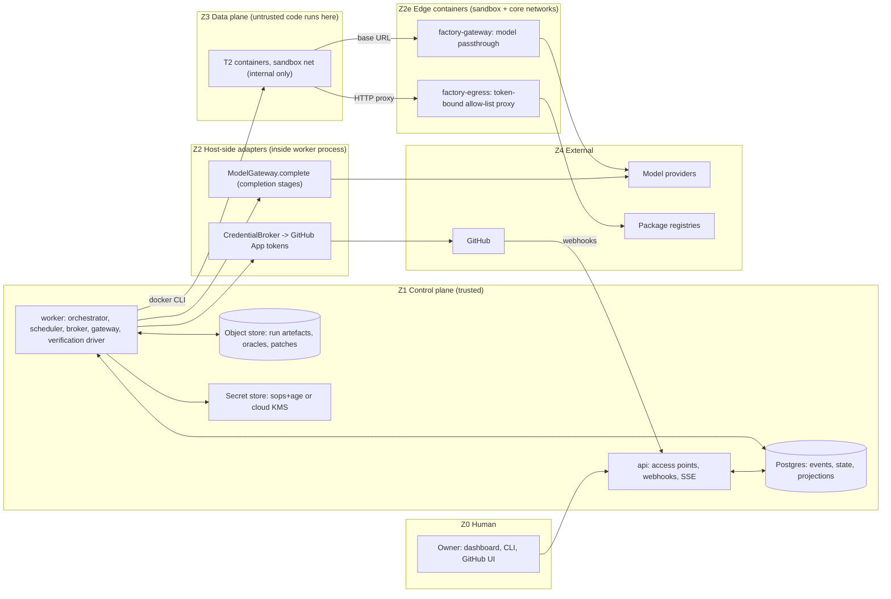
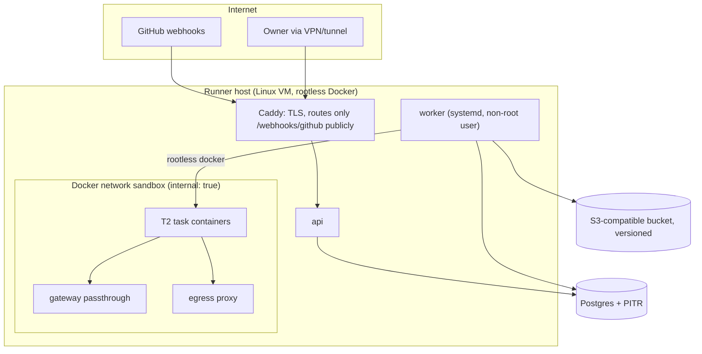

# 02 — Architecture Specification (buildable)

> **Audience:** implementing agents and the owner. **Read third.** Companion files: data/interfaces → `03_…`, integrations/APIs → `04_…`, work items → `05_…`, gates → `06_…`.
> **Authority order when sources disagree:** blueprint ADRs > blueprint requirements (06) > this file > ticket text. If you find a conflict, stop and raise it (`07_…` §9). Markers: `[BP: …]` blueprint-mandated · `[PACK]` pack decision · `[VERIFY]` re-check externally.

---

## 1. The system in one page

A **modular monolith** (one TypeScript codebase, two long-running processes: `api` and `worker`) on Postgres + an S3-compatible object store, which drives **rootless-Docker sandboxes** to run a coding harness and the verification gates, and talks to **GitHub** (App) and **model providers** (through its own gateway). Humans act only through **six typed access points**. [BP: ADR-0002, ADR-0012]



**Process model.** `apps/api` (Fastify: access points, GitHub webhooks, SSE, static dashboard) and `apps/worker` (orchestrator loop, scheduler, projector, reaper, cron, edge-outbox drain). Two further tiny entrypoints, `apps/egress-proxy` and `apps/gateway`, run as **edge containers** attached to both Docker networks (ADR-0020, `04_…` §7). All import the same packages. Only `worker` can reach Docker and hold the GitHub-App key; the **`factory-gateway` edge container is the only network-reachable holder of a provider key** (hardened: non-root, read-only filesystem, fixed route allow-list, no shell) — recorded as an accepted risk. `api` holds no provider or GitHub-App secret (it verifies webhook signatures with a separate webhook secret and enqueues work). [PACK]

---

## 2. Zones and the rules that cross them

| Zone | Contents | May hold secrets? |
|---|---|---|
| Z0 | Owner (browser, CLI, GitHub UI) | n/a |
| Z1 | api, worker modules, Postgres, object store, secret store | yes (worker only) |
| Z2 | Adapters executing inside the worker with brokered credentials | in memory, per task, redacted |
| Z3 | T2 containers: checkout, harness, gates, repo code | **never** |
| Z4 | GitHub, providers, registries | n/a |

**Boundary rules (each becomes a test):**
* **B-1** Z3 has no DB role, no secret, no docker socket, no route except `egress-proxy` and `gateway`. (`INV-1`, A3.1)
* **B-2** Z3 → Z1 data flows only as files copied out by the worker (patch, logs, reports), treated as untrusted bytes.
* **B-3** The worker never executes host `git` inside any directory a container could write. Patches are extracted and applied to a clean host worktree (ADR-0020).
* **B-4** Every Z1/Z2 effect on an external system passes `ToolBroker` (10-step order, §4.5). Harness-internal tools (shell/edit inside T2) are governed by isolation, not the broker, and are recorded from the stream (§4.13).
* **B-5** Agents never hold or request credentials; credentials are minted by the broker for a task and referenced by id only.
* **B-6** Policy is evaluated by pure code from the *applied definition*; no model output can alter the bundle.

---

## 3. Repository layout and dependency rules

```
factory/
├─ AGENTS.md                      # builder rules (from 07 §2)            [R3]
├─ CODEOWNERS                                                              [R4]
├─ definition/                    # declarative definition (ADR-0014)       [R4]
│  ├─ factory.yaml  routing-policy.yaml  policy-bundle.yaml
│  ├─ workflows/ roles/ capabilities/ grants/ environments/ criticality/ repos/
│  └─ context/ skills/ verifiers/
├─ migrations/                    # forward-only SQL                         [R4]
├─ packages/
│  ├─ contracts/   # Zod schemas, types, interfaces, JSON-Schema export (no deps on other packages)
│  ├─ core/        # pure helpers: ids, sha256, canonicalJson, glob, Result, redaction primitives
│  ├─ policy/      # PolicyEngine (pure)                                     [R4]
│  ├─ state/       # state machines + guards (pure)                          [R3]
│  ├─ eventlog/    # EventLog on Postgres, hash chain, NOTIFY                [R4]
│  ├─ db/          # Kysely repos, projections, projector
│  ├─ definition/  # loader, validator, applier, drift
│  ├─ broker/      # registry, ToolBroker, adapters (inproc/http/cli/mcp)    [R4]
│  ├─ credentials/ # CredentialBroker, SecretStore                           [R4]
│  ├─ gateway/     # ModelGateway, providers, passthrough                    [R3]
│  ├─ artefacts/   # RunArtifactStore, redaction pipeline
│  ├─ isolation/   # IsolationProvider (T1,T2), egress proxy                 [R4]
│  ├─ harness/     # HarnessAdapter + claude-code adapter
│  ├─ context/     # assembler (pure), skills, prompt builder
│  ├─ oracle/      # oracle model, generators, admission                     [R3]
│  ├─ verify/      # gate runner, authorship flags, gate-weakening detector  [R3]
│  ├─ review/      # blast-radius scorer, queue, panel aggregator
│  ├─ approvals/   # ApprovalService                                         [R4]
│  ├─ merge/       # MergeGate (L2 rules)                                    [R3]
│  ├─ scm-github/  # webhooks, REST, checks, rulesets script
│  ├─ calibration/ # corpora, harness, injection
│  └─ orchestrator/# stage runner, executors, workflow binding
├─ apps/ api/ worker/ cli/ dashboard/
├─ tests/ invariants/ redteam/ e2e/ fault/ fixtures/
└─ tools/ baseline/ mining/ protect-repo/
```

> Paths and tool names in this layout are the **TypeScript profile**; layouts for Python, Go, .NET and Java are in `A1` §4.1. The unit structure and the dependency rules below are identical in every profile.

**Dependency rules (enforced in CI by dependency-cruiser or ESLint `no-restricted-imports`):**
`contracts` imports nothing internal · `core` → `contracts` · `policy`, `state`, `context`(assembler), `review`(scorer, panel), `merge`(rules) are **pure: no `node:fs/net/child_process`, no `pg`, no network, no clock/randomness except injected** · packages never import `apps/*` · `apps/*` wire packages together · `orchestrator` may import everything except `apps`.

**Criticality of the factory's own repo** (used when the factory ever targets itself, and for human review depth now): **R4 = human-only** (paths marked R4 above plus `tests/redteam/**`, `tests/invariants/**`, `.github/**`). **R3** (marked). Everything else R2, docs/dashboard R1.

---

## 4. Component specifications

Each block: purpose · rules · failure behaviour · proof. Interfaces and schemas are in `03_…`. Read the cited blueprint section before building.

### 4.1 Definition store and applier [BP: ADR-0001, 09 §9, 07 §4.1]
* Loads `/definition` at a git SHA, validates every document against `contracts`, computes `bundleSha256`.
* `plan(sha)` = structured diff vs the latest applied version. `apply(sha)` requires: SHA is on the protected default branch with required checks green (checked through the SCM adapter), an owner `definition` approval bound to `bundleSha256`, and the applier DB role.
* Drift job (nightly): compare applied bundle vs the git SHA it claims; emit `definition.driftDetected`; **never auto-correct**. [BP: FR-26]
* **Rejects control-surface writes:** only role `factory_applier` can insert `definition_versions`; the API role cannot (A0.7, AT-6/7).
* Failure: invalid bundle → apply refused, previous version stays active.

### 4.2 Event log [BP: ADR-0008, 09 §4–6, ADR-0019]
* `append(events[], expectedVersions)` in **one DB transaction**: take the counter row `FOR UPDATE` → assign gapless `seq` → CAS-bump the aggregate row version where the event changes state → insert → compute `hash = sha256(prev_hash ‖ canonicalJson(envelope))` (chain per aggregate) → `NOTIFY factory_events`.
* Append-only by three layers: DB role has no UPDATE/DELETE/TRUNCATE on `events`; triggers raise; monthly partitions created ahead by a job (plus a default partition).
* Reads: by aggregate, by correlation id, by `seq` range, by type. Redaction is applied **before** insert (`redaction.applied[]` lists what).
* Failure: transaction rollback leaves no partial state; an append failure aborts the surrounding operation (state and event are never separated). Gaps in `seq` or non-contiguous state-changing aggregate versions raise a monitor alert.

### 4.3 State machines [BP: 09 §2–3]
* Implement the **19 task states** and **8 node states** and the transition table verbatim from `09 §2.2/§3` (`03_…` §6 gives the machine-readable list). *Note:* the roadmap text says "20 states"; doc 09 §2.1 lists 19 and is authoritative.
* `transition(cmd)`: lock aggregate row → check `(from,to)` allowed → evaluate named guard (pure function over snapshot + policy decision) → update state+version → append event(s) → return. Illegal transition → `ConcurrencyError | IllegalTransition`, no state change, a `policy.denied`-class event.
* The `APPROVED → MERGING` guard is where the autonomy ladder is enforced: at L2 the only accepted trigger is a **human-initiated action** (webhook from a human merge whose PR head SHA equals the approved SHA). [BP: 09 §2.3]
* Proof: property tests (fast-check) — only table transitions succeed; every successful transition emits ≥1 event; replaying events reproduces the state.

### 4.4 Policy engine [BP: ADR-0004, 13 §2, 11 §4]
Pure function `evaluate(input, bundle) → Decision`. Algorithm (**fail-closed**):
1. Validate input against schema → invalid ⇒ `DENY(invalid_input)`.
2. Any matching **deny rule** (path deny, action deny, forbidden scope) ⇒ `DENY` listing every matched rule id. *Deny dominates.*
2b. **Equivalent-effect check (AT-14):** if `priorDenials` (supplied by the broker from this task's recorded denials) already contains the same `(effectClass, resourceKey)` pair via a *different* capability ⇒ `ESCALATE` (the task is flagged to a human; the second attempt is not executed).
3. Autonomy check: action's required level > workflow's level ⇒ `DENY(autonomy)`.
4. Grant check: effective grant = `workflow ∩ stage ∩ resource`; capability or scope absent ⇒ `DENY(no_grant)`.
5. Effect class: E0/E1 ⇒ allow; E2 ⇒ allow only if resource-scope matches; **E3/E4 ⇒ `REQUIRE_APPROVAL` (artefact-bound)**; v1 registers no E3/E4 capability.
6. Tier rule: tier ≥ R3 on approve/merge-class actions ⇒ `REQUIRE_APPROVAL(security-scope)`.
7. Default ⇒ `DENY(default)`.
Any thrown error ⇒ `DENY(engine_error)`. Output: `{outcome, ruleIds[], reason, bundleSha256, requiredApproval?}`; every decision is persisted (`policy_decisions`) and emitted (`policy.allowed|denied|escalated`).
Enforcement points: broker step 5, state-transition guards, scheduler admission, approval decide, definition apply, egress proxy (host allow-list derived from grants).
Proof: table-driven + property tests (`unknown ⇒ deny`, `deny dominates`, `exception ⇒ deny`, `idempotent`), AT-4/5/14.

### 4.5 Capability registry and ToolBroker [BP: 11 §2–6]
* Registry = versioned `ToolCapability` records (`03_…` §4.4), loaded from the applied definition. **A tool the registry doesn't list does not exist**, even if an MCP server advertises it (reconciliation rule). [BP: 11 §3.2]
* `invoke(call, ctx)` processing order — **exactly this**, each step emitting its event and failing closed:
  1 validate args vs `inputSchema` → 2 deny-list → 3 grant → 4 resource-scope → 5 `PolicyEngine.evaluate` → 6 approval check (if required; bound to `argsSha256`/artefact) → 7 credential acquire + inject (never into returned data) → 8 execute with timeout through the adapter → 9 validate result vs `outputSchema`, tag trust → 10 write invocation record (`tool_invocations`) incl. idempotency key.
* Idempotency keys: tool `(taskId,nodeId,attempt,toolId,argsSha256)`; external side effects `(…,externalOperation)`; duplicate key ⇒ return the recorded result. [BP: 09 §8.4]
* Adapters: `in-process`, `http`, `cli` (argv arrays only, no shell strings), `mcp` (via the official MCP client; test fixture server), `library`. Adapter contract `describe/invoke/health/close`. Health ⇒ `healthy|degraded|unavailable|unknown`; **broker and policy fail closed**, optional adapters degrade.
* Results from `trust: untrusted` capabilities are tagged and can only reach agents through the assembler's untrusted envelope.
* Proof: A0.1, A0.2 (direct adapter call without broker fails — adapters are constructed only inside the broker module), AT-4/14.

### 4.6 Credential broker and secret store [BP: 11 §7, SEC-04, ADR-0012]
* `SecretStore` reads control-plane secrets (GitHub App private key, provider keys, webhook secret, DB URL) from sops+age or a cloud manager at process start; never writes them to logs/DB/events.
* `CredentialBroker.mint(task, scopeSpec)` → GitHub installation token narrowed to the task's `repositories` and `permissions` (TTL ≤ 1 h; re-mint for long tasks). It records a `credential_leases` row (id, task, scope, expiry — **no secret material**) and adds the token string to the task's **redaction set** (exact-match scrubbing in artefacts, events, logs).
* `revoke(task)` runs in a `finally` at every terminal state and in a reaper for orphans: revoke at the provider where supported, mark the lease revoked.
* Credentials are injected **only inside broker step 7**, into the adapter call — never into prompts, context, container env, argv or results.
* Proof: A3.3 (context scan finds none), A3.4 (use-after-terminate fails), AT-11, leak scanner over the store.

### 4.7 Model gateway [BP: 11 §9, ADR-0012]
* `complete(request)`: resolve route from `routing-policy.yaml` (role → model, fallbacks) → **budget check before the call** (request/task/workflow/day) → idempotency lookup `(taskId,nodeId,attempt,promptSha256,modelVersion)` → provider call with timeout and bounded retry → usage + cost into `model_calls` and `model.requested|failed|failedOver` events → return `{content, toolCalls, usage, model, routingDecision, cached}`.
* **Structured output:** `responseFormat: json-schema` is implemented portably (forced single tool call whose input schema is the JSON schema) or with the provider's native structured outputs when available `[VERIFY]`; the result is always re-validated with Zod; one repair attempt counts as a retry.
* **Failover** triggers: provider error, rate-limited, repeated schema failure when a stronger route is configured. **Budget exhaustion never fails over** — it halts with `budget.exhausted` and outcome `incomplete`.
* **Prompt caching:** place cache breakpoints at the end of the stable prefix only (policy, role, standards, procedures); the untrusted envelope and task come after. Re-check semantics (minimum length, TTL) in the provider docs `[VERIFY]`.
* **Startup check:** call the provider's models list and refuse routes naming unknown models `[VERIFY]`.
* **Passthrough** (for the harness; §4.13): HTTP endpoint run as the `factory-gateway` edge container on the sandbox network (usage is written to `edge_outbox` and materialised into `model_calls`/events by the worker), authenticated by a **per-task gateway token**, forwarding only the messages endpoint (+ token counting if used) to the provider with the real key; enforces model allow-list, `max_tokens` cap, body-size cap; accounts usage from the response (including streamed usage fields `[VERIFY]`) into the same ledger; refuses with a provider-shaped error when `spent + pending edge_outbox usage + a conservative estimate for this request` would exceed the task budget.
* Proof: INV-9 (failover with FakeProvider), A0.8, reconciliation test (gateway usage vs provider-reported usage within tolerance).

### 4.8 Scheduler and leases [BP: 09 §6, ADR-0012]
* Relational queue `jobs`: claim with `UPDATE … WHERE id = (SELECT … FOR UPDATE SKIP LOCKED LIMIT 1) RETURNING *`; lease `lease_expires_at`; heartbeat every `lease/3`; reaper re-queues expired leases (`node.leased → ready`) and records `node.duplicateExecution` if a stale worker later reports; first committed result wins.
* Concurrency caps come from the definition per workflow and globally; **no auto-fill of spare capacity** (I-11).
* Node handlers are idempotent by `(taskId,nodeId,attempt)`.
* Proof: A0.5 (kill `worker` mid-run ⇒ resumed or explicitly failed), concurrency suite.

### 4.9 Orchestrator [BP: 09 §8]
Loop per ready node: build `StageInput` (spec, assembled context, tools/grants, budget, isolation, model policy, upstream artefact only) → run the **stage executor** for the stage kind → persist result → apply the resulting state transition(s). 14 stage kinds exist in the blueprint; v1 implements 12: `specify, plan, implement, verify, review, aggregate, approve, merge(observe), record, sweep` (D-1), a stub `evaluate` (calibration) and a minimal `propose` (T-5.05); `deploy` and `investigate` are not implemented.
Executor kinds (ADR-0017): `deterministic` (code), `completion` (gateway call), `harness` (T2 + HarnessAdapter), `human` (approval wait).
* Resume: on start, rebuild in-flight state from DB; nodes with expired leases are re-queued; tasks in `RUNNING` with no live node become `ESCALATED(resume_failed)`.
* Cancellation/pause: cooperative flag checked between steps and via `docker kill` for harness nodes; always followed by cleanup.
* Failure classes (10) per [BP: 08 §4.3]; unknown ⇒ `workflow.composition`. Retries per policy (default max 2 for model-reasoning/verification failures, 0 for policy.denied, 3 with backoff for tool.unavailable).
* Budget exhaustion ⇒ stage outcome `incomplete` with partial artefacts preserved and labelled (FR-32).

### 4.10 Context assembler, skills, prompts [BP: 10 §2–5, §8]
* `resolve(stageSpec, taskInputs, repoScope)` is a **pure function** over a content-addressed item store: select by scope → apply precedence (central security policy > repo-local > central context > general policy; record gaps) → order → enforce **byte budget** (over budget ⇒ **fail** `context.budget_exceeded`, never silently truncate) → compute `resolvedContextSha256` → return `ContextEnvelope`. Same inputs ⇒ same envelope (golden-file tests; A0.4, A1.10).
* **Ordering [BP: 10 §5.7]:** policy → acceptance criteria + oracle summary → standards → procedures → repo-local context → reference (repo map) → **untrusted envelope last**.
* **Untrusted envelope format [PACK]:** each untrusted item is wrapped as `<<<UNTRUSTED id=… source=… nonce=…>>> … <<<END nonce=…>>>` with a fresh random nonce; any occurrence of the delimiter or nonce inside content is neutralised. The prompt states the rules once (defence in depth only; the real controls are tagging, policy re-check and human visibility). [BP: 10 §8.5]
* Repo-local context sources in v1: `AGENTS.md`/`CLAUDE.md` and `.factory/context/*.md` in the target repo **at the base SHA** (privileged ⇒ changes to them are R3). Reference = a deterministic repo map (tree + selected file heads), not retrieval.
* Skills: versioned YAML in `definition/skills`, `kind: procedure|standard`; integrity hash checked at load (SEC-09); lifecycle DRAFT→…→ACTIVE through reviewed definition changes only. "Derive, don't inject": never paste what an agent can deterministically read.
* Prompt builder emits the **ten-part structure** (role, authority-deny-first, acceptance, trust rules, context, task+non-goals, procedure, numeric budgets, output contract, untrusted envelope) and stores `promptSha256`. Prompts are versioned artefacts.

### 4.11 Run-artefact store and redaction [BP: 15 §2, ADR-0011]
* One **run record** per stage execution with the 12 required elements (identity/workflow/spec version; context manifest; model/harness/config versions; every tool call; prompts + generated text; verification per layer **with authorship**; artefacts with hashes; outcome + failure class; approval + authority; token + compute cost; budget consumption; policy decisions). Structure per `15 §2.3`.
* Written by the framework (never by agents), **incrementally** and atomically with the outcome; objects go to `runs/<runId>/…` in the object store; Postgres `runs` indexes sha256 and cost.
* **Redaction at capture**: (1) exact-match scrub of the task's minted secrets, (2) pattern scrub (token formats, private keys, JWTs, high-entropy strings near `key|token|secret|password`), (3) deny-listed env names. Anything redacted is listed in `redaction.applied[]`.
* Retention classes per `15 §2.5`; implement `retain_until` and a purge job that never touches `events`.
* Proof: A0.3 completeness assertion; leak scan = 0 (PRD-5).

### 4.12 Isolation providers and egress proxy [BP: ADR-0006, 13 §7.3–7.5, ADR-0020]
**T1** (host, no code execution): read-only repo **snapshot** (`git archive` of the base SHA into a pinned directory) for context assembly and completion stages; reclaimed at terminal state (leak detector A0.9).
**T2** (rootless Docker, mandatory when repo code or harness runs): per task one container created from a **digest-pinned** image declared in the definition:
* flags: `--user 10001:10001 --read-only --tmpfs /tmp --cap-drop=ALL --security-opt no-new-privileges --pids-limit N --memory M --cpus C` · no `--privileged`, no host network, **no `docker.sock`** · seccomp default (optionally `--runtime=runsc` `[VERIFY]`)
* mounts: only `/work` (self-contained clone of the base SHA with `origin` removed) and read-only toolchain caches; oracle files mounted read-only at `/oracle` (holdout files not mounted)
* network: attached **only** to the internal `sandbox` network; proxy env points at `egress-proxy`; model env points at the gateway passthrough
* labels `factory.task=<id>`, TTL reaper; destroy in `finally`; leak detector lists labelled containers of terminal tasks.
**Egress proxy** (Node `CONNECT` proxy running as the `factory-egress` edge container, port 3128, attached to the `sandbox` and `core` networks; denials/summaries go to `edge_outbox`): auth `Proxy-Authorization` carries `taskId:token`; allow-list = the task's `net.egress:<host>` grants (exact host or `*.suffix`, port 443 unless stated); resolve DNS **in the proxy** and refuse private/loopback/link-local/metadata ranges after resolution (SSRF); no TLS interception; every denial emits `net.egress.denied` (security event), allows are aggregated per task/host. Proxy down ⇒ **no network** (fail closed).
* Proof: A3.1, A3.2-equivalent for T2 (egress test), AT-9, AT-10.

### 4.13 Harness adapter [BP: 07 §5.1, ADR-0010; PACK: ADR-0017]
* Contract: `run({prompt, workdir, env, limits{maxTurns, wallClockSeconds, maxUsd}, allowedTools, model}) → AsyncIterable<HarnessEvent> ⇒ HarnessResult{status, turns, usage, patchRef?}`. Adapters are interchangeable; **only the adapter knows CLI flags**.
* **claude-code adapter:** executes the pinned CLI **inside the T2 container** non-interactively with structured stream output, a turn cap, a tool allow-list (shell/edit/read/grep only — **no web tools, no MCP, no sub-agents**), a permission mode suited to unattended runs, an appended system prompt (the assembled prompt), the model via env/flag, `ANTHROPIC_BASE_URL` → gateway passthrough, `ANTHROPIC_API_KEY` → the **task gateway token**, and nonessential traffic/telemetry/auto-update disabled. **All flag/env names are `[VERIFY]`** against `claude --help` and current docs in Spike S-4, then frozen behind a contract test with a recorded golden stream.
* Streamed tool uses become run-record entries and `tool.invoked` events with `transport: harness-internal` (recorded post-hoc, effect class E1 inside the sandbox).
* **Honest limit [PACK]:** harness-internal actions are confined by T2, not pre-authorised by the broker. Defence in depth: (a) restrictive allow-list, (b) optional in-container pre-tool hook denying protected paths, (c) **authoritative deterministic check at patch extraction** (§4.14).
* Budget: CLI turn/budget caps **and** gateway hard cap; either stops the run ⇒ `incomplete`.

### 4.14 Worker output path: patch extraction, oracle, verification [BP: 14 §2–3, §6; ADR-0005]
**Patch extraction (deterministic, runs after every harness node):**
1. In the container produce `git diff --binary --no-color --no-ext-diff <baseSha>` (including untracked via `git add -N`); copy the patch out as bytes.
2. On the host, **validate before applying**: file count ≤ N, size ≤ S `[PACK: 200 files, 2 MB]`; reject symlink (mode 120000) and submodule (160000) changes; reject path traversal; reject paths matching **R4/protected** globs or the oracle paths; flag executable-bit changes and `.gitattributes`/`.gitmodules`/CODEOWNERS/lockfile/`package.json scripts` changes.
3. Apply to a **clean host worktree** from the base SHA with hooks disabled (`-c core.hooksPath=/dev/null -c core.fsmonitor=false`), commit as the factory identity with trailers (`Factory-Task`, `Factory-Run`, `Factory-Oracle-Sha`), push via the broker (`git.push.branch`, `factory/<taskId>-<slug>` only).
4. Violations ⇒ `patch.rejected` (reason list) and node failure class `policy.denied` (no retry).

**Oracle** (`packages/oracle`) [BP: 14 §3; ADR-0021]
* Model: criteria → checks; each check has `kind`, files, `expectedBefore (fail|pass)`, `visibility (visible|holdout)`; provenance `{route, author, implementationRunId (must be null), commitSha/hash}`.
* Routes: **R-H** owner writes files under the protected oracle path (default `tests/acceptance/<slug>/**`); **R-G** generators for kinds `command-check`, `cli-golden`, `behavior-table`, `file-assertion` (+`http-contract` if the repo declares a runnable service in `repo.yml`); **R-A** an agent run **separate from and before** the implementer, flagged `untrusted` until the owner approves it in the plan approval.
* **Admission** (before the plan-approval request, re-checked at `PLANNED → QUEUED`): run the oracle in T2 at the base SHA; compare each check to `expectedBefore`; mismatch ⇒ `oracle.admissionFailed` (R-A: one regeneration; R-G: escalate as generator bug; R-H: back to owner). Admission also checks: every acceptance criterion has ≥1 check (A1.3) and `implementationRunId == null` (A1.2).
**Verification runtime** (`packages/verify`) runs in a **fresh** T2 container (never the worker's): base + patch + overlay of oracle files from the store, then gates in order — static/type/lint → existing tests → **acceptance oracle** → security scan (dependency audit + secret scan; more per repo) → **gate-weakening detector** → produce `GateReport{checks[], authorship flags, tier, reportSha256, headSha}`.
* **Authorship flags (I-10):** tests added by the worker are `untrusted`; they run for information and **never** satisfy a criterion.
* **Gate-weakening detector** [BP: 14 §6.3]: touches to CI/test/lint/type configs, coverage thresholds, deleted tests, added skip markers (`.skip`, `xit`, `xdescribe`, `@pytest.mark.skip`, `t.Skip`), added suppression comments above a threshold ⇒ classification `gate-weakening` ⇒ tier ≥ R3, flagged to the reviewer; in Workflow D-2 ⇒ automatic rejection (A4.4).

### 4.15 Blast radius, criticality map, review queue [BP: 13 §5; ADR-0022]
`BlastRadiusScorer.score(diff, criticalityMap, repoConfig, history) → {score, dimensions[], tier, floor, rationale[]}` — **deterministic**.

| Dimension (weight) | 0 | 1 | 2 |
|---|---|---|---|
| reach (High) | ≤1 module | 2–3 modules or a public-interface path | >3 modules / multi-service config |
| reversibility (High) | git revert restores behaviour | coordinated rollback (flags, locks, config) | data/state mutated irreversibly |
| data (High) | none | uses persisted-data paths | schema/migration/PII/retention/crypto code |
| security boundary (High) | none | validation/serialisation/sensitive logging | authn/authz/credentials/trust boundary/exposure |
| blast of error (High) | touched paths R0–R1 | touched paths R2 | touched paths R3–R4 |
| novelty (Medium, 0–1) | ≥5 prior accepted changes of the class, 0 escapes | fewer (**default 1 until history exists**) | — |
| change size (Low, 0–1) | ≤150 lines and ≤8 files | larger | — |

Score → tier `0–1 R0 · 2–3 R1 · 4–6 R2 · 7–8 R3 · 9+ R4` [BP: 13 §5.3]. **`tier = max(score tier, criticality-map floor of any touched path)`**; a new dependency adds +1 to security boundary; `gate-weakening` forces ≥R3; the tier can be **raised only by a human** and lowered only by a reviewed policy change. **R4 ⇒ agents may not change it** (patch rejected at extraction).
**Gate set by tier** — authoritative source is `14 §6.1`; v1 starting reading: R0 static+tests+oracle · R1 +reviewer agent · R2 +security scan, +panel (spec-conformance + code-quality), +docs check · R3 +security reviewer, +owner approval with the *security-scope* box, +declared rollback note · R4 human-only.
**Review queue:** ordered by tier desc then age; each item stores `rationale[]` explaining its position (A2.8).

### 4.16 Approval service [BP: 13 §6, 11 §5, FR-73/74/75]
* Types in v1: `plan`, `merge`, `definition`, `temporary-grant`. An approval binds `(type, artefactKind, artefactRef, artefactSha256)` where the sha is `sha256(canonicalJson(artefact))`: plan ⇒ `{spec, graph, oracleManifestSha, contextPins}`; merge ⇒ `{headSha, gateReportSha, oracleSha, tier}`.
* Properties: **bound, time-limited, single-use, revocable, identity-bound, non-transferable.** Defaults `[PACK]`: plan 72 h, merge valid while head SHA unchanged (max 7 days), temporary-grant ≤ 1 h. Any artefact change ⇒ hash mismatch ⇒ approval **void** (A2.9); expired ⇒ unusable (A2.10).
* `decide()` accepts only identities in the approver list for that type; the decision is recorded with actor `human:<github-login>`; **chat messages and notification replies are never decisions**. A verified GitHub approving review bound to the head SHA is accepted as a merge approval for tiers R0–R2 only (`04_…` §2.5); R3 requires the dashboard approval.
* Solo-owner caveat [PACK]: separation of duties (R3+) cannot be met by one person; compensating controls are the reviewer-agent evidence, the mandatory 'security-scope' tick and a 10-minute cool-off before an R3 approval can be consumed. Recorded as accepted risk until a second approver exists.

### 4.17 Merge gate (L2) [BP: 14 §6.2, ADR-0003, ADR-0016]
* Computes `ready = oracle passed for headSha ∧ required gates for tier passed ∧ panel has no blockers ∧ approval valid for headSha ∧ autonomy permits (L2: human merge)`, and publishes **check run `factory/merge-gate`** on the head SHA (success/failure + summary). Ruleset requires it (+ CODEOWNERS review + repo CI).
* New commits on the PR branch ⇒ check resets (SHA-bound) ⇒ approval void ⇒ task returns to `VERIFYING`.
* On `pull_request.closed(merged=true)`: verify `sender ∈ approvers` and merged head SHA == approved SHA ⇒ record `change.merged` (authority = that human) ⇒ drive `APPROVED → MERGING → MERGED` (the human-initiated trigger that the L2 guard requires). A merge that bypassed the gate ⇒ `change.merged` with `authority.violation=true` + `policy.escalated` alert.
* The factory never merges, force-pushes, or touches protected branches. (`INV-4`, AT-7/AT-13.)

### 4.18 Projections and operational surface [BP: 15 §3, §6; 13 §8]
* A **projector** (worker) tails `events` by `seq` with a durable cursor (woken by `LISTEN`), maintaining: `task_current`, `review_queue`, `approval_queue`, `cost_attribution`, `workflow_performance`, `agent_performance`, `calibration_state`, `drift_state`. **Every projection can be dropped and rebuilt from the log** (A0.6) — rebuild is a CLI command and a test.
* Staleness thresholds (alert beyond): task_current 60 s, review_queue 60 s, cost 15 min, agent_performance 1 h, calibration 24 h.
* Dashboard regions (one view): **Needs you · In flight · Recent outcomes · Health · Cost**; verbs: Pause, Cancel, Escalate, Re-run, Redirect(=new intent), Grant(temporary) + a **global kill switch**. Review view: risk-ordered queue, evidence in one place, **no implementer transcript by default**.

### 4.19 Access points [BP: 13 §3, ADR-0002]
Six typed entry points — AP-1 define-intent · AP-2 approve · AP-3 review · AP-4 inspect · AP-5 intervene · AP-6 amend-factory (opens a PR against `/definition`; never writes it). **No chat-with-agent endpoint exists.** Every request: authenticated identity → schema validation → policy check → event with `actor=human:<id>` and `authority`. Details/endpoints in `04_…` §3.

### 4.20 Knowledge capture and docs [BP: 10 §9, FR-81/82]
Deterministic `record` stage after merge: extract `{change, spec summary, acceptance criteria, decisions (from planner output), files, links}` into `knowledge_records` with Postgres full-text search (keyword, not vector). Docs: if criteria are tagged `public-interface`, the plan must include a docs node and the gate verifies docs paths changed (minimal check).

### 4.21 Calibration harness and injection [BP: 14 §5, ADR-0011]
Corpus format `CalibrationCorpus` (violation **and** conforming samples; corpus with only violations is **rejected**, A2.3); procedure: run verifier over corpus → detection rate + false-positive rate vs thresholds by property kind (security ≥0.98/≤0.005, correctness ≥0.95/≤0.02, contract ≥0.90/≤0.05, convention ≥0.85/≤0.10); reports stored with a 90-day currency window; a verifier with **no valid report cannot gate** (A2.1) and an expired one drops out automatically (A2.2). Injection harness: historical mining, seed injection (most valuable), mutation operators, mandatory negative control (A2.4/A2.5).

### 4.22 Measurement [BP: 15, 14 §8–9]
v1 computes: lead time · task completion time · PR cycle time · accepted-PR rate · first-pass success · human intervention frequency · agent failure rate (model-reasoning vs workflow-composition split) · retry frequency · **cost per accepted change** · token consumption · tool execution cost · oracle coverage · **same-run-authored oracle rate (must be 0)** · approval latency by tier · context-budget compliance · rubber-stamp rate · defect-escape proxy (reverts within 14 days + owner "defect found" flag) · calibration currency. Baseline procedure: `14 §9`. **No targets** (MEAS-06).

---

## 5. Flows

### 5.1 Workflow B — issue → PR (happy path with state transitions) [BP: 12 §3]

| # | Step | Executor | Task state after | Key events | Fails → |
|---|---|---|---|---|---|
| 1 | Owner labels issue `factory:ready` (or `factory intent create`) | webhook / AP-1 | `DRAFT` | `webhook.received`, `intent.recorded` | non-allow-listed author ⇒ `intent.rejected` |
| 2 | Triage: classify, route to workflow | completion (cheap) | `TRIAGED` | `request.triaged` | out of scope ⇒ `REJECTED` |
| 3 | Refinement: spec + checkable criteria + oracle plan | completion (strong) | `REFINED` | `spec.refined`, `spec.accepted` | not expressible ⇒ `ESCALATED` |
| 4 | Oracle construction (R-H/R-G/R-A) + admission (before-state check in T2) | human / deterministic / completion | `REFINED` | `oracle.constructed`, `oracle.admitted` | admission fail ⇒ repair once, else `ESCALATED` |
| 5 | Planning: task graph (1–3 nodes typical), topology + chunkability | completion (strong) | `PLANNED` | `plan.produced`, `plan.validated` | invalid ⇒ `ESCALATED` |
| 6 | **Plan approval** (plan + oracle, one artefact) | human (AP-2) | `QUEUED` | `approval.requested/granted`, `node.ready` | refused ⇒ `REJECTED` |
| 7 | Implement in T2 via harness; budgets enforced | harness | `RUNNING` | `node.leased`, `environment.provisioned`, `model.requested`, `tool.invoked` | budget ⇒ `INCOMPLETE`; env failure ⇒ retry |
| 8 | Patch extraction + scope validation + commit + push | deterministic + broker | `RUNNING` | `patch.extracted`, `tool.invoked` | violation ⇒ `patch.rejected`, node failed |
| 9 | Verify in fresh T2: gates + oracle + authorship + weakening | deterministic | `VERIFYING` | `gate.started/passed/failed` | fail with iterations left (≤2) ⇒ `RUNNING`; else `FAILED` |
| 10 | Review (≠ worker) + panel aggregate; open PR with generated summary; publish `factory/merge-gate` | completion + deterministic | `AWAITING_REVIEW` | `review.queued`, `change.opened` | blockers ⇒ one rework loop, then flagged to owner |
| 11 | Owner reviews, approves (merge approval bound to head SHA), merges in GitHub | human (AP-3/AP-2 + GitHub) | `APPROVED → MERGING → MERGED` | `review.approved`, `approval.granted`, `change.merged` | refuse ⇒ `REJECTED` |
| 12 | Record knowledge; reclaim env/credentials/worktrees | deterministic | terminal | `environment.cleaned`, `credential.revoked` | cleanup failure ⇒ reaper + alert |

**Admission runs before step 6** so the owner never reviews a non-discriminating oracle; the `PLANNED → QUEUED` guard re-verifies `oracle.admitted ∧ approval valid`.

### 5.2 Workflow C deltas [BP: 12 §4]
Trigger: issue labelled `bug` + `factory:ready`. A **reproduction node** produces a failing regression test as the oracle (`expectedBefore: fail`). If it cannot reproduce within budget ⇒ `ESCALATED(not_reproducible)` and **no speculative fix** (A4.3). The fix node cannot start until the oracle is admitted; a regression test that passes on the unfixed code is rejected (A4.2).

### 5.3 Workflow D deltas [BP: 12 §5]
* **D-1 weekly dependency upgrade:** cron ⇒ deterministic candidate scan in T2 ⇒ chunk by group (≤K per run) ⇒ one task per chunk, oracle = existing suite + lockfile integrity (`expectedBefore: pass`); if candidates ≫ expected (`threshold` in definition) ⇒ stop and escalate instead of fanning out (A4.5).
* **D-2 CI repair:** trigger `workflow_run` failure on a **factory-authored** PR branch ⇒ worker fixes with a hard cap of 2 attempts; the gate-weakening detector **rejects** any fix that edits CI/test/lint config or removes tests (A4.4).

### 5.4 Failure → outcome map
`model.reasoning`/`model.capability` → retry (cap) then `FAILED`/escalate · `workflow.composition` → `ESCALATED` (never silently retried) · `context.insufficient` → `ESCALATED` with the gap list · `verification.failure` → rework loop (≤2) · `environment.failure` → retry with new env · `policy.denied` → no retry, security event · `budget.exhausted` → `INCOMPLETE` · `tool.unavailable` → backoff retry then degrade/escalate. [BP: 08 §4.3]

---

## 6. Security architecture [BP: 13]

| Threat actor | Primary controls in v1 |
|---|---|
| T1 malicious requester (issue/PR/comment text) | tag-at-ingest, envelope-last, requester allow-list, policy re-check of proposed actions, no content-derived grants, owner sees raw content in approvals |
| T2 compromised dependency | T2 sandbox, no creds in container, default-deny egress, lockfiles + digest pins, dependency scan, new-dependency ⇒ extra score |
| T3 compromised integration/MCP | registry reconciliation (unlisted tool doesn't exist), result tagged untrusted, MCP server trust levels |
| T4 insider/owner mistake | approval binding, protected paths, kill switch, audit tool |
| T5 confused agent | grants, budgets, patch-scope validation, authorship flags |
| T6 the system itself | fail-closed policy/broker/proxy, invariants tests, red-team in CI |

**The six injection controls → code** [BP: 13 §1.4]: ① tag at ingest (`scm-github` ingest + fetch service) ② envelope last & fenced (`context`) ③ prompt statement (defence in depth) ④ policy checks every proposed action (`broker`/`policy`) ⑤ effect class + blast radius escalate to a human (`policy`, `review`) ⑥ human sees raw content (dashboard approval view).
**Protected paths (default list; per-repo override in `repo.yml`):** `.github/**`, `CODEOWNERS`, `.factory/**`, oracle paths, `**/migrations/**` (R3 min), `Dockerfile*`/compose files, CI/test/lint/type configs, lockfiles (allowed but flagged), `definition/**` in the factory repo.
**GitHub controls:** ruleset requires PR + 1 approval + code-owner review + `factory/merge-gate` + repo CI; no bypass actors (including the App); the App has no admin permission — the owner applies the ruleset with their own credentials via `tools/protect-repo` (`04_…` §2.4).
**Audit:** `factory audit explain <eventId|taskId>` walks events → authority → policy decision → approval → context envelope → run record (A3.12).

---

## 7. Deployment architecture [BP: 07 §9, ADR-0012; PACK: ADR-0025]



* Dev: `docker compose` brings up Postgres, MinIO, and the apps. Prod: the same images; `worker` runs as a non-root systemd service owning the rootless Docker socket; **never mount the socket into a container**.
* Secrets via sops+age (or cloud manager) decrypted into the service environment at start; DB roles: `factory_owner` (migrations), `factory_app`, `factory_projector`, `factory_applier`, `factory_edge` (edge containers: read token tables, insert `edge_outbox` only), `factory_readonly`.
* Webhook route is the only public path; everything else is reachable over the private network only.

## 8. Degradation matrix (NFR-10)

| Component down | Behaviour |
|---|---|
| Postgres | api read-only/503; worker stops claiming; leases expire and resume after recovery; **no work proceeds without the log** |
| Object store | writes spooled to bounded local disk then stage fails `environment.failure`; reads degrade views |
| Primary provider | failover per routing policy; else tasks queue, then `INCOMPLETE` |
| GitHub | intake pauses; push/PR retried with idempotency keys; nothing is merged by the factory anyway |
| Docker host | node retried on another attempt; no fallback to unsandboxed execution — **ever** |
| Egress proxy / gateway | **fail closed** (no network / no model calls) |
| Policy engine error | `DENY` |
| Dashboard | api + CLI remain the access points |

## 9. After v1 — extension points (each with its trigger in `01_…` §3)
`IsolationProvider` T3 · `git.merge` capability and L3 promotion path · `DeploymentController` (Workflow A/E, **write E4 capabilities only via enumerated runbooks**) · LLM-judge verifiers · replay evaluator + improvement loops · second repository (Workflow F) · multi-tenant (unscoped; Q-01).
