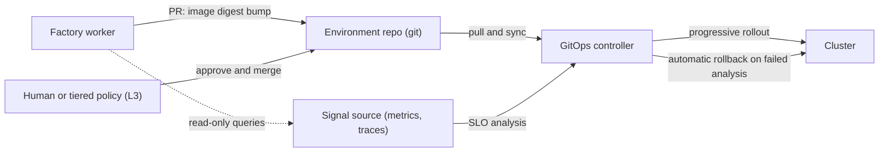

# A2 — Path to Peak Automation (beyond v1)

> **Audience:** the owner (a DevOps engineer) and the agents that will build the next tranches.
> **Question this answers:** "Automate the whole software-building journey at its peak" — what is *peak*, what stands between v1 (`00`–`08`) and it, and in what order do we build and **earn** it?
> **Stack-neutral by construction** (`A1`): every tool named here is an adapter example. Markers: `[BP]` blueprint · `[PACK]` pack proposal · `[VERIFY]` confirm externally.

---

## 1. What "peak" means — and what it does not

**Peak** = for each *(workflow × repository × risk tier)*, the whole journey — **intent → spec → oracle → plan → code → verify → review → merge → build → deploy → verify in production → operate → learn** — runs with humans only at **intent, policy, exceptions and sampled audit**.

**It is reached per workflow, by evidence — not switched on.** [BP: ADR-0003]
* The floor: human reading of code stays mandatory for any workflow whose output enters the main branch **until that workflow has a discriminator-calibrated verifier set covering its acceptance criteria** — a verifier may replace human review only if it has been *shown, on this repo and this class of change, to fail when the property is violated*.
* L3 = "merge **and deploy** after a configured, **risk-tiered** approval is satisfied" (approval can be satisfied by calibrated gates for low tiers, by a named human for high tiers). L4 = an **enumerated** set of production operations with a written runbook, abort condition and post-hoc review — never a general "deploy to production" permission.
* Promotion needs a calibration run **and** an observed defect-escape rate below an **agreed threshold** over a defined sample; revocation by evidence is a normal path.
* A "dark factory" (no human anywhere) was attempted and abandoned in the source corpus [V02]; the staged-autonomy ladder exists precisely to avoid that failure mode.

**The thesis for a DevOps engineer:** the limiting factor at peak is *verification coverage × calibrated trust*, not code generation. Peak automation is the point where your verifiers are good enough that humans stop being the bottleneck for low-risk changes — and stay firmly in the loop for high-risk ones.

---

## 2. The full journey: today, peak, and how

| # | Stage | v1 (files 00–08) | Peak | Mechanism | Human role at peak | Max level |
|---|---|---|---|---|---|---|
| 1 | Intake & triage | label an issue; triage agent | issues, alerts, roadmap items → flood-controlled intents | webhooks + deterministic dedupe + triage | sets intent and priority | L2 (intent is always human) |
| 2 | Spec & criteria | refinement; owner approves plan | criteria templates per domain; auto-accept templated R0–R1 | refine + generators | approves novel / R2+ plans | L3 (templated) |
| 3 | Oracle | human / generator / agent+approval | generators cover most criterion kinds | R-G routes | reviews novel oracles | — |
| 4 | Plan & decompose | planner; 1–3 nodes | interface-first parallel chunks | task graph + chunkability rules | — | L2–L3 |
| 5 | Implement | harness in T2 | parallel workers, per-chunk isolation | harness adapters | none | L2–L3 |
| 6 | Verify | oracle + gates | + calibrated verifiers, mutation, perf/security gates | calibration harness | none | L3 |
| 7 | Security | scan + reviewer | + SBOM, provenance, policy-as-code | scanners + OPA-style rules | named approver for R3+ | L3 |
| 8 | Review | reviewer + panel + owner | humans review R2+ and a sample; R0–R1 by calibrated gates | risk-tiered queue | sampled audit | L3 |
| 9 | Merge | human merges | factory merges after tiered approval | `git.merge` + guard | approves R3+ | L3 |
| 10 | Build & package | repo CI | build in sandbox/CI; sign; SBOM; provenance | attestations | none | L3 |
| 11 | Preview env | — | ephemeral env per PR + e2e | namespaces/vclusters + TTL | none | L3 |
| 12 | Deploy staging | — | GitOps PR merged by factory | GitOps controller | none | L3 |
| 13 | Deploy production | — | progressive delivery; controller-driven rollback | GitOps + analysis | approves R2+ (tiered) | L3 |
| 14 | Post-deploy verify | — | deterministic SLO/synthetic guards | signal source queries | none | L3 |
| 15 | Operate & incidents | — | candidate fix **on the pager**; enumerated runbooks | Workflow E, T3 | decides non-runbook cases | **L4 (narrow)** |
| 16 | Maintenance | D-1, D-2 | + CVE fast lane, flaky, coverage, drift, cost | sweeps | sampled | L3 |
| 17 | Docs & release notes | knowledge record | + changelog/release notes as reviewed artefacts | docs stage | skim | L2–L3 |
| 18 | Learn | manual proposals | replay + outer/meta loops → proposals | evaluator | approves changes | never auto-applied |

---

## 3. DevOps-native design principles for the peak path

| # | Principle | Consequence |
|---|---|---|
| P-1 | **Git is the only write path to production** (GitOps-first). The factory's authority **ends at a pull request to an environment repo**; a pull-based controller (e.g., Argo CD / Flux) applies it. Rollback = revert commit. | The factory never holds cluster-admin or cloud-admin credentials. Production writes happen in the controller, whose credentials the factory cannot read. |
| P-2 | **Approvals bind artefacts, not intentions** — image **digest** + manifest hash for deploys; **plan-file hash** for IaC. | Re-approval on any change (A2.9 generalised); no "approve then swap". |
| P-3 | **Production credentials never enter a sandbox.** E4 capabilities execute in a dedicated runner with per-operation, short-lived, minimum-scope credentials, minted by the credential broker. | Sandbox compromise ≠ production compromise. |
| P-4 | **Promotion and rollback decisions are deterministic** — canary analysis and SLO guards are code/controller logic (Argo Rollouts / Flagger-style), not model judgement. | Models may *draft* and *explain*; they never decide a rollout. |
| P-5 | **Every R3+ change has a declared, tested rollback**; a change without one cannot deploy. [BP: 13 §5.6] | Rollback proofs run automatically in staging per release class. |
| P-6 | **The factory never weakens its own gates.** Pipeline definitions, policy-as-code, controller config and env repos are protected paths; the gate-weakening detector extends to them. | CI/CD changes are always human-approved proposals. |
| P-7 | **Promote artefacts, don't rebuild them** — the digest tested in staging is the digest in production. | Eliminates a drift class; makes evidence transferable. |



---

## 4. Workflows beyond v1 (each is its own ADR + evidence-gated promotion)

| Workflow | Trigger | What decides "done" (oracle) | Key gates | Capabilities (effect class) | Approval and rollback |
|---|---|---|---|---|---|
| **A-ext · Release & deploy** (GitOps) | merged change or release intent | staging post-deploy checks (synthetic + SLO queries) and e2e | signed artefact · SBOM clean · tested rollback · promotion evidence fresh | `registry.push` (E2) · `deploy.gitops.propose` (E2) · `deploy.gitops.merge` (**E4**, L3) · `obs.query` (E0) | tiered; prod R2+ named approver; rollback = revert PR + controller rollback |
| **IaC change** | IaC intent, schedule, drift | plan analysis + policy-as-code + tests | plan classified (destroy/replace/IAM/network/data) · **plan-hash-bound approval** | `iac.plan` (E0, read-only role) · `iac.apply` (**E4**) | human for R3+ (stateful, IAM, network); reviewed rollback plan tested in non-prod |
| **Pipeline-as-code** | CI failures, maintenance | `actionlint`-class validation + dry-run in a canary repo + gate-weakening check | **always human-approved** (R4 path) | PR only | revert |
| **Security patch fast-lane** | advisory with a fix | existing suite + re-scan shows fixed (+ regression/exploit test if available) | shortened path, same gates | PR (+ merge at L3 for R0–R1) | revert; fast promotion by digest |
| **E · Incident response** [BP: 12 §6] | production alert (untrusted) | candidate fix passes a test reproducing the alert condition + prod-like verification | **T3**; read-only prod; wall-clock bound; human decision accept/modify/reject | `obs.query` (E0) · PR · `deploy.*` via gate | pager carries the candidate PR; runbook rollback |
| **Cost / capacity** | schedule, budget alert | IaC plan analysis + cost estimate within bounds + SLO headroom | PR only | `iac.plan` (E0) · PR | human for R2+; revert |
| **Preview environments** | PR opened | e2e green; TTL destroy | no route to production; quotas | `env.preview.create/destroy` (E2) | TTL |

**IaC specifics (DevOps-native):** `plan` produces a **plan file** (`terraform plan -out=…` then structured JSON for analysis — or the OpenTofu/Pulumi equivalent `[VERIFY]`); the analyser classifies resource changes into blast-radius floors; **the approval is bound to the plan file's sha256**; `apply` consumes **exactly that file** and refuses if the state moved, policy fails, an unapproved drift exists, or the lock cannot be taken. Plan files can contain secrets: store them as restricted-retention artefacts and never feed raw plan text to a model without redaction.

---

## 5. Earning autonomy — the promotion machine [BP: ADR-0003, 14 §5]

**Unit of promotion:** *(workflow, repo, tier band)* — e.g., "Workflow D-1 on `repo-x`, R0–R1". Never global.

| Step | What happens | Evidence artefact |
|---|---|---|
| 1 | **Calibrate** verifiers for the acceptance-criteria classes of the workflow (corpus with violations *and* conforming samples; seed injection; negative control). Thresholds by property kind in `14 §5.4` | calibration reports (valid, unexpired) |
| 2 | **Observe at L2** over a defined window; record defect escapes (reverts within 14 days + owner flags), review minutes, escalation reasons, cost | metrics report vs the pre-factory baseline |
| 3 | **Shadow mode** `[PACK]`: compute "would the factory have auto-merged this?" for every PR **without acting**; record agreement with the human decision | agreement rate with confidence caveats |
| 4 | **Propose promotion** as a definition change (reviewed PR) with the evidence bundle; the threshold is the one **you agreed in advance** | PR + bundle hash |
| 5 | **Approve** by a named human; promote the **lowest tier band first** (R0–R1) | `definition.applied` + approval |
| 6 | **Watch** with automatic **demotion** triggers: defect escape · verifier regression/expired calibration · cost anomaly · rubber-stamp anomaly · gate-weakening attempt | `autonomy.revoked` event, back to L2 |
| 7 | **Re-validate** on a cadence (default 90 days, the calibration window) | fresh reports |

**Starting values for an agreed threshold `[PACK]` — you set the real ones:** ≥8 weeks *and* ≥30 completed tasks of the class · verifier detection/false-positive rates meeting `14 §5.4` · **zero** high-severity escapes and an escape rate no worse than the pre-factory baseline · shadow agreement ≥95 % on R0–R1 · tested rollback · no cost anomaly.
**Never automated at any level:** changes to policy, gates, the factory definition, credentials, CI/CD pipeline definitions, **R4 paths**, and the autonomy promotions themselves.

---

## 6. Phased roadmap beyond v1

Windows are **earliest possible, counted from v1 go-live (PRR sign-off)**. Calendar time is dominated by **evidence accumulation** (observation windows), not engineering — which is why deploy automation can be built *while* v1 soaks (it runs at L2: the factory opens PRs, humans merge).

| Phase | Window | Theme | Builds | Exit evidence | Autonomy outcome |
|---|---|---|---|---|---|
| **P6** Ship at L2 | +0…+8 w | build → package → preview → **staging deploy via GitOps PR** → post-deploy verify → rollback proof | E7, E8 (T-8.01…8.06) | DORA baseline captured; ≥10 staging deploys with passing verification; one rollback drill | all L2 |
| **P7** Calibrate & promote code | +4…+12 w | verifier calibration breadth; shadow mode; first L3 **merge** for low tiers | E11 (T-11.01…11.04), more oracle generators | promotion bundle for D-1 (R0–R1) accepted | D-1 and simple bug-fix **merge at L3** (deploy still L2) |
| **P8** Deploy at L3 | +10…+20 w | production via GitOps with progressive delivery; IaC plan/apply | E8 rest, E9 | change-failure-rate ≤ baseline over window; rollback proofs current; IaC drills | prod deploy at L3 for stateless R0–R1; named approval R2+ |
| **P9** Operate | +16…+30 w | T3, signals, Workflow E, runbook registry | E10 | incident drills; candidate-fix usefulness measured | **L4 for 2–3 enumerated runbooks** (e.g., roll back to previous release, restart, scale within bounds) |
| **P10** Improve & scale | +24 w … | replay, outer/meta loops (proposals only), multi-repo, more target profiles, team mode | E11 rest, E12 | ≥100 completed runs; proposal evaluation results | per-workflow, evidence-gated |

---

## 7. Epic outlines (ticket stubs — expand with the `05` format when each phase starts)

Format: `ID · title · satisfies · oracle in one line`. Each becomes a full ticket (Read bundle, Build paths, tier, Stop-if) at phase start.

### E7 — Build, package, preview (P6)
| ID | Title | Oracle (one line) |
|---|---|---|
| T-7.01 | Artefact build in T2 with provenance attestation | attestation names task, base SHA, builder-image digest; tampered artefact fails verification |
| T-7.02 | Signing + SBOM + vulnerability gate `[VERIFY tooling]` | unsigned artefact cannot be promoted; known-critical CVE blocks (recorded waiver path) |
| T-7.03 | Registry adapter (`registry.push`, E2, scoped creds) | pushes only to allow-listed repos; never overwrites a digest; creds revoked |
| T-7.04 | Preview environment provisioner (TTL, quota) | TTL destroy works; quota enforced; no route to production |
| T-7.05 | E2E-against-preview as a verification layer | failing e2e blocks; preview torn down in `finally` |

### E8 — Deploy via GitOps (P6 → P8)
| ID | Title | Oracle |
|---|---|---|
| T-8.01 | `DeploymentController` interface + GitOps adapter (`deploy.gitops.propose`) | factory opens env-repo PR (digest bump only) but cannot merge at L2 |
| T-8.02 | Environment definitions + promotion policy (dev→staging→prod, freeze windows) | prod PR impossible without fresh staging evidence |
| T-8.03 | Post-deploy verification gate (deterministic SLO/synthetic queries) | failing check marks deployment failed and proposes rollback |
| T-8.04 | Rollback capability + **rollback proof** per release class | deploy without a tested rollback is refused (hard gate; SEC-10) |
| T-8.05 | Deploy approval classes + change calendar | approval bound to digest + manifest hash; expiry; named approver for prod |
| T-8.06 | DORA metrics projection | reproducible from events; refuses a delta without baseline |
| T-8.07 | *(optional)* direct-apply adapter (kubectl/helm) as E4 with enumerated runbooks | only enumerated operations; per-operation approval; ephemeral scoped creds |

### E9 — Infrastructure as code (P7 → P8)
| ID | Title | Oracle |
|---|---|---|
| T-9.01 | IaC repo profile + runner image; remote state + locking rules | static checks run in T2 with **no credentials** |
| T-9.02 | `iac.plan` capability (E0, read-only role, dedicated runner) | creds absent from sandbox; plan hash recorded; plan artefact restricted |
| T-9.03 | Plan analyser → blast-radius floors | destroy/replace of stateful resource ⇒ ≥R3; IAM/network broadening ⇒ ≥R3; deterministic |
| T-9.04 | Policy-as-code gate over plan JSON | violating plan blocked; policy files are protected paths |
| T-9.05 | `iac.apply` (E4): applies exactly the approved plan | altered plan ⇒ hash mismatch; stale state ⇒ refuse; approval reuse ⇒ refuse |
| T-9.06 | Drift sweep (read-only; report-then-correct) | drift reported as event; no apply path exists |
| T-9.07 | Break-glass runbooks (state corruption, stuck lock) — human-only | drill record |

### E10 — Operate (P9)
| ID | Title | Oracle |
|---|---|---|
| T-10.01 | **T3** isolation provider (microVM or Kata/gVisor-class) | passes A3.1/A3.2 and AT-10 variants at T3 strength |
| T-10.02 | Signal ingestion (alerts → untrusted-tagged intents; flood control) | injected alert text never becomes instruction; rate limits hold |
| T-10.03 | Read-only production observability capabilities (`obs.query`, E0) | no write path; scoped read creds; bounded queries |
| T-10.04 | Workflow E: diagnose → candidate fix PR → **enriched alert** → human decision | wall-clock bound enforced; enriched alert carries diff + evidence |
| T-10.05 | Runbook registry (enumerated E4 ops: scope, abort condition, rollback) | operation outside the registry denied; abort enforced; post-hoc review item created |
| T-10.06 | Post-incident knowledge capture + postmortem draft (flagged unverified) | record created; draft labelled |
| T-10.07 | On-call/escalation integration | timeout ⇒ escalate, **never** auto-approve |

### E11 — Autonomy machinery (P7 → P10)
| ID | Title | Oracle |
|---|---|---|
| T-11.01 | Promotion evidence report generator | derived only from events; shows sample sizes and caveats |
| T-11.02 | **Shadow mode** ("would auto-merge?") | never merges; agreement rate computed |
| T-11.03 | L3 merge path: `git.merge` capability + guard accepting a **policy-authorised** trigger for configured tiers | any red gate ⇒ no merge; `INV-4` still holds; only configured tiers |
| T-11.04 | Auto-demotion (FR-94) | simulated escape demotes within N minutes; re-promotion needs new evidence |
| T-11.05 | LLM-judge verifier framework with calibration (FR-54) | uncalibrated judge excluded; never sole gate for irreversible changes |
| T-11.06 | Panel-confidence calibration (A2.11) — only if panel output is used to reduce review | stated confidence correlates with outcomes |
| T-11.07 | Replay evaluator (MEAS-07) | reproducible class-matched comparison, cost accounted |
| T-11.08 | Outer/meta-loop proposal generator (FR-90/91) | proposals without batch evidence rejected; nothing auto-applied |

### E12 — Scale and improve (P10)
| ID | Title | Oracle |
|---|---|---|
| T-12.01 | Workflow F: multi-repo, interface-first (FR-83) | contract tests first; integration order; partial-failure semantics |
| T-12.02 | Context promotion/demotion (FR-15, A4.11) | promotion by evidence; demotion on staleness |
| T-12.03 | Target-profile library (`A1` §6) with a fixture repo per stack | each fixture builds and tests green in T2 |
| T-12.04 | Flaky-test repair, coverage backfill, conformance sweeps (FR-85 rest) | gate-weakening rejected; chunk bounds |
| T-12.05 | Team mode: second approver + separation of duties for R3+ | one person cannot both author and approve R3+ |

---

## 8. Capability and policy extensions

**New E4 capabilities are runbook entries, not tools.** Each needs: exact scope, abort condition, **declared and tested rollback**, artefact-bound approval (or L4 pre-approval with post-hoc review), a runner **outside** every task sandbox, and an R4 definition change to add. Example `[PACK]` — requires a contracts ticket to add the `approval`, `rollback` and `preconditions` fields to `ToolCapability`:

```yaml
apiVersion: factory/v1
kind: ToolCapability
metadata: { name: iac.apply, version: 1.0.0 }
spec:
  owner: platform
  kind: mutation
  transport: cli                        # runs in the dedicated apply runner, NOT a task sandbox
  effect: { class: E4, reversible: false, external: true }   # reversal = a reviewed, tested rollback plan
  scope: { required: [prod.write], resourcePattern: "iac:STACK:WORKSPACE", environment: ENV }
  approval: { required: true, boundTo: planFileSha256, ttlSeconds: 600, singleUse: true }
  credentials: { provider: cloud, role: "iac-apply-ENV", ttlSeconds: 900, source: broker }
  rollback: { declared: true, ref: "runbooks/iac-rollback.md", tested: true }
  preconditions: [ "plan produced by iac.plan", "plan sha256 equals approval artefact sha256", "policy checks passed", "no unapproved drift", "state lock held" ]
  inputSchema: { $ref: "schemas/iac.apply.in.json" }
  outputSchema: { $ref: "schemas/iac.apply.out.json" }
  trust: { inputTrust: trusted, resultTrust: untrusted }
```

**`INV-7` (v1: "no production capability exists") becomes, from P8:** every capability of effect class E3/E4 or scope `prod.*` is (a) listed in the **runbook registry** with scope, abort condition and tested rollback; (b) approval-bound, or L4 pre-approved with post-hoc review; (c) executable only by a runner outside any task sandbox; (d) absent from every agent role's grant except the dedicated deploy/ops roles; (e) addable only by an R4 definition change. The invariant test enumerates the registry and fails on any capability missing one of (a)–(e).

**Policy additions:** change calendars and freeze windows · environment-specific rules (prod stricter than staging) · promotion-evidence freshness · two-person rule when a second approver exists · deny-by-default for any new environment until registered.

---

## 9. Metrics for peak — baseline first

* **Delivery (DORA):** deployment frequency · lead time for changes · change failure rate · time to restore. **Capture the pre-factory baseline now** (T-0.04 is extended to include them when the repo deploys).
* **Factory:** accepted-PR rate · **cost per accepted change** · human intervention rate · escalation rate and reasons · review minutes per PR by tier · verifier calibration currency · shadow-mode agreement · same-run-authored-oracle rate (must stay 0).
* **Rule [BP: MEAS-06]:** no target is taken from the research corpus; report baseline, delta, cost and guardrail — or nothing.

---

## 10. Risks specific to the peak path

| ID | Risk | Mitigation |
|---|---|---|
| RK-1 | Over-trusting calibrated verifiers (Goodhart): the verifier is gamed or goes stale | seed-injection recalibration on a window; holdout checks; rotating corpora; automatic demotion |
| RK-2 | Approval fatigue / rubber-stamping as throughput rises | fatigue indicators (T-3.05); tiering; sampling; **never loosen gates to relieve the queue** |
| RK-3 | Production credential sprawl | dedicated runners; per-operation scoped credentials; no credentials in the factory core; audit tool |
| RK-4 | IaC state corruption or lock contention | remote state with locking; single apply runner; plan-hash binding; break-glass runbook |
| RK-5 | GitOps controller misconfiguration (auto-sync with prune) | env repo and controller config are R4; deletion policies reviewed; dry-run diffs |
| RK-6 | Drift between environments | digest promotion (P-7); drift sweeps |
| RK-7 | Alert-driven injection or flooding | untrusted tagging; dedupe; rate limits; **no auto-approve on timeout** |
| RK-8 | Model-provider outage during a deploy or incident | rollback and promotion are deterministic and model-independent; models only draft |
| RK-9 | Evidence starvation (low-traffic repos) | do not promote; staying at L2 is a valid outcome |
| RK-10 | Scope explosion (too many workflows at once) | one workflow, one repo, one tier band per promotion; each new workflow needs its own ADR |
| RK-11 | Build supply chain | signing, SBOM, pinned builder images, provenance |
| RK-12 | Compliance/audit obligations (if any) | event log + audit tool + retention classes; owner assesses requirements before P8 |

---

## 11. What to do **now** (during v1) to keep this path open

1. **Extend T-0.04** with a DORA baseline for the target repo's deployments (patched into `05`).
2. **Keep `deploy.*`/`prod.*` absent** (`INV-7` as written for v1) — do not add shortcuts "just for staging".
3. **Keep adapters honest:** every SCM/isolation/harness/provider adapter has a contract test against its fake (I-12) — this is what makes later swaps (`A1` §7) cheap.
4. **Decide the GitOps shape now:** one environment repo (or folder per environment), the controller you will use, and who owns its credentials — it costs nothing today and shapes P6.
5. **Calibrate early:** run T-4.02…4.04 on real repo history; calibration is the longest-lead item for P7.
6. **Protect pipeline, policy and controller files** as R4 paths in every target repo's criticality map from day one.
7. **Use the soak as raw material:** review minutes, escalation reasons, defect flags and cost per accepted change are exactly the promotion evidence of step 2/3 in §5.
8. **Pick the language profile** (`A1` §4.3) before W1 so nothing is built twice.
