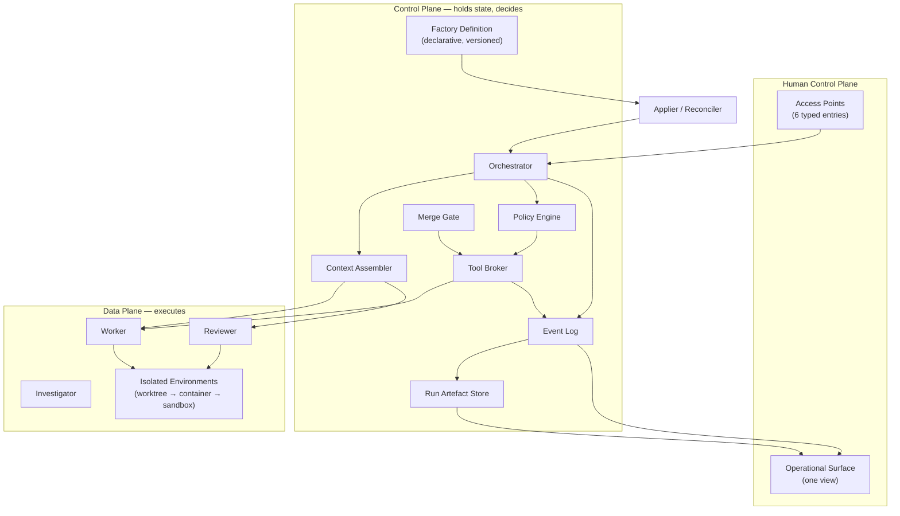

# 01 — Executive Vision

**Purpose:** the answer to "what is this, and why does it exist" — in terms a person who will make decisions about it can act on.

**Source of truth for:** the factory's identity, its boundary, its central design commitments, and what it deliberately is not.
**Derived from:** the fifteen source analyses, `04_CROSS_SOURCE_SYNTHESIS.md`, `18_OPEN_QUESTIONS_AND_RISKS.md`, and the twelve ADRs.

---

## 1. What a software factory is

The term is fifty-eight years old. In 1968, at GE, the term meant something specific (V05, 2:22):

> A computer-controlled programming environment containing standardised development tools along with historical information for management and measurement.

Three components. Not a collection of AI tools, and not an org chart with chatbots in it.

| 1968 component | What it becomes here |
|---|---|
| Controlled programming environment | The execution environment, the isolation tiers, the worktree, the sandbox |
| Standardised development tools | The tool registry, the skill corpus, the standards verifiers |
| Historical information for management and measurement | The run artefact store, the event log, the metric catalogue |

That definition is used here as a **design constraint, not a slogan**. If a proposed component of this blueprint does not map to one of the three, it is questionable. If one of the three is missing, the blueprint is incomplete. The 1968 definition also carried the term's original ambition — the industry had overestimated how quickly it would arrive, and V02's abandoned dark factory is what that overestimation looked like when it reached the agent era.

**The working definition of this factory:**

> A software factory is an organisation in which the production cycle is performed by agents, with humans supplying intent and judgement rather than executing the steps — and in which the factory is itself engineered, measured, and improved as a product.

The second clause is the load-bearing one. It is what separates this from a collection of AI tools pointed at a repository.

### 1.1 What it is not

| It is not | Why |
|---|---|
| A collection of AI tools | Tools do not compose into a factory. V02's finding is that failures concentrate in *composition*, not in the tools. |
| An autonomous company | Every workflow in this blueprint ends at L2 by default. Human judgement is retained at the points where it is worth money. |
| A black-box pipeline | Every action is reconstructable with its authority. A factory you cannot audit is one you cannot improve. |
| A model with a repository attached | The model is replaceable. The control plane, the gates, and the measurement are not. |
| A productivity claim | No number in this blueprint is promised. The factory measures itself and reports honestly, including when the result is unflattering. |

---

## 2. The problem this addresses

Software organisations have two structural problems that more capable models do not solve on their own.

**The first is that generated work cannot be trusted without an independent check.** As models improve, the volume of plausible-looking output rises. The bottleneck moves from generation to *judgement*. V12's finding — that most tests an agent writes assert nothing meaningful — is the shape of this: the more an agent produces, the more a pass/fail signal from that same agent becomes worthless. A factory that produces faster without an independent oracle is a factory that produces defects faster.

**The second is that agent failures are not reasoning failures.** V02 audited hundreds of runs and found that workflow defects, not agent reasoning, caused the failures. This is the most consequential finding in the corpus and it points the opposite way from intuition: the thing to engineer is not the agent, it is the *machine the agent runs inside* — the workflow, the gates, the isolation, the context selection, the recovery.

So this blueprint is built around two commitments:

1. **An agent never judges its own work.** The acceptance oracle is constructed before implementation, by a deterministic generator or a human, and is never authored by the agent that implements the change (ADR-0005).
2. **The factory's own machinery is the primary engineering object.** Not the prompt, not the model, not the role count. The workflow, the state machine, the gate set, and the measurement.

---

## 3. The central design commitment: the authority split

One idea carries more of the architecture than any other.

**No single component holds both deterministic policy authority and probabilistic orchestration authority** (ADR-0004).

- **Policy** decides what is permitted: is this action in scope, does this exceed the blast-radius threshold, is this credential valid, is this content untrusted. It is code, it is deterministic, it is auditable, and it cannot be overridden by an agent's judgement.
- **Orchestration** decides *how* to achieve a goal policy has already authorised: decomposition, sequencing, tool selection within scope, retry strategy, interpretation of unstructured output. It cannot widen its own scope, escalate its autonomy, mint credentials, or bypass a gate.

The reason this matters more in an agentic system than in an ordinary one: in an ordinary system, a component that exceeds its authority produces a bug. In an agentic system, a component that *believes* it has authority produces an authorised-looking action, and the same component would have been the one to object. The split makes the objection structurally independent of the actor.

This is also where the blueprint departs from its sources. The corpus is **silent on prompt injection** — not once. Every source treats the agent as the thing being trusted and the risk as the agent doing something wrong. The actual threat is an agent doing exactly what it was told, by an instruction embedded in content it was asked to read. The blueprint's answer is structural rather than detective: untrusted content is **tagged and passed as data, never as instruction**, and the enforcement point is a deterministic boundary, not a model instruction telling the model to ignore embedded instructions.

---

## 4. The autonomy ladder, earned rather than declared

Autonomy is not a dial you set. It is **earned per workflow, through demonstrated reliability, and revoked on evidence** (ADR-0003).

| Level | What the factory may do unattended |
|---|---|
| **L0** | Read and analyse. Produce nothing that changes anything. |
| **L1** | Produce plans, proposals, and suggestions for human action. |
| **L2** | Work in isolated workspaces, open pull requests, run verification. **This is where every workflow in this blueprint starts.** |
| **L3** | Merge and deploy after configured approvals. |
| **L4** | Operate production autonomously within enumerated runbooks. |

Two things make the ladder real rather than decorative:

**A human review floor.** Human reading of code remains mandatory until the workflow's verifier set is *discriminator-calibrated* for its acceptance criteria — meaning the verifiers have been shown, against a labelled corpus with negative controls, to actually fail when the property they check is violated. A verifier that has never been shown to fail is not evidence of correctness; it is evidence of nothing.

**A mechanical enforcement point.** The ladder is not a policy statement an agent could be talked out of. It is a transition guard: at `APPROVED → MERGING`, the policy engine checks the workflow's autonomy level, and an L2 workflow cannot merge autonomously — the merge must arrive through a human access point.

The corpus disagrees with itself here, and the disagreement is instructive. V15 and V12 describe high autonomy with confidence; V14 describes unattended operation degrading silently; V02 abandoned a dark factory entirely. The blueprint resolves this not by picking a side but by **narrowing the scope of the claim**: autonomy is earned per workflow, evidence is required, and the human floor is a floor rather than a preference.

---

## 5. The measurement discipline

The 1968 definition's third component — "historical information for management and measurement" — was not an afterthought, and measurement is not a modern addition to this blueprint.

The corpus's central methodological failure is that most of its productivity figures are vendor-reported, have no baseline, and cannot be checked. **No figure from the source corpus is used as a target, an SLA, or a planning input anywhere in this blueprint.** Where a corpus number appears, it is cited as directional evidence about a different organisation's deployment.

What replaces it is a method, generalised from the one credible before/after in the corpus (V09): every change reports four things.

| Element | Requirement |
|---|---|
| **Baseline** | The same metric, before the change, over a stated window, on the same workload |
| **Delta** | The change in the metric, with confidence information where the sample permits |
| **Cost** | Total cost — inference, tools, infrastructure, and the evaluation's own cost |
| **Guardrail** | At least one metric that must not degrade |

A change with no baseline is not evidence. A change with no guardrail is not safe. A change with no baseline is a belief.

This also settles the productivity question the directive posed. The blueprint does not claim 10×, 20×, or 30× — not because the number is unknown, but because **no honest number can be claimed before the factory has measured its own baseline**. That baseline is one of the first two things started on day one, and the other is the calibration corpus. Both are wall-clock-bound and neither can be compressed later.

---

## 6. The five commitments

If the whole blueprint were reduced to five commitments, these are they.

### 6.1 The oracle comes first

A task's acceptance criteria are expressed as a checkable oracle during specification, **before** any implementation stage runs, and the oracle is authored against the specification rather than the implementation — by a deterministic generator where possible, by a human otherwise. An agent may propose extra tests; it may never write the tests that decide its own change.

This is the single highest-leverage decision in the blueprint, because it attacks the false-signal problem directly. If the same agent writes the fix and the test that judges it, the gate measures the agent agreeing with itself.

### 6.2 The control plane holds the state; the data plane does the work

Every consequential action passes through the control plane. The data plane reports outcomes; the control plane writes state. There is no path from an agent to an effect that bypasses a policy decision, because no such path exists.

### 6.3 Context is selected, pinned, and never maximal

An agent sees what its stage needs and nothing else — selected deterministically by the context assembler, pinned by identifier and version for the life of the run. Over budget is a **failure**, not a truncation. Silently dropping context is how a factory produces confidently wrong output.

### 6.4 Every change to the factory is a change like any other

Including changes to the factory itself. The factory proposes; it never applies. A change to a skill, a workflow, the harness, a policy, or an autonomy level goes through review, replay evaluation, approval at a scope-appropriate class, and an observation window with automatic rollback on a guardrail breach.

### 6.5 The factory is a product, and products are engineered

It has requirements, an architecture, a test suite, a red-team suite, a roadmap, an incident process, and a cost model. The people who build it are responsible for it in the same way they would be responsible for a product they shipped. This is the "machine that builds the thing" reframe from V01, and it is the answer to abandonment risk: a factory that nobody owns as a product is a factory that gets started and not finished.

---

## 7. What the research contributed, and what it did not

### 7.1 What the corpus established

| Contribution | Where |
|---|---|
| The 1968 definition — three components, including measurement as intrinsic | V05 |
| Failures concentrate in workflow composition, not agent reasoning | V02 |
| The control plane / data plane / access-point separation | V07 |
| The factory as a declarative definition with an applier and drift detection | V09 |
| Runner / reporter / panel separation, and confidence-gated merging | V04 |
| Worktrees as the unit of isolation | V08 |
| Deferred context, progressive tool disclosure, fresh-context sequential workers | V10 |
| The chunkability criterion as the fan-out rule; model-tier hierarchy | V12 |
| Harness as a privilege-bearing artefact; the inner/outer/meta loops | V11 |
| Blast-radius-proportional review; turn budgets | V13 |
| Plan-first approval; tool-call gating; unattended degradation; the pager that carries the fix PR | V14 |
| 12-factor discipline for agentic systems | V14 |
| Verifier generation from skills; specificity as the ruler of quality; the context inventory | V15 |
| The 1968 ambition and the overestimation that followed it | V05, V02 |

### 7.2 What the corpus was silent on — and the blueprint filled in

Eleven areas where every source is silent. Each is [E3] engineering judgement, each is marked as such in the documents where it appears, and each is listed in `18_OPEN_QUESTIONS_AND_RISKS.md` §5 as work with a validation plan rather than as settled fact.

| Gap | The blueprint's answer | Where |
|---|---|---|
| **Prompt injection** | Untrusted content is tagged, quarantined, and passed as data; enforcement is deterministic | ADR-0004, `13_...` §1.4 |
| **Secret handling** | Credential broker; secrets are never context; per-task scoping | `11_...` §7 |
| **The authority split** | No component holds both policy and orchestration authority | ADR-0004 |
| **Test authorship** | Agent-authored tests never gate their own implementation | ADR-0005 |
| **Oracle independence** | The oracle precedes and is independent of the implementation | `14_...` §3 |
| **Rollback** | Rollback is a hard gate, not a hope | `13_...` §5, `12_...` §5 |
| **Drift** | Declared state wins; drift is detected and reported | `09_...` §5 |
| **Multi-tenancy** | Explicitly **not designed** — recorded as open question Q-01 | `18_...` §1 |
| **Supply-chain security** | Context and skill artefacts are privilege-bearing artefacts | `13_...` §7 |
| **Approval fatigue** | Recognised as a failure mode of the control itself; the response is a higher evidence bar | `13_...` §6 |
| **Discriminator calibration** | The first-class requirement that no source states | `14_...` §5 |

### 7.3 The disagreements the blueprint had to resolve

The corpus does not agree, and pretending it does would be the easiest way to produce a blueprint that reads well and fails. `04_CROSS_SOURCE_SYNTHESIS.md` documents eight disagreements, each with the competing approaches, their assumptions, advantages, disadvantages, failure modes, appropriate use cases, the recommendation for this factory, and the conditions under which another approach would be preferable.

The four that shaped the architecture most:

| Disagreement | Resolution |
|---|---|
| High autonomy vs. unattended degradation | Narrow the scope: per-workflow, evidence-earned, with a human review floor enforced mechanically |
| One orchestrator vs. hierarchical roles | Split by *different responsibility*, not by specialisation for its own sake — ten roles, each with a distinct context scope, tool scope, authority, and evaluation |
| Agent-managed context vs. deterministic assembly | Deterministic assembly with pinned versions; the agent requests, the assembler selects |
| Third-party components vs. owned machinery | Own the workflow runner (failures concentrate there); use managed services elsewhere |

---

## 8. The shape of the thing

**The architecture in one sentence:** humans act through typed access points; the control plane decides and holds state; the data plane executes inside isolated environments; every consequential action is recorded; and the recorded history is the factory's only legitimate basis for changing itself.

### 8.1 What is in the box

| Component | One line |
|---|---|
| Control plane | Decides intent, policy, state, scheduling. Never executes work. |
| Orchestrator | Sequences the task graph. Decides how, not what. |
| Context assembler | Selects and pins context per stage. Deterministic. |
| Policy engine | Every consequential decision. Deterministic. Fails closed. |
| Tool broker | The single choke point for every capability invocation. |
| Merge gate | The tier-scaled check set. Weakening a gate is itself a change. |
| Model gateway | Makes model choice configuration. Provider-diverse fallbacks. |
| Isolation manager | Provisions T1/T2/T3 environments and reclaims them. |
| Verification runtime | Runs the oracle, the standards verifiers, and the repo's own suite. |
| Event log | Append-only. The substrate for audit, evaluation, cost, and improvement. |
| Run artefact store | Everything about every run, retained per class. |
| Reviewer | Judges. Never the agent that produced what it judges. |

### 8.2 What is deliberately not in the box

- **No general-purpose message broker.** Work distribution is a relational-backed queue with leases. A broker is justified only on measured need.
- **No third-party workflow engine.** Failures concentrate in composition, so the composition layer is owned and testable.
- **No vector database as a source of truth.** Semantic retrieval is an optional aid; no correctness property depends on it.
- **No separate identity service, audit product, or policy engine.** Small-team constraint; each is a component, not a platform.
- **No multi-tenancy.** Explicitly not designed. Recorded as open question Q-01.

---

## 9. How to judge whether it is working

The factory is not judged on productivity claims. It is judged on five questions, each of which has a metric and an owner.

| Question | Metric | Where |
|---|---|---|
| Is the output correct? | Acceptance-oracle pass rate; defect escape rate; revert rate | `14_...` §8 |
| Is it fast? | Idea-to-production lead time; PR cycle time; p50/p90 cycle time | `14_...` §8 |
| Is it cheap? | Cost per **accepted** change — not cost per run | `15_...` §4 |
| Is it safe? | Unauthorised-action denials; approval rubber-stamp rate; intervention rate | `13_...`, `14_...` |
| Is it improving? | The share of proposals that are batch-evidenced, replay-validated, and measurably effective | `15_...` §5 |

The fifth question is the one that distinguishes a factory from a demo. **A factory that does not measurably improve is not a factory; it is a pipeline.** And an improvement loop that cannot be measured is the loop the corpus warns about — V15's "you're creating loops to monitor loops" is only a problem when the monitoring produces no correction.

---

## 10. The ten questions a reader should hold this blueprint to

If this document is useful, these should be answerable from the blueprint as a whole.

1. **Can I see the check?** For any claim of quality, where is the check and who calibrated it?
2. **Can I see the authority?** For any action, which grant permitted it, and who approved the grant?
3. **Can I see the cost?** For any run, what did it consume and what did it produce?
4. **Can I see the failure?** When it broke, where is the evidence?
5. **Can I see the boundary?** What can it not do, and what stops it?
6. **Can I see the recovery?** What happens when a stage, a lease, a process, or a model fails?
7. **Can I see the improvement?** What changed because of the last hundred runs, and how do I know it was better?
8. **Can I see the cost of the change?** What did each proposed improvement cost to evaluate?
9. **Can I replace the model?** If the provider changes tomorrow, what breaks?
10. **Can I see what we don't know?** Which parts of this are [E4] hypotheses, and what would settle them?

If the answer to any of these is "not really," that is a gap in the blueprint — and the gap is recorded in `18_OPEN_QUESTIONS_AND_RISKS.md`.

---

## 11. A closing position

The research produced fifteen architectures' worth of ideas, most of them optimistic, several of them mutually inconsistent, and a small number of genuinely load-bearing. The blueprint's job was not to collect them. It was to decide which survive contact with each other, which need a constraint the corpus never supplied, and which should be left as open questions rather than closed as answers.

Three things this blueprint holds that the corpus does not:

- **The oracle precedes the implementation**, and it is agent-independent.
- **No component holds both policy and orchestration authority.**
- **The factory proposes changes to itself and never applies them.**

And one thing it refuses to hold: any number it cannot measure.

---

## Related documents

- `00_START_HERE.md` — orientation and the map of everything here
- `04_CROSS_SOURCE_SYNTHESIS.md` — the disagreements and how they were resolved
- `07_REFERENCE_ARCHITECTURE.md` — the full component specifications
- `12_END_TO_END_WORKFLOWS.md` — what the factory does, step by step
- `13_SECURITY_GOVERNANCE_AND_HUMAN_CONTROL.md` — the authority and risk models
- `16_IMPLEMENTATION_ROADMAP.md` — the phases and their exit criteria
- `18_OPEN_QUESTIONS_AND_RISKS.md` — what is still unknown, and how it would be settled
- `architecture-decisions/` — the twelve decisions and their reasoning
