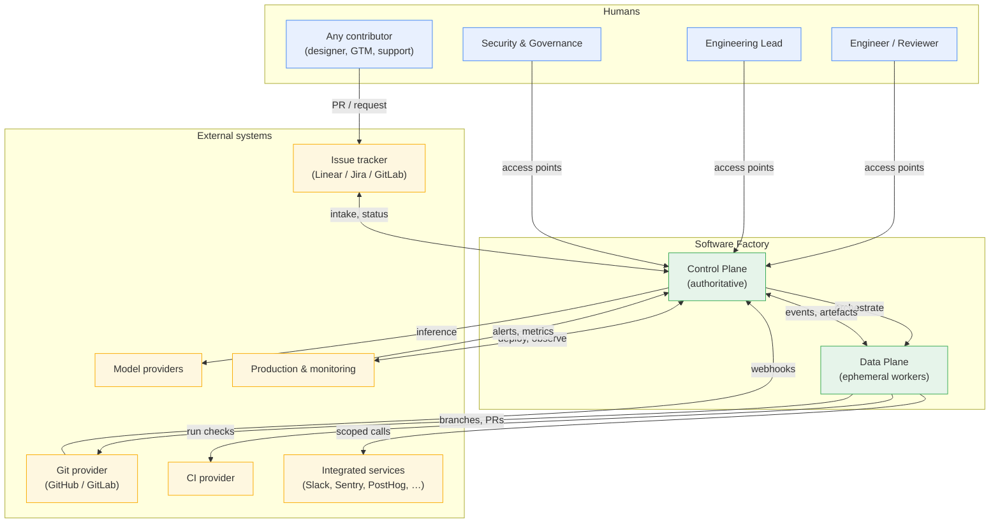
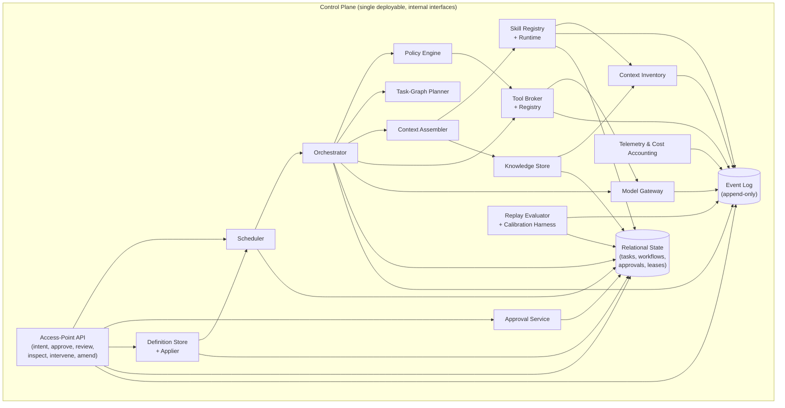
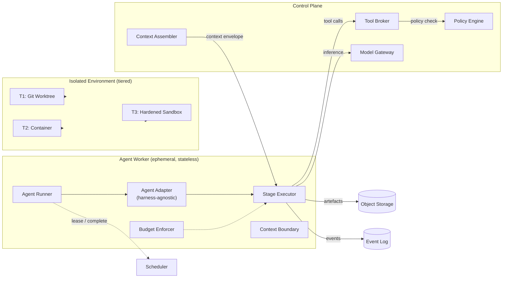
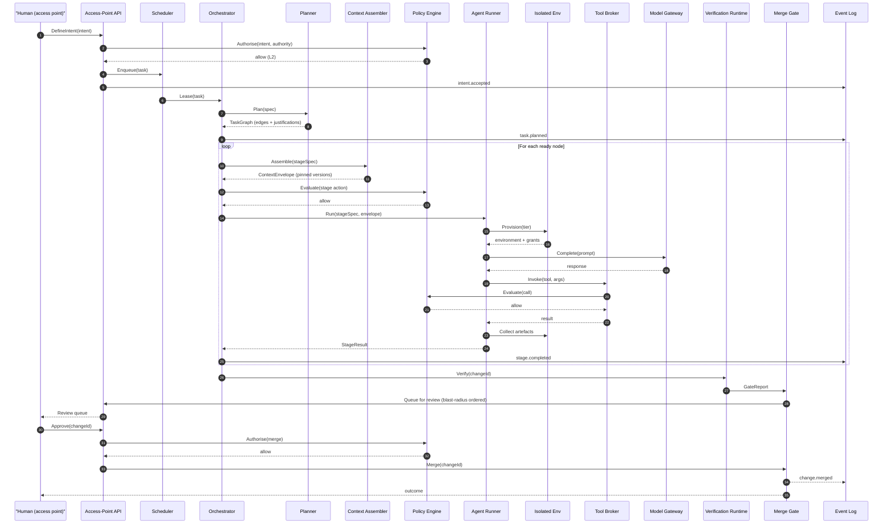
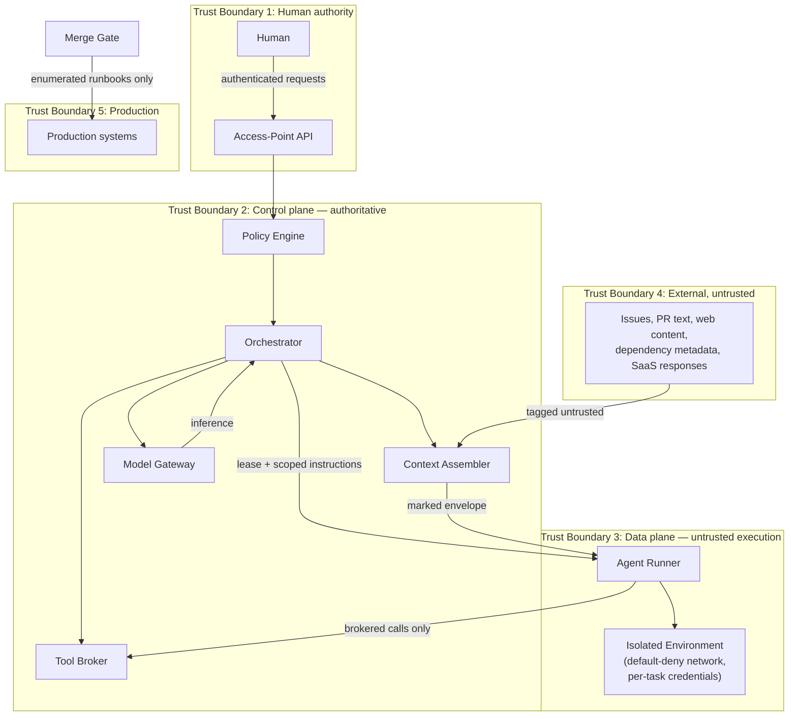

# 07 — Reference Architecture

**Purpose:** the target architecture for the Software Factory: layered structure, component responsibilities, and the twelve properties required for each major component.

**Source of truth for:** component boundaries, component responsibilities, data ownership, and interfaces.
**Derived from:** `06_REQUIREMENTS_AND_NFRS.md`, `04_CROSS_SOURCE_SYNTHESIS.md`, and the ADR set.
**Status:** reference architecture. Nothing here is implemented; this is the design a build agent realises.

---

## 1. Architectural style

| Property | Choice | Basis |
|---|---|---|
| Style | Layered planes with a single authoritative control plane; a declarative definition reconciled by an applier | ADR-0002, ADR-0001 |
| State | Authoritative state in one relational store; append-only event log; artefacts in object storage | ADR-0008 |
| Communication | Synchronous request/response and lease-based work claiming; no broker in the core path | ADR-0008 |
| Execution | Stateless workers in tiered isolated environments; context passed in, artefacts passed out | ADR-0006, ADR-0010 |
| Configuration | Declarative, version-controlled, reviewed | ADR-0001 |
| Governance | Deterministic policy separated from probabilistic orchestration | ADR-0004 |
| Deployment | Modular monolith for the control plane in the initial phase, behind interfaces that permit later extraction | ADR-0012, directive §17 |

**The modular-monolith choice is deliberate.** The control plane's components (definition store, event log, scheduler, policy engine, orchestrator, context assembler, tool broker, model gateway) begin as one deployable with internal interfaces. They are separated at the *interface* level from day one, so that any of them can later be extracted without changing the factory definition, workflows, or agent contracts (NFR-01). Premature distribution is explicitly rejected by the directive.

---

## 2. System context

**Note the Any-contributor path.** A non-engineering contributor does not enter through the access points; they submit through ordinary channels (a PR, a request). The factory treats it as untrusted external input and subjects it to the same gates. This is V15's *fungibility* (D-61) expressed without granting non-engineers governance authority.

---

## 3. Layer map

The blueprint's ten required layers map onto five physical tiers. The mapping matters because it shows which layers share a deployment, and therefore which share a failure domain.

| Blueprint layer (directive §6) | Physical tier | Primary components | ADRs |
|---|---|---|---|
| 6.1 Human Control Plane | Control | Access-point API, approval service, operational surface, change-request interface | ADR-0002, ADR-0003 |
| 6.2 Factory Orchestration Layer | Control | Definition store + applier, scheduler, policy engine, orchestrator, task-graph planner | ADR-0001, ADR-0002, ADR-0010 |
| 6.5 Tool & MCP Integration Layer | Control | Tool registry, tool broker, MCP adapters, model gateway, policy hooks | ADR-0004, ADR-0012 |
| 6.6 Context, Knowledge & Memory | Control | Context assembler, skill registry, context inventory, knowledge store, artefact store | ADR-0009 |
| 6.7 Engineering Execution Environment | Data | Isolation manager, worktree manager, container/sandbox provisioner, artefact collector | ADR-0006 |
| 6.3 Agent Runtime & Organization | Data | Agent runner, context-boundary executor, turn/wall-clock budget enforcer, agent registry | ADR-0010 |
| 6.8 Quality Engineering Layer | Data + CI | Verifier runtime, test-authorship policy enforcer, CI gate integration, calibration harness | ADR-0005 |
| 6.9 Delivery & Operations Layer | Data + external | Merge gate, deployment controller, rollback controller, release promotion | ADR-0003 |
| 6.10 Continuous Improvement & Meta-Factory | Control | Run-artefact store, log analyser, improvement proposer, replay evaluator, change-request builder | ADR-0007, ADR-0011 |
| 6.4 Skills & Capability Layer | Cross-cutting | Skill registry, skill runtime, skill authoring interface, marketplace synchroniser | ADR-0009 |

**The cross-cutting nature of the Skills layer is important.** Skills are consumed by the data plane (agents execute them), by the control plane (the context assembler resolves them), and by the improvement loops (they are what the loops improve). They are therefore a shared artefact store with an access policy, not a component owned by one tier.

---

## 4. Control plane

### 4.1 Component specification — the twelve properties

The directive requires twelve properties for every major component. The format is uniform: purpose, responsibilities, inputs, outputs, interfaces, dependencies, data ownership, security boundaries, failure modes, observability, scaling, extension mechanisms.

---

#### 4.1.1 Definition Store and Applier

| Property | Specification |
|---|---|
| **Purpose** | Hold the authoritative declarative description of the factory, and converge actual runtime state onto it. |
| **Responsibilities** | (1) Store and version the factory definition. (2) Validate definitions against the schema and policy. (3) Reconcile: compare declared to actual and take steps to converge. (4) Report drift without silently correcting it. (5) Serve the resolved, effective configuration to every other component. (6) Own the change-application audit trail. |
| **Inputs** | Merged definition changes; runtime state snapshots from the scheduler and agent registry. |
| **Outputs** | Effective configuration; reconciler actions; drift reports; configuration-change events. |
| **Interfaces** | `GET /definition` (effective config), `GET /definition/revision`, `POST /definition/validate`, `POST /definition/apply` (internal, applier-only), `GET /definition/drift`. |
| **Dependencies** | Definition repository; relational state; event log; policy engine. |
| **Data ownership** | **Owns** the definition repository and the derived effective configuration. **Does not own** the definition *history* (git owns that) — it owns the record of which revision is applied and when. |
| **Security boundaries** | The definition is privilege-bearing (ADR-0004). Only the applier may write effective configuration. No agent path reaches the applier's write interface. Definition changes reach it only through the reviewed-change path. |
| **Failure modes** | (a) Invalid definition applied → rejected by validation before apply. (b) Reconciliation loop (declared and actual oscillate) → bounded retry with escalation after N attempts. (c) Drift never corrected → surfaced as a persistent drift alert. (d) Definition repository unavailable → factory continues with the last applied revision and raises an alert; no partial apply. |
| **Observability** | Applied revision, drift count by resource type, reconciliation actions per hour, definition-change events, validation failures. |
| **Scaling** | Definition size is small and bounded; applies are rare. Reads are served from an in-memory effective configuration with version stamps, refreshed on change. No scale concern at the stated scale; a change-event stream would be the first scaling move. |
| **Extension mechanisms** | Additional definition sections are added by schema extension with a versioned migration. New resource kinds are registered as reconcilers implementing a `ResourceKind` interface. |

---

#### 4.1.2 Scheduler and Work Queue

| Property | Specification |
|---|---|
| **Purpose** | Decide what should run, when, and with what concurrency; lease work to workers. |
| **Responsibilities** | (1) Maintain the ready queue and the dependency-aware release logic. (2) Lease work with visibility timeouts. (3) Enforce per-capability and per-repository concurrency limits. (4) Apply backoff and retry policy, including escalation to a human on exhaustion. (5) Release dependent work when its prerequisites complete. |
| **Inputs** | Task graphs from the planner; completion events from workers; policy (concurrency caps, retry budgets); timers. |
| **Outputs** | Work leases; retry and escalation decisions; queue-depth and latency signals. |
| **Interfaces** | Internal: `Lease(capability, repo)`, `Complete(taskId, outcome)`, `Fail(taskId, classification)`, `Release(dependentIds)`. External (read): `GET /queue`, `GET /tasks/{id}`. |
| **Dependencies** | Relational state; policy engine; event log; notification service. |
| **Data ownership** | Owns queue state, leases, and retry counters. |
| **Security boundaries** | The scheduler may only lease work whose workflow holds the required capability grant. Leases are scoped, so a worker cannot pick up work outside its grant. |
| **Failure modes** | (a) Lease expiry causes duplicate execution → handlers are idempotent, keyed by task id; a duplicate is detected and recorded. (b) Queue starvation → priority inversion is detected and reported. (c) Scheduler restart mid-lease → leases expire and work is re-leased. (d) Dependency deadlock → cycle detection at graph admission; a stalled task is escalated. |
| **Observability** | Queue depth by workflow and capability, lease age, retry counts by classification, time-to-first-lease, time-to-completion, escalation rate. |
| **Scaling** | The relational-backed queue is adequate to the initial scale. Deferral trigger for a broker is defined in ADR-0012. |
| **Extension mechanisms** | New scheduling policies (priority functions, batching) implement a `SchedulingPolicy` interface. New capabilities are declared in the definition. |

---

#### 4.1.3 Policy Engine

| Property | Specification |
|---|---|
| **Purpose** | Hold deterministic authority over what the factory may do, independent of any agent's judgement. |
| **Responsibilities** | (1) Evaluate every consequential action against policy. (2) Decide allow / deny / escalate. (3) Own the capability model and the trust-boundary tagging rules. (4) Emit the policy decision alongside every action for audit. (5) Never consult an LLM. |
| **Inputs** | Action requests (capability, resource, workflow, task, actor, authority); the policy set; capability grants. |
| **Outputs** | Allow / deny / escalate decisions with the rule that produced them; policy decision events. |
| **Interfaces** | `Evaluate(request) -> Decision`, `EvaluateCapability(request)`, `RegisterPolicyBundle(version)`. |
| **Dependencies** | Policy bundle (versioned in the definition repository); capability registry; event log. |
| **Data ownership** | Owns the policy bundle's runtime representation and its version. The authoritative copy is the definition repository. |
| **Security boundaries** | **This is the security boundary.** The engine is the only component permitted to authorise a consequential action. No agent-supplied input can alter a policy rule, and no agent may request a policy evaluation with an elevated authority claim. |
| **Failure modes** | (a) Engine unavailable → all consequential actions denied (fail-closed). (b) Policy bundle invalid → the previous known-good bundle remains active and an alert fires. (c) Undeterminable case → escalate, never allow by default. (d) Policy too permissive → caught by the red-team suite; policy changes are reviewed. |
| **Observability** | Decision counts by outcome and rule, escalation rate by workflow, denial reasons, policy evaluation latency, policy bundle version in use. |
| **Scaling** | Evaluations are pure and fast. Per-task caching by (workflow, capability, resource) is valid for the task's duration. |
| **Extension mechanisms** | New rule types are added to the policy language with a schema version. New capabilities register their grant semantics. |

---

#### 4.1.4 Orchestrator

| Property | Specification |
|---|---|
| **Purpose** | Convert authorised intent into executed work, coordinating the planner, context assembler, tool broker, model gateway, and workers. |
| **Responsibilities** | (1) Own the lifecycle of a task from authorisation to terminal state. (2) Call the planner to obtain a task graph. (3) Request context for each stage from the context assembler. (4) Execute stages via the agent runner, respecting budget limits. (5) React to stage outcomes: continue, re-plan, retry, or escalate. (6) Never widen scope, escalate autonomy, or bypass policy. |
| **Inputs** | Authorised intent; task graph; resolved context; policy decisions; stage results. |
| **Outputs** | Stage invocations; re-plan decisions; task state transitions; escalation requests; artefacts. |
| **Interfaces** | `Start(intent) -> taskId`, `Advance(taskId, stageOutcome)`, `Abort(taskId, reason)`. |
| **Dependencies** | Scheduler; planner; context assembler; tool broker; model gateway; policy engine; agent runner; event log. |
| **Data ownership** | Owns in-flight task state; writes it transactionally to the relational store. |
| **Security boundaries** | The orchestrator is **probabilistic authority only**. It proposes; the policy engine disposes. Every action it takes is subject to a policy decision. It has no credential access of its own — all external effects go through the tool broker. |
| **Failure modes** | (a) Orchestrator mis-plans → the plan is a reviewable artefact and is checked against acceptance criteria before dispatch. (b) Orchestrator loops → turn and wall-clock budgets, plus a per-task step cap, bound it. (c) Model unavailable → the model gateway fails over per routing policy. (d) Context assembly fails → the task fails to a human rather than proceeding with incomplete context. (e) Partial completion → artefacts are preserved and labelled incomplete. |
| **Observability** | Tasks in flight by state and workflow, stage duration, re-plan count, budget consumption, failure classification (model vs workflow), escalation rate. |
| **Scaling** | The orchestrator is the control-plane hot path. It is stateless between stages, so horizontal scaling is straightforward; the shared-state contention is in the relational store. |
| **Extension mechanisms** | New stage types implement a `StageKind` interface. New planning strategies implement `PlannerStrategy`. The orchestrator itself is replaceable behind its three-method interface. |

---

#### 4.1.5 Task-Graph Planner

| Property | Specification |
|---|---|
| **Purpose** | Produce a reviewable, executable task graph with explicit topology decisions. |
| **Responsibilities** | (1) Decompose intent into work items with dependencies. (2) Classify each dependency edge independent or dependent. (3) Apply the chunkability criterion and record a justification for every fan-out decision. (4) Assign each work item a role specification, context scope, and tool scope. (5) Attach acceptance criteria and the oracle reference to each work item. |
| **Inputs** | The refined specification with acceptance criteria; repository context; the applicable workflow definition. |
| **Outputs** | A task graph artefact: nodes, edges, topology classification, chunkability justifications, per-item role and context assignment. |
| **Interfaces** | `Plan(spec) -> TaskGraph`, `Validate(TaskGraph) -> Issues`. |
| **Dependencies** | Model gateway; context assembler; policy engine (for admissibility); role catalogue. |
| **Data ownership** | Owns the task-graph artefact. The graph is immutable once accepted; changes produce a new graph version. |
| **Security boundaries** | The planner may only propose work items whose required capabilities are within the workflow's grant. The policy engine validates this before dispatch, and the plan is reviewable — a wrong plan is caught before N workers amplify it (ADR-0010). |
| **Failure modes** | (a) Over-decomposition → excess coordination; detected by chunkability validation and by the plan review. (b) Under-decomposition → non-independent items merged; detected by missing dependency edges, hard to detect fully — mitigated by the specification's acceptance criteria. (c) Cycle → rejected at admission. (d) Unspecifiable item → the planner emits an explicit "needs refinement" marker rather than guessing. |
| **Observability** | Plan size, fan-out ratio, chunkability rejection reasons, re-plan rate, plan-to-dispatch latency, items needing refinement. |
| **Scaling** | Planning is an LLM call per task graph; graphs are bounded in size. Very large graphs are decomposed hierarchically. |
| **Extension mechanisms** | New planning strategies implement `PlannerStrategy` and are selectable per workflow in the definition. |

---

#### 4.1.6 Context Assembler

| Property | Specification |
|---|---|
| **Purpose** | Produce the exact context an agent receives, deterministically, from the two-tier context model. |
| **Responsibilities** | (1) Resolve effective context from central policy, central context, and repository-local context under the ADR-0009 precedence rules. (2) Select the context items relevant to the stage (deferred context with trigger evaluation). (3) Assemble the prompt payload and the tool set offered for the stage. (4) Record the resolved context (identifiers and versions) for the run artefact. (5) Flag uncovered concerns as gaps. |
| **Inputs** | Task/stage specification; repository identity; central and local context corpora; trigger definitions; tool registry. |
| **Outputs** | A context envelope: text payload, offered tool set, context version manifest. |
| **Interfaces** | `Assemble(stageSpec) -> ContextEnvelope`, `Explain(stageSpec) -> ResolutionTrace`. |
| **Dependencies** | Skill registry; knowledge store; repository context store; tool registry; model gateway (for embedding-based retrieval if enabled). |
| **Data ownership** | Owns the resolution algorithm and the resolution trace. Does not own the context corpora themselves. |
| **Security boundaries** | Context is assembled **by a deterministic component**, not by the agent. Untrusted content is tagged and placed in a marked section that the agent may quote but not obey. Secrets are never included; credentials are brokered at invocation (SEC-03, SEC-04). |
| **Failure modes** | (a) Wrong context selected → the resolution trace makes it diagnosable; a curated context set is the first implementation. (b) Context too large → deferred context and trigger evaluation bound it; over-budget context is an error, not a silent truncation. (c) Stale context selected → the context inventory flags staleness; the assembler prefers the higher-precedence source. (d) Untrusted content leaking into the instruction section → assembly-time tagging is structural and testable. |
| **Observability** | Context size in tokens, items selected and rejected with reasons, trigger hit rate, gaps flagged, assembly latency. |
| **Scaling** | Assembly is on the hot path and must be fast. It is cacheable by (task, stage, context-revision). At larger scale, a retrieval index is introduced — but it remains a quality aid, never a correctness path. |
| **Extension mechanisms** | New context sources implement `ContextSource`. New trigger types extend the trigger evaluator. New selection strategies implement `ContextSelector` — including an embedding-based selector as a later phase. |

---

#### 4.1.7 Tool Broker and Registry

| Property | Specification |
|---|---|
| **Purpose** | Be the single path by which any capability is invoked, and the point at which policy, scope, credentials, and audit are applied. |
| **Responsibilities** | (1) Maintain the registry of capabilities with owner, schema, scope, health, version. (2) Enforce per-workflow and per-stage tool scope. (3) Invoke the policy engine for every consequential call. (4) Broker credentials at the invocation boundary. (5) Record the invocation in the event log with arguments and result summaries. (6) Health-check integrations and expose degraded states. |
| **Inputs** | Invocation requests (tool, arguments, workflow, task, stage); grants; policy decisions; health state. |
| **Outputs** | Tool results; invocation records; degraded-mode signals. |
| **Interfaces** | `Invoke(request) -> Result`, `Register(capability)`, `Health() -> Status[]`, `Admit(workflow, stage) -> ToolSet`. |
| **Dependencies** | Policy engine; credential broker; MCP adapters; native adapters; event log; observability. |
| **Data ownership** | Owns the registry and the invocation record. Does not own the credentials themselves — the credential broker does. |
| **Security boundaries** | **The single choke point for all external effects.** A tool not in the registry is not callable. Scope is enforced here rather than by prompt. Credentials are injected here and never enter an agent's context. MCP is one adapter among several (FR-62). |
| **Failure modes** | (a) Integration down → the capability is marked unavailable; dependent stages fail fast with a clear message, not a hang. (b) Policy unavailable → call denied (fail-closed). (c) Credential expired → the broker requests renewal via policy, or the call fails with a scoped error. (d) Argument validation failure → rejected before invocation. (e) Slow call → per-call timeout; the call is recorded as attempted. |
| **Observability** | Call count by tool and workflow, latency and error rate, denial count, degraded tools, cost per call, retries. |
| **Scaling** | The broker is a shared hot path. Horizontal scaling is straightforward because it is stateless; rate limiting is per-tool and per-provider. |
| **Extension mechanisms** | New capabilities implement a `ToolAdapter` interface. New transports (MCP, HTTP, CLI, library) implement the same adapter contract. |

---

#### 4.1.8 Model Gateway

| Property | Specification |
|---|---|
| **Purpose** | Be the single point of model access, making model choice and provider a configuration matter. |
| **Responsibilities** | (1) Abstract providers behind one interface. (2) Route per task difficulty and context scope. (3) Enforce per-task and per-workflow token and cost budgets. (4) Fail over between providers on error or budget exhaustion. (5) Account and report token consumption and cost. (6) Cache stable prefixes where safe. |
| **Inputs** | Inference requests with routing hints; routing policy; budget state; provider health. |
| **Outputs** | Model responses; token and cost records; routing decisions; provider health signals. |
| **Interfaces** | `Complete(request) -> Response`, `Route(request) -> Provider`, `Budget(taskId) -> Remaining`. |
| **Dependencies** | Provider adapters; routing policy; budget store; event log; observability. |
| **Data ownership** | Owns token and cost accounting; owns provider health state. |
| **Security boundaries** | Provider credentials live in the gateway and are never exposed to the data plane. Prompts pass through the gateway and are logged according to the retention policy. |
| **Failure modes** | (a) Provider outage → failover to the next provider in the routing policy. (b) All providers unavailable → the task fails with a classified failure; it does not hang. (c) Budget exceeded → the request is refused and the task is halted with a recorded reason. (d) Degraded quality from a provider change → detected by the evaluation suite, since the gateway's model choice is a configuration change that the replay evaluator can test. |
| **Observability** | Requests by model and provider, token consumption, cost, latency, failure and failover counts, budget consumption rate, quality scores from the evaluation suite. |
| **Scaling** | The gateway is a shared hot path with provider rate limits as the real ceiling. Per-provider concurrency caps and queueing are the control. |
| **Extension mechanisms** | New providers implement a `ProviderAdapter`. New routing strategies implement a `RoutingStrategy`. |

---

#### 4.1.9 Skill Registry and Runtime

| Property | Specification |
|---|---|
| **Purpose** | Hold the versioned corpus of skills — workflows to complete and standards to adhere to — and make them executable, composable, and promotable. |
| **Responsibilities** | (1) Store, version, and review skills. (2) Resolve a skill to its effective version for a context scope. (3) Execute a skill's workflow steps. (4) Track skill usage, outcomes, and quality. (5) Support promotion and demotion between local and central tiers (ADR-0009). (6) Support marketplace distribution where the organisation uses one. |
| **Inputs** | Skill definitions; skill invocations; promotion and demotion requests; usage telemetry. |
| **Outputs** | Resolved skills; skill execution results; usage and quality telemetry; promotion proposals. |
| **Interfaces** | `Resolve(scope) -> SkillVersion`, `Invoke(skillId, inputs) -> Result`, `ProposePromotion(skillId)`, `Usage(skillId) -> Metrics`. |
| **Dependencies** | Definition repository; context assembler; workflow runner; event log; context inventory. |
| **Data ownership** | Owns the skill registry's runtime index and usage telemetry. The authoritative skill content lives in the definition repository. |
| **Security boundaries** | Skills are privilege-bearing (ADR-0004, FR-16). A skill that changes what an agent may do requires security-relevant review. Skill-supplied tool declarations are subject to the same scope and policy checks as any other capability. |
| **Failure modes** | (a) Skill stale relative to the code → the context inventory flags it. (b) Skill in conflict with local context → the precedence rules resolve it deterministically, and central security policy wins. (c) Skill invocation fails → the workflow step fails with classification; the skill is not silently skipped. (d) Skill version drift between repos → promoted copies are linked to a single source. |
| **Observability** | Skill invocation count, success rate, outcome distribution, age and staleness, duplicate count, promotion/demotion counts. |
| **Scaling** | Skills are read frequently and written rarely. The resolved index is cached with version stamps; invalidation is by change event. |
| **Extension mechanisms** | New skill kinds implement `SkillKind`. New step types extend the workflow runner's step vocabulary. Skill bundles package skills with hooks and tool declarations. |

---

#### 4.1.10 Knowledge Store

| Property | Specification |
|---|---|
| **Purpose** | Hold the organisation's engineering knowledge — decisions, rationale, and outcomes — distinctly from skills and context. |
| **Responsibilities** | (1) Record decisions with rationale and links to implementing changes. (2) Provide retrieval for planning and for agent context. (3) Record and surface recurring failure patterns. (4) Retain history; supersede rather than overwrite. |
| **Inputs** | Decision records; change outcomes; failure classifications; agent requests for knowledge. |
| **Outputs** | Knowledge entries; retrieval results; failure-pattern reports. |
| **Interfaces** | `Record(entry)`, `Query(topic) -> Results`, `Link(changeId, knowledgeId)`. |
| **Dependencies** | Event log; change records; retrieval index (optional). |
| **Data ownership** | Owns the knowledge records. Distinct from skills (how to do things) and context (what is true about the code). |
| **Security boundaries** | Knowledge may contain sensitive material; access is scoped by the workflow's grant. Knowledge is not a source of authority — it informs, and the policy engine decides. |
| **Failure modes** | (a) Knowledge becomes stale → superseded entries are marked and excluded by default. (b) Knowledge retrieval returns irrelevant material → retrieval precision is measured and reported. (c) Knowledge grows unbounded → retention and curation policies apply. |
| **Observability** | Entries created, retrieval hit rate, superseded ratio, failure patterns identified, retrieval latency. |
| **Scaling** | The initial implementation is a relational table with full-text search. An embedding index is an optional later aid. |
| **Extension mechanisms** | New entry types extend the schema; new retrieval strategies implement `RetrievalStrategy`. |

---

#### 4.1.11 Context Inventory

| Property | Specification |
|---|---|
| **Purpose** | Continuously detect outdated, duplicate, and stale context across the estate, and propose remediation. |
| **Responsibilities** | (1) Scan all repositories for context artefacts. (2) Classify findings: outdated, duplicate, stale, conflicting. (3) Detect drift between a skill and the code it describes. (4) Propose promotion, demotion, update, or consolidation. (5) Track finding counts over time. |
| **Inputs** | Repositories and their context artefacts; the skill registry; code-change history. |
| **Outputs** | Inventory reports; remediation proposals; tracked counts. |
| **Interfaces** | `Scan(scope) -> Report`, `ProposeRemediation(finding) -> ChangeRequest`. |
| **Dependencies** | Git provider; skill registry; code-change history; definition repository (for proposals). |
| **Data ownership** | Owns the inventory findings and their lifecycle. |
| **Security boundaries** | Read-only over repositories; remediation is proposed as a change request, never applied directly (ADR-0007). |
| **Failure modes** | (a) Scan misses a repository → coverage is reported as a metric. (b) False positive "duplicate" → the proposal is reviewed. (c) Drift detection is noisy → precision is measured; a low-precision detector is tuned rather than trusted. (d) Scan load on the git provider → scanning is scheduled and incremental. |
| **Observability** | Repositories scanned, findings by class, remediation proposals and their acceptance rate, count trend. |
| **Scaling** | Incremental scanning keyed by repository change history. Full scans are scheduled and off-peak. |
| **Extension mechanisms** | New detectors implement `ContextDetector`. New finding classes extend the classification schema. |

---

#### 4.1.12 Run-Artifact Store and Telemetry

| Property | Specification |
|---|---|
| **Purpose** | Preserve the complete record of every run and emit the telemetry the improvement loops and evaluations depend on. |
| **Responsibilities** | (1) Persist the run artefact per MEAS-01. (2) Emit framework-level telemetry (never agent-reported). (3) Attribute cost to the accepted change. (4) Support replay of a historical run. (5) Apply retention and redaction policy. |
| **Inputs** | Run events from every component; billing data; policy. |
| **Outputs** | Run artefacts; metric streams; cost attribution; replay inputs. |
| **Interfaces** | `Append(event)`, `GetRun(runId) -> Artefact`, `Replay(runId, config) -> Result`, `Cost(changeId) -> Amount`. |
| **Dependencies** | Event log; object storage (for bulky payloads); relational store (for indexes and aggregates). |
| **Data ownership** | Owns the run artefacts and the telemetry pipeline. |
| **Security boundaries** | Artefacts may contain sensitive material: secrets are redacted at capture; retention is policy-driven; access is scoped. Artefact content must never be treated as instruction when replayed into a context. |
| **Failure modes** | (a) Artefact write fails → the run is marked as artefact-incomplete and the task does not proceed to a merge gate that depends on it. (b) Volume growth → retention and partitioning. (c) Redaction misses a secret → periodic sampling audit plus secret-scanning of stored artefacts. (d) Replay diverges → divergence is recorded and surfaced, not suppressed. |
| **Observability** | Artefact completeness rate, write failures, ingestion lag, cost reconciliation delta, replay divergence rate, redaction audit results. |
| **Scaling** | Hot/cold partitioning by time; bulky payloads to object storage; metric aggregates materialised into a separate table for fast dashboards. |
| **Extension mechanisms** | New artefact fields are additive with a schema version. New metric types register a collector. New replay strategies implement `ReplayStrategy`. |

---

#### 4.1.13 Replay Evaluator and Calibration Harness

| Property | Specification |
|---|---|
| **Purpose** | Make any change to the factory falsifiable before it is promoted, and measure whether verifiers actually detect violations. |
| **Responsibilities** | (1) Replay historical runs against a candidate configuration, prompt, skill, or verifier. (2) Compare candidate to baseline on the metric set. (3) Maintain the benchmark of known violations per verifier property. (4) Measure a verifier's detection rate on that benchmark. (5) Report guardrail breaches. (6) Produce the evaluation report required by MEAS-03. |
| **Inputs** | Historical run artefacts; candidate change; the metric catalogue; violation benchmarks. |
| **Outputs** | Evaluation reports (baseline, delta, cost, guardrail); calibration reports; promotion recommendations. |
| **Interfaces** | `Evaluate(candidate) -> Report`, `Calibrate(verifierId) -> DetectionReport`, `Benchmark(property) -> Cases`. |
| **Dependencies** | Run-artifact store; model gateway; CI; metric definitions. |
| **Data ownership** | Owns the violation benchmarks and the calibration state. |
| **Security boundaries** | Evaluation runs in an isolated environment with the same isolation tier as the workflow being evaluated. Replayed content is untrusted and tagged as such. |
| **Failure modes** | (a) Replay is not faithful → divergence is recorded; a candidate with unexplained divergence is not promoted. (b) Benchmark is unrepresentative → benchmark coverage is measured and reviewed. (c) Evaluation is expensive → it runs on a sampled run set with stated sampling, and the sample is recorded. (d) Metric gaming → guardrail metrics are chosen to be hard to trade off, and the report shows all four elements together. |
| **Observability** | Evaluations run, detection rates per verifier, guardrail breaches, replay divergence, evaluation cost. |
| **Scaling** | Evaluation is the most expensive component; it is sampled and scheduled, not continuous. |
| **Extension mechanisms** | New evaluation strategies implement `EvaluationStrategy`. New benchmark generators implement `BenchmarkGenerator`. |

---

#### 4.1.14 Access-Point API and Approval Service

| Property | Specification |
|---|---|
| **Purpose** | Be the only sanctioned channel through which humans act on the factory, and provide the approval mechanism the governance model depends on. |
| **Responsibilities** | (1) Expose the enumerated access points. (2) Authenticate and authorise every request against the identity's role. (3) Run the approval queue with risk-ordered priority. (4) Bind an approval to the exact artefact approved, and verify execution matches it. (5) Detect and surface approval-fatigue indicators. (6) Record every request and decision. |
| **Inputs** | Human requests; task and change state; risk scores; policy. |
| **Outputs** | Authorised actions; approval decisions; escalation requests; audit records. |
| **Interfaces** | `DefineIntent`, `Approve(requestId)`, `Review(changeId)`, `Inspect(scope)`, `Intervene(taskId, action)`, `Amend(changeRequest)`. |
| **Dependencies** | Policy engine; relational state; event log; notification service; operational surface. |
| **Data ownership** | Owns access-point requests, approvals, and decisions. |
| **Security boundaries** | **The human-authority boundary.** Every request is authorised; the identity and its role determine what is possible. Approvals are bound to specific artefacts: approving a plan does not authorise a different plan, and approving a change does not authorise its deployment. |
| **Failure modes** | (a) Approval fatigue → risk-ordered queue plus fatigue metrics; if the rubber-stamp rate exceeds a threshold, the policy escalates affected workflows to a higher requirement. (b) Stale approval → approvals expire; execution after expiry is denied. (c) Execution diverges from the approved artefact → the divergence is detected and the action is halted or escalated. (d) Approver unavailable → the request routes to the next approver by policy, or waits with an alert. |
| **Observability** | Request volume, queue depth and age by risk tier, decision latency, rubber-stamp rate, escalations, approval-to-execution divergence. |
| **Scaling** | Human attention is the true ceiling. The design's job is to ration it, not to increase it. |
| **Extension mechanisms** | New access points implement `AccessPoint` with an explicit authority declaration. New approval channels implement `ApprovalChannel` (in-app, chat, CLI, email). |

---

## 5. Data plane

### 5.1 Component specification

#### 5.1.1 Agent Runner

| Property | Specification |
|---|---|
| **Purpose** | Execute a single stage in an isolated environment under a bounded budget, and return a typed result. |
| **Responsibilities** | (1) Provision the environment at the required isolation tier. (2) Apply the context envelope. (3) Run the agent through the harness adapter. (4) Enforce the turn and wall-clock budgets. (5) Collect and hash artefacts. (6) Emit the run events. (7) Destroy the environment. |
| **Inputs** | Stage specification; context envelope; granted tool set; isolation tier; budgets. |
| **Outputs** | Stage result (success, failure classification, artefacts, verification outcome); run events. |
| **Interfaces** | `Run(stageSpec) -> StageResult`. |
| **Dependencies** | Isolation manager; model gateway; tool broker; artefact collector; event log. |
| **Data ownership** | Owns the run's working state. Holds no authoritative state beyond the run. |
| **Security boundaries** | The runner never holds credentials; it holds only the *offered* tool set and reaches tools through the broker. The environment's isolation tier determines what the agent can reach. |
| **Failure modes** | (a) Environment provisioning fails → retry with backoff, then escalate. (b) Budget exceeded → stop, preserve partial artefacts, label incomplete. (c) Agent produces no result → classified failure. (d) Artefact upload fails → the run is artefact-incomplete and cannot pass a merge gate requiring artefacts. (e) Cleanup fails → leak detector raises an alert; resources are reclaimed by the reconciler. |
| **Observability** | Run duration, turn count, budget consumption, isolation tier, failure classification, artefact completeness, cleanup success, cost per run. |
| **Scaling** | The runner is horizontally scalable and stateless. Concurrency is bounded by the scheduler's capability limits and by environment-provisioning capacity. Warm pools reduce cold-start cost. |
| **Extension mechanisms** | New harnesses implement `HarnessAdapter`. New isolation tiers implement `IsolationProvider`. New stage kinds implement `StageKind`. |

#### 5.1.2 Isolation Manager

| Property | Specification |
|---|---|
| **Purpose** | Provide the correct execution environment for a task's risk profile, and reclaim it reliably. |
| **Responsibilities** | (1) Select the isolation tier from the workflow's declaration and the task's inputs. (2) Provision the environment (worktree, container, or sandbox). (3) Apply network policy and resource quotas. (4) Inject per-task credentials at the invocation boundary. (5) Destroy the environment and revoke credentials on terminal state, including failure. |
| **Inputs** | Isolation tier; repository; task identity; network allow-list; credential grants. |
| **Outputs** | A provisioned environment handle; a credential grant handle; cleanup confirmation. |
| **Interfaces** | `Provision(spec) -> Environment`, `Cleanup(envId)`, `Revoke(credId)`. |
| **Dependencies** | Git provider (worktrees); container/sandbox provider; credential broker; policy engine. |
| **Data ownership** | Owns the environment registry and lease records. |
| **Security boundaries** | This component *is* the containment boundary. Default-deny egress. No host mounts beyond the checkout. Per-task ephemeral credentials. |
| **Failure modes** | (a) Provisioning failure → retry, then escalate. (b) Cleanup failure → leak detector and reconciler reclaim. (c) Tier escalation needed mid-run → the run is aborted and restarted at the higher tier, not upgraded in place. (d) Credential leakage → revoked immediately; a security event is raised. |
| **Observability** | Provision time by tier, pool utilisation, active environments, cleanup latency, leak count, network-denial count. |
| **Scaling** | Warm image pools for T2; hibernation for T3. Autoscaling on queue depth. |
| **Extension mechanisms** | New tiers implement `IsolationProvider`; new backends are adapters behind it. |

#### 5.1.3 Context-Boundary Executor

| Property | Specification |
|---|---|
| **Purpose** | Execute one stage against a freshly assembled context, with no inheritance from any prior stage. |
| **Inputs** | Stage specification; context envelope; upstream artefacts (typed, for dependent stages only). |
| **Outputs** | Stage output; verification results; the artefacts produced. |
| **Interfaces** | Internal to the agent runner. |
| **Dependencies** | Context assembler (upstream); verification runtime. |
| **Data ownership** | Owns the stage's local working set. |
| **Security boundaries** | The executor enforces that the stage's context contains only what the envelope declares. A dependent stage receives the upstream *artefact*, never the upstream agent's transcript. |
| **Failure modes** | (a) Context envelope malformed → the stage fails before the agent runs. (b) Stage output malformed → a schema validation failure, not a downstream mystery. (c) Upstream artefact missing → the stage is not released. |
| **Observability** | Context size, schema validation failures, output schema failures. |
| **Scaling** | Stateless and cheap. |
| **Extension mechanisms** | New output schemas are declared in the definition; new stage kinds implement `StageKind`. |

#### 5.1.4 Verification Runtime

| Property | Specification |
|---|---|
| **Purpose** | Run the applicable quality gates and produce an unambiguous, trustworthy pass/fail outcome per layer. |
| **Responsibilities** | (1) Execute the acceptance oracle, contract/integration tests, static analysis, lint, type check, security scan, and standards verifiers as applicable. (2) Record per-layer outcomes with the layer's authorship classification. (3) Enforce the authorship policy. (4) Emit the machine-readable verdict the merge gate consumes. |
| **Inputs** | The change; the applicable gate set (derived from blast radius and workflow); the authorship marks. |
| **Outputs** | A gate report: per-layer results, authorship classification, the overall verdict, and the reason for any block. |
| **Interfaces** | `Verify(changeId) -> GateReport`. |
| **Dependencies** | CI provider; verifier runtime; policy engine (for gate-set selection). |
| **Data ownership** | Owns the gate report and the authorship marks. |
| **Security boundaries** | The gate report is the merge gate's sole input. It cannot be overridden by an agent; only by a reviewed policy change. |
| **Failure modes** | (a) Flaky test → the flake is detected, the run is retried within a bound, and the flake is recorded as a maintenance-loop input (FR-85). (b) Gate infrastructure down → the merge is blocked; it never passes by default. (c) Agent-authored test detected in a gating position → the gate blocks with a specific reason (FR-52). (d) Verifier false-negative → caught by the calibration harness; until corrected, the verifier cannot substitute for human review. |
| **Observability** | Pass rate per layer, block reasons, flake rate, gate duration, authorship-policy violations, calibration drift. |
| **Scaling** | Gates are the dominant CI cost. Parallelism per layer; selective execution by changed area; caching of static analysis. |
| **Extension mechanisms** | New gate types implement `Gate`. New verifier kinds implement `Verifier` (deterministic or judge). |

#### 5.1.5 Merge Gate and Deployment Controller

| Property | Specification |
|---|---|
| **Purpose** | Decide whether a change may merge, and carry out the deployment under the configured autonomy level. |
| **Responsibilities** | (1) Verify the gate report is complete and passing. (2) Verify the required approval exists and matches the artefact. (3) Evaluate blast-radius tiering and apply the corresponding rule. (4) Merge, or enqueue to the review queue. (5) Execute the deployment for approved releases under the L4 runbook constraints. (6) Support rollback. |
| **Inputs** | Gate report; approval record; blast-radius assessment; deployment runbook. |
| **Outputs** | Merge decision; deployment; rollback; or a review-queue entry. |
| **Interfaces** | `Evaluate(changeId) -> Decision`, `Deploy(releaseId) -> Outcome`, `Rollback(releaseId) -> Outcome`. |
| **Dependencies** | Verification runtime; approval service; policy engine; git provider; deployment platform. |
| **Data ownership** | Owns merge decisions and deployment state. |
| **Security boundaries** | The merge gate is the last point before code enters the protected branch. The deployment controller is the only component with production write capability, and only for enumerated runbooks. |
| **Failure modes** | (a) Merge without approval → refused. (b) Partial merge → transactional merge operation; a failed merge is atomic. (c) Deployment failure → automatic rollback per runbook; the incident workflow opens. (d) Guardrail breach after deploy → automatic rollback (FR-94). (e) Approval expired between approval and merge → re-approval required. |
| **Observability** | Merge decision distribution, time-to-merge, approval latency, deployment success and failure, rollback count and time, defect escape rate. |
| **Scaling** | Merge operations are human-review-limited; deployment operations are limited by the deployment platform. |
| **Extension mechanisms** | New merge rules implement `MergeRule`. New deployment targets implement `DeploymentTarget`. |

---

## 6. Cross-cutting data flow

---

## 7. Data ownership map

| Data | System of record | Owner | Retention | Notes |
|---|---|---|---|---|
| Factory definition | Definition repository (git) | Platform architecture | Indefinite | Reviewed history is the audit trail |
| Policy bundle | Definition repository | Security | Indefinite | Security-relevant review |
| Effective configuration | Control plane (derived) | Platform architecture | Regenerable | Version-stamped |
| Task and workflow state | Relational store | Control plane | 90 days hot, then archived | Transactional |
| Approvals | Relational store | Human Control Plane | 1 year | Audit-relevant |
| Event log | Relational store (partitioned) | Platform architecture | 13 months hot, then archive | Immutable |
| Run artefacts (metadata) | Relational store | Platform architecture | 13 months | Queryable |
| Run artefacts (bulky) | Object storage | Platform architecture | Per retention class | Versioned, immutable |
| Skill corpus | Definition repository + registry index | Domain owners | Indefinite | Promotion/demotion per ADR-0009 |
| Knowledge records | Knowledge store | Domain owners | Indefinite | Superseded, not deleted |
| Repository-local context | The repository | Repo owners | With the repo | Git history |
| Violation benchmarks | Benchmark store | Quality | Indefinite | Required for verifier gating |
| Secrets | Credential broker / secret manager | Security | Rotated | Never in the factory definition, never in a context |

---

## 8. Security boundary map

**Boundary rules:**

1. **Boundary 2 → 3.** The only instruction path is a lease carrying scoped instructions; the only effect path is a brokered tool call.
2. **Boundary 4 → 2.** Untrusted content enters only through the context assembler, tagged, and never in the instruction section.
3. **Boundary 3 → 5.** Never direct. Production is reachable only from the merge/deployment gate, for enumerated runbooks.
4. **Every boundary crossing is logged with the authority that authorised it.**

---

## 9. Technology profile

The initial implementation uses the profile fixed in ADR-0012. The mapping from blueprint layer to physical component is:

| Component | Technology (reference instance) | Interface boundary |
|---|---|---|
| Relational state + event log | PostgreSQL-compatible managed database | Schema + repository interfaces |
| Artefacts | S3-compatible object storage | Blob store interface |
| Job queue | Relational-backed queue with leases | Queue interface |
| Workflow execution | Own runner over declared definitions | `StageKind`, `PlannerStrategy` |
| Model access | Model gateway over provider adapters | `ProviderAdapter` |
| Tool access | Tool broker with MCP + native adapters | `ToolAdapter` |
| T1 isolation | Git worktree | `IsolationProvider` |
| T2 isolation | OCI container on managed container compute | `IsolationProvider` |
| T3 isolation | Hardened ephemeral sandbox | `IsolationProvider` |
| CI | Existing CI provider | Gate reports via CI status |
| Source control | Existing Git provider | Git/PR adapters |
| Vector retrieval | **Not adopted** (optional later aid) | `RetrievalStrategy` |
| Broker / Kubernetes | **Deferred** with measurable triggers | — |

---

## 10. Scaling model

The factory scales along four independent axes, and they must not be confused:

| Axis | Mechanism | Current bottleneck |
|---|---|---|
| **Concurrency** | Scheduler leases to a bounded worker pool; per-capability and per-repo caps | Environment provisioning throughput; provider rate limits |
| **Throughput per task** | Workflow decomposition into independent nodes | Human review capacity (the real constraint, per CP-7) |
| **Control-plane scale** | The orchestrator is stateless between stages; horizontal scale | Relational write contention |
| **Factory size** | More workflows, more agents, more skills | Human configuration and review of the definition |

**The stated design target is deliberately modest.** The architecture must be correct and complete at small scale before it is scaled, because the corpus's central finding (V01's "no one who has finished", V02's abandoned dark factory) is that scale attempted before correctness is the failure mode.

---

## 11. Architectural invariants

These are properties the implementation must preserve. They are the design's contract with itself, and each maps to a validation test.

| # | Invariant | Validated by |
|---|---|---|
| I-1 | The data plane cannot mutate control-plane state except through an authorised command. | Interface test |
| I-2 | No agent can widen its own scope, autonomy level, or credential set. | Policy test + red-team suite |
| I-3 | Every consequential action is attributable to an authority and is in the event log. | Audit reconstruction test |
| I-4 | No merge occurs without a passing acceptance oracle and the applicable approval. | Merge-gate negative test |
| I-5 | No factory change takes effect without a reviewed, evaluated, reversible change. | Change-management audit |
| I-6 | Untrusted content cannot become instruction. | Red-team injection suite |
| I-7 | No production write occurs outside an enumerated runbook. | Deployment-gate test |
| I-8 | Every run's context is pinned and recoverable. | Replay test |
| I-9 | No dependency on a single model provider for correctness or governance. | Provider-failover test |
| I-10 | No agent-authored test can alone satisfy an acceptance criterion. | Authorship-policy test |
| I-11 | Surplus capacity is allocated by policy, not by default. | Capacity-policy test |
| I-12 | Every architectural component is replaceable without changing the definition, workflows, or agent contracts. | Replaceability suite |

---

## 12. Known limitations of this architecture

Stated plainly, because the directive requires the blueprint to expose its own weaknesses.

1. **The control plane is a single logical authority.** It is a single point of failure and a high-value target. Mitigated by managed-service durability, replay-based recovery, and stateless data-plane workers, but not eliminated.
2. **Human review remains the dominant constraint.** The architecture rations review; it does not remove it. The throughput figures in the corpus that imply otherwise are not adopted.
3. **Verifier calibration is expensive and ongoing.** The safety of autonomy above L2 rests on a benchmark that must be maintained as the code changes. If it drifts, the safety property degrades silently. Mitigation: calibration is re-run on a schedule and on skill changes, and the calibration report is a promotion precondition.
4. **Context correctness is not formally verifiable.** The assembler is deterministic given its inputs, but the *selection* of relevant context is a judgement call, and a bad selection is diagnosable only after the fact. This is why the acceptance oracle is agent-independent and why human review remains the floor.
5. **Blast-radius estimation is approximate.** It is a heuristic over dependency and change-history signals. It drives review depth and approval, so its errors cost review effort rather than safety directly — but a systematically under-estimating estimator would erode the governance model.
6. **Multi-tenancy is not designed.** See `18_OPEN_QUESTIONS_AND_RISKS.md`.
7. **The corpus's own evidence is weak on the dimensions that matter most.** Twelve of the fifteen sources report no metrics; the few that do are self-reported. The blueprint's response is to measure everything itself (ADR-0011) rather than to trust the corpus.

---

## 13. Related documents

- `06_REQUIREMENTS_AND_NFRS.md` — the requirements this architecture satisfies
- `08_AGENT_CATALOG_AND_CONTRACTS.md` — role specifications and contracts
- `09_ORCHESTRATION_STATE_AND_EVENTS.md` — state model, event schema, transitions
- `10_CONTEXT_SKILLS_PROMPTS_AND_MEMORY.md` — context model, skill specification
- `11_TOOLS_MCP_AND_INTEGRATIONS.md` — registry, broker, MCP, model gateway
- `12_END_TO_END_WORKFLOWS.md` — the seven end-to-end workflows
- `13_SECURITY_GOVERNANCE_AND_HUMAN_CONTROL.md` — threat model, permissions, approvals
- `14_QUALITY_TESTING_AND_EVALUATION.md` — gates, calibration, metrics
- `15_OBSERVABILITY_COST_AND_FEEDBACK.md` — telemetry, cost accounting, feedback loops
- `architecture-decisions/` — the decisions this architecture embodies
