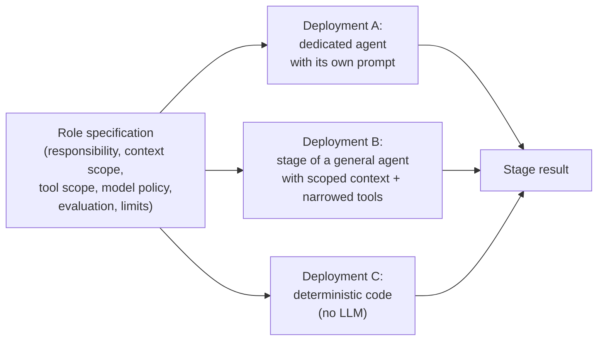
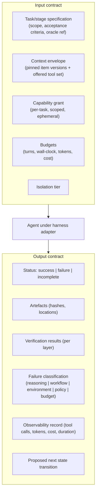
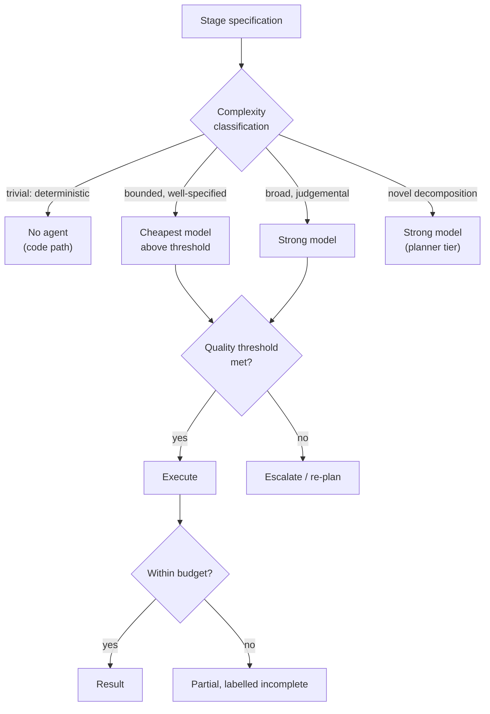

# 08 — Agent Catalog and Contracts

**Purpose:** the role specifications the factory recognises, the contract each role must satisfy, and — importantly — which candidate roles the blueprint deliberately excludes and why.

**Source of truth for:** role definitions, contracts, and the agent-selection rules.
**Derived from:** `06_REQUIREMENTS_AND_NFRS.md` (FR-30…FR-35), ADR-0010, V04 (runner/reporter/panel), V13 (role roster), V12 (tiering, chunkability).

**Critical framing.** In this blueprint, a **role** is a *specification* — a responsibility, a context scope, a tool scope, a model policy, an evaluation, and a set of limits. A role is *not* necessarily a deployment. The same role may be realised as a dedicated agent or as a stage executed by a general-purpose agent with a narrowed context and tool set. The catalogue below specifies roles; it does not mandate a fleet.

---

## 1. The role-versus-deployment distinction



**Merge rule (FR-31).** Two role specifications are merged into one implementation when they are identical in context scope, tool scope, authority, and evaluation. Duplication is a defect, not a configuration choice.

**Escalation rule.** A role is split into two only when the two halves differ in at least one of: tools required, authority held, context scope, or evaluation method. A role is never split because "agents should specialise" in the abstract.

**Determinism preference.** A role is realised as deterministic code wherever the output can be specified exactly. The LLM is used where the task involves unstructured interpretation or novel decomposition. This is a direct consequence of V01's oracle-first finding and of the requirement that verification be agent-independent.

---

## 2. The catalogue

Ten role specifications are adopted. Roles 1–3 are control-plane roles; roles 4–8 are data-plane roles; role 9 is an operational role that spans both; role 10 is the incident role, which is data-plane but holds an escalation path into the control plane.

---

### Role 1 — Triage Agent

| Attribute | Specification |
|---|---|
| **Purpose** | Classify and route incoming work to the right workflow before anything expensive happens. |
| **Responsibilities** | (1) Read the incoming request. (2) Classify its type, affected subsystem, and risk indicators. (3) Route it to a workflow, or reject it as out of scope with a reason. (4) Attach discovered context. |
| **Context scope** | The request; repository identifiers; the workflow catalogue; the routing policy. **Not** the full codebase, not other agents' history. |
| **Tool scope** | Read-only: repository metadata, issue tracker read, workflow catalogue read, context lookup. **No** write tools, no shell, no network beyond the internal services. |
| **Model policy** | Cheapest model meeting a routing classification accuracy threshold. Classification is a bounded, well-specified task. |
| **Evaluation** | Routing accuracy against a labelled set of historical requests; false-route rate; misroute severity. |
| **Limits** | Low turn budget; hard wall-clock cap; no sub-agent spawning. |
| **Failure mode** | Misrouting is cheap — it is caught at the next stage — so misrouting is tolerated more than a wrong implementation. But a misroute into a production-touching workflow is not tolerated; such workflows require an explicit classification confidence threshold and human confirmation. |
| **Source** | V13 (triage agent) |

---

### Role 2 — Refinement Agent

| Attribute | Specification |
|---|---|
| **Purpose** | Turn a vague request into a specification with explicit, checkable acceptance criteria — before any implementation begins. |
| **Responsibilities** | (1) Identify what is actually being asked and by whom. (2) Identify ambiguities, missing constraints, and implicit assumptions. (3) Produce a specification: scope, non-goals, acceptance criteria, verification approach, blast-radius estimate, and required capabilities. (4) Flag anything that cannot be specified and escalate it. |
| **Context scope** | The request; repository context; relevant standards; the affected subsystem's structure. Deliberately broader than any implementer, because it must find what the implementer would miss. |
| **Tool scope** | Read-only repository access; context lookup; capability catalogue read. **No** write, no execution. |
| **Model policy** | Strong model. This role's output determines everything downstream, so it receives the strongest model within a bounded budget. |
| **Evaluation** | Acceptance-criteria completeness; downstream defect-escape rate attributed to incomplete specs; human rating of specification usefulness; the rate at which a spec is returned for further refinement. |
| **Limits** | Moderate turn budget; no sub-agent spawning. |
| **Failure mode** | A confidently wrong spec is the most damaging failure in the factory, because it propagates. Mitigations: the spec is a reviewable artefact; acceptance criteria must be expressed as checkable conditions; the acceptance oracle is written independently of the implementing agent; a spec that cannot be expressed as checkable criteria is escalated rather than passed downstream. |
| **Source** | V13 (refinement agent); convergence with V01 (oracle first) and V15 (define what correct is) |

---

### Role 3 — Prioritiser Agent

| Attribute | Specification |
|---|---|
| **Purpose** | Order the work queue by value, effort, and risk. |
| **Responsibilities** | (1) Score candidate work items on value, effort, and risk. (2) Produce a ranked order. (3) Respect hard constraints: safety, regulatory deadlines, dependency ordering, and capacity limits. |
| **Context scope** | The candidate work items and their metadata; historical throughput and escape-rate data. |
| **Tool scope** | Read-only queue access; metric reads. **No** repository write, no execution. |
| **Model policy** | Cheap model, with deterministic scoring for hard constraints. The judgement component is a bounded ranking task. |
| **Evaluation** | Agreement with human ranking; whether the ordering improved throughput without increasing escape rate; queue-age distribution by tier. |
| **Limits** | Low turn budget. |
| **Failure mode** | A bad ordering wastes capacity but does not corrupt anything. It is the safest of the control-plane roles. |
| **Source** | V13 (prioritizer agent) |

---

### Role 4 — Planner

| Attribute | Specification |
|---|---|
| **Purpose** | Produce the executable task graph with explicit topology decisions. |
| **Responsibilities** | (1) Decompose the specification into work items with dependencies. (2) Classify each dependency edge independent or dependent. (3) Apply the four-condition chunkability criterion and record a justification for every fan-out decision. (4) Assign each item a role specification, context scope, and tool scope. (5) Attach acceptance criteria and oracle references. |
| **Context scope** | The refined specification; repository structure; the role catalogue; the capability catalogue. |
| **Tool scope** | Read-only repository access; context lookup. **No** execution. |
| **Model policy** | Strong model for decomposition; the topology classification may be partially deterministic (graph-theoretic properties such as cycle detection are computed, not judged). |
| **Evaluation** | Chunkability-justification validity (audited); re-plan rate; fraction of items needing refinement; downstream defect attribution to planning errors; wall-clock efficiency of the resulting graph. |
| **Limits** | Moderate turn budget; bounded graph size. |
| **Failure mode** | The correlated-failure risk ADR-0010 addresses: a wrong decomposition produces N consistently wrong implementations. Mitigations: the graph is a reviewable artefact; the plan is validated against the spec's acceptance criteria before dispatch; misclassification is detectable in the recorded justifications. |
| **Source** | V03, V12 (planning/decomposition), ADR-0010 |

---

### Role 5 — Worker / Implementer

| Attribute | Specification |
|---|---|
| **Purpose** | Execute one bounded work item and produce a change that satisfies its acceptance criteria. |
| **Responsibilities** | (1) Work only within its item's scope. (2) Produce the change in its isolated environment. (3) Run or request the applicable verification. (4) Produce or update the required artefacts. (5) Report its result, including an honest failure. |
| **Context scope** | Exactly its work item's specification, its inputs, and the upstream artefact if the edge is dependent. **Not** the sibling items' context, not the full history, not the task graph. |
| **Tool scope** | The tools its work item requires, and nothing more. A read-only item receives no write tools; a scoped file write is limited to the item's declared paths. |
| **Model policy** | The cheapest model that meets the task's accuracy threshold. Model selection is by difficulty and context scope, not by prestige (ADR-0010). |
| **Evaluation** | Acceptance-oracle pass rate; first-pass success rate; token and cost consumption; tool-call count; a defect attribution taxonomy separating reasoning failures from workflow failures (MEAS-08). |
| **Limits** | Turn budget (default 100, per V13) and wall-clock budget. Exhausting either returns control to a human with labelled partial artefacts. No sub-agent spawning by default — only where the planner's chunkability analysis has explicitly authorised it for a nested independent item. |
| **Failure mode** | The characteristic agent pathology: implementation-shaped output that satisfies checks without satisfying the specification. Mitigated by the acceptance oracle being agent-independent (ADR-0005), and by the mandatory human review floor (ADR-0003). |
| **Source** | V03, V12, V13 |

---

### Role 6 — Reviewer

| Attribute | Specification |
|---|---|
| **Purpose** | Judge whether an output meets its stated criteria, and report the judgement with evidence. |
| **Responsibilities** | (1) Apply the review criteria relevant to the change (the "lens"). (2) Distinguish verification by specification conformance from verification by observed behaviour. (3) Report findings with location and rationale. (4) State uncertainty honestly rather than asserting a clean result. |
| **Context scope** | The artefact under review; the specification and acceptance criteria; the standards that apply to the affected component. **Not** the implementer's reasoning transcript, unless the review mode explicitly calls for it — because inheriting the implementer's reasoning reproduces its blind spots. |
| **Tool scope** | Read-only access to the change and its context. Optionally the ability to run the applicable verifiers. **No** write tools. |
| **Model policy** | A model at or above the implementer's tier for the properties being judged. Weak models are acceptable only for narrowly mechanical properties, and only where the corresponding verifier has been calibrated. |
| **Evaluation** | Precision and recall against human-labelled findings; false-positive rate (noise); calibration of confidence against actual correctness; contribution to reduced human review load without increased escape rate. |
| **Limits** | Moderate turn budget; bounded scope. |
| **Failure mode** | The reviewer shares the implementer's model-family assumptions, producing correlated blind spots. Mitigation: a different model tier for the reviewer where feasible; a "lens" narrowed to specific properties; and the calibration requirement before any agent review substitutes for human review (ADR-0003). |
| **Source** | V04 (reporter), V13 (reviewer), V15 (lens, specificity) |

---

### Role 7 — Security Reviewer

| Attribute | Specification |
|---|---|
| **Purpose** | Assess a change specifically for security risk, independently of general review. |
| **Responsibilities** | (1) Identify the change's trust-boundary interactions. (2) Assess authorisation, authentication, input handling, secret handling, and dependency implications. (3) Check for privilege escalation, injection, and data exposure risks. (4) Rate the finding and state whether the change is acceptable at its blast radius. |
| **Context scope** | The change; the applicable security policy; the affected component's trust boundaries. |
| **Tool scope** | Read-only access; security scanning tools; dependency metadata. **No** write tools. No production access. |
| **Model policy** | Strong model. Security judgement is high-stakes and the volume is comparatively low. |
| **Evaluation** | Precision and recall against security findings on a labelled set; false-negative rate weighted heavily; contribution to preventing escape of a security defect to production. |
| **Limits** | Moderate turn budget. |
| **Failure mode** | A missed finding is severe. Mitigation: automated security scanning is a mandatory independent gate (FR-53) that does not rely on this role; the role covers what scanners cannot. |
| **Source** | V13 (separate security reviewer) |

---

### Role 8 — Panel / Decision Aggregator

| Attribute | Specification |
|---|---|
| **Purpose** | Aggregate multiple independent judgements into a single confidence-bearing recommendation. |
| **Responsibilities** | (1) Collect verdicts from reviewers and verifiers. (2) Apply the aggregation policy (weighted vote, disagreement rule, veto rule). (3) Produce a confidence value and a recommendation. (4) Escalate on disagreement rather than deciding unilaterally. |
| **Context scope** | The verdicts and their provenance; the aggregation policy; the blast-radius tier. **Not** the raw change — the panel judges judgements, not artefacts. |
| **Tool scope** | Read-only access to verdict records. **No** repository access, no execution. |
| **Model policy** | Deterministic where the policy is deterministic. The aggregation policy is code, not a model, so that it is auditable and consistent. |
| **Evaluation** | Confidence calibration (predicted confidence versus observed correctness) — the key metric; escalation rate; false-merge rate (merges recommended that should not have been). |
| **Limits** | No sub-agent spawning; no autonomous merge authority below L3. |
| **Failure mode** | Correlated failures across reviewers produce confident wrong agreement. Mitigation: reviewers are selected for independence (different model tiers and lenses where possible); the calibration harness measures the panel's confidence against observed outcomes. |
| **Source** | V04 (panel) |

---

### Role 9 — Maintenance and Sweep Agent

| Attribute | Specification |
|---|---|
| **Purpose** | Run recurring, repo-wide improvement work: conformance sweeps, dependency upgrades, flaky-test repair, coverage backfill, documentation refresh. |
| **Responsibilities** | (1) Execute the sweep defined by its skill. (2) Detect non-conformance across the estate. (3) Propose or create changes, per the skill's declared authority. (4) Report findings and outcomes. |
| **Context scope** | The sweep target and its applicable standards. Broad by nature — this is the one role whose context scope is deliberately wide. |
| **Tool scope** | Read across the target; write only where the skill authorises it. A read-only sweep (detection) receives no write tools. |
| **Model policy** | Cheap model. Sweep work is high-volume and highly patterned; the verifiers do the precise checking. |
| **Evaluation** | Findings per sweep; acceptance rate of proposed changes; defect escape from sweep findings; cost per accepted change from sweeps. |
| **Limits** | Bounded per-run scope; a sweep over a very large estate is chunked into independent items (fan-out permitted — this is the canonical chunkable case). |
| **Failure mode** | A wrong sweep produces a large volume of wrong changes. Mitigation: a sweep's output is always reviewed, and the acceptance oracle applies per item. Sweeps never merge autonomously below L3. |
| **Source** | V15 (sweep loops, maintenance loops), D-60 (capacity reallocation) |

---

### Role 10 — Incident Agent

| Attribute | Specification |
|---|---|
| **Purpose** | Investigate a production alert and produce a candidate fix, so that human effort is spent on judgement rather than diagnosis. |
| **Responsibilities** | (1) Receive the alert context. (2) Form a diagnosis. (3) Locate or construct a candidate fix as a reviewable change. (4) Verify it. (5) Attach the candidate fix and the reasoning to the alert. (6) Hand over to the human approver. |
| **Context scope** | The alert, the implicated service's context, the relevant runbooks, and the change history of the implicated component. |
| **Tool scope** | Read production telemetry; create branches and changes; run verification. **No** direct production write — production changes flow through the deployment gate (SEC-08). |
| **Model policy** | Strong model. Incident reasoning is high-variance and time-critical. |
| **Evaluation** | Diagnosis accuracy against incident ground truth; candidate-fix acceptance rate; time-to-candidate-fix; false-alarm rate. |
| **Limits** | Tight wall-clock budget (incidents are time-sensitive); turn budget. |
| **Failure mode** | A confident wrong diagnosis sends the human down the wrong path. Mitigation: the reasoning is attached and must be assessed alongside the diff; the change goes through the normal review and verification path. The agent proposes; the human disposes. |
| **Source** | V14 (11:49: the alert carries the PR the agent thinks will fix it) |

---

## 3. Roles considered and excluded

The directive requires that agents not be created merely to increase their number. The following candidate roles from the sources are **deliberately not adopted**, with reasons.

| Candidate role | Source | Why excluded |
|---|---|---|
| **Docs agent** (separate role) | V13 | Documentation update is a *stage* within the change workflow, not a separate agent. It has the same context as the change, the same tools, and the same evaluation — it is a stage, and by the merge rule it would be a duplicate implementation. It is realised as a workflow stage of the implementer role. |
| **Knowledge agent** (separate role) | V13 | Knowledge capture is a *deterministic workflow step* that records what the change already states (its decision rationale, its outcome). It requires no judgement beyond extraction that the change artefact already contains, so it is deterministic code, not an agent role. |
| **Manager agent** | V12 | The manager tier's decisions (decomposition, escalation, coordination) are already Role 4 (Planner) plus Role 3 (Prioritiser). A separate manager that also plans would duplicate the planner with a stronger model and no additional capability — the classic failure of the "agent hierarchy for its own sake" that V12 warns about. The **model tier** is preserved; the **role** is merged. |
| **Coordinator agent** | V12 | Coordination is a deterministic function of the task graph's dependency edges and the workers' completion events. Implementing it with an LLM adds cost and non-determinism to a process that is fully specifiable. It is code inside the orchestrator. The **model tier** is preserved for the re-planning path, which is genuinely judgemental. |
| **Tessl-style loop builder** | V15 | Automating the construction of new loops is a meta-factory capability. It belongs to the **meta-factory layer** (`10_CONTEXT_SKILLS_PROMPTS_AND_MEMORY.md`, §6), not to the data-plane agent catalogue, and its output is a *proposal* under ADR-0007, never an applied loop. |
| **Verifier agent** | V15 (judge variant) | A verifier is not an agent role; it is a **gate instrument** with a defined property to check. Where it uses an LLM as a judge, the judge is a parameter of the verifier, not a separately-evaluated role. |

---

## 4. The contract

Every agent execution, regardless of role, satisfies this contract.



### 4.1 Input contract

| Field | Required | Description |
|---|---|---|
| `stage.specification` | Yes | Scope, non-goals, acceptance criteria, oracle reference, required capabilities, blast-radius estimate. |
| `stage.context` | Yes | The assembled context envelope, with every context item's identifier and version. Untrusted content is present but marked. |
| `stage.tools` | Yes | The exact set of capabilities offered for this stage. The agent cannot invoke anything else. |
| `stage.grant` | Yes | The scoped, ephemeral capability grant, injected at invocation by the broker — never in the context. |
| `stage.budget` | Yes | Turn budget, wall-clock budget, token budget, cost budget. |
| `stage.isolation` | Yes | The isolation tier and the environment handle. |
| `stage.model_policy` | Yes | The routing hint and permitted models. The gateway makes the final selection. |
| `stage.attempts` | Yes | The attempt number and any prior failure classification. |
| `stage.upstream` | If dependent | The typed upstream artefact. **Not** the upstream transcript. |

### 4.2 Output contract

| Field | Required | Description |
|---|---|---|
| `result.status` | Yes | `success`, `failure`, or `incomplete`. "Incomplete" is used when a budget was exhausted with partial work preserved. |
| `result.artifacts` | On success | Artefact references with hashes. The artefact store is the system of record. |
| `result.verification` | Yes | Per-layer outcomes from the applicable gates. |
| `result.failure` | On failure | The classification from the taxonomy below, a machine-readable reason, and a human-readable summary. |
| `result.observability` | Yes | Tool-call trail, token counts, cost, duration, turn count. Emitted by the framework, not by the agent. |
| `result.next_state` | Yes | The proposed transition, which the orchestrator may accept or override. |
| `result.confidence` | Where meaningful | The agent's own confidence in its result, recorded separately from the panel's aggregate confidence. Calibration is measured over time. |

### 4.3 Failure classification taxonomy

The taxonomy is mandatory, because ADR-0011 and MEAS-08 require separating model-reasoning failures from workflow-composition failures (V02's finding). The classes:

| Class | Meaning | Default response |
|---|---|---|
| `model.reasoning` | The agent produced an incorrect or incomplete result given correct context and correct tools. | Retry with a different model or a different decomposition; escalate after budget exhaustion |
| `model.capability` | The task exceeded what the selected model can do (e.g. a very large refactor). | Re-plan with a different decomposition or a stronger model |
| `workflow.composition` | The workflow itself was wrong: wrong order, missing step, wrong retry semantics. | **Fix the workflow, not the agent.** Raise a workflow-scope improvement proposal |
| `context.insufficient` | The assembled context was missing what the task needed. | Fix the context sources or triggers; raise a skill-scope proposal |
| `verification.failure` | The change did not satisfy the acceptance criteria or another gate. | Iterate within the budget; raise a skill-scope proposal if repeated |
| `environment.failure` | Provisioning, tooling, or infrastructure failed. | Retry with backoff; escalate if persistent |
| `policy.denied` | The policy engine refused an action. | Not retried by the agent. Route to a human with the policy reason |
| `budget.exhausted` | A turn, wall-clock, token, or cost budget was reached. | Return partial artefacts labelled incomplete to a human |
| `tool.unavailable` | A required integration was down. | Degraded mode if the workflow permits; otherwise fail fast with a clear message |
| `unknown` | Unclassifiable. | Treated as `workflow.composition` for improvement purposes, because that is the class most likely to be silently misattributed |

**The `unknown` → `workflow.composition` default is a deliberate choice.** It reflects V02's observation that agent failures are frequently misattributed to the agent when the real cause is the pipeline. Defaulting the ambiguous class toward the pipeline makes the workflow-defect rate visible instead of hiding it inside the agent-failure rate.

---

## 5. Agent selection and model routing



### 5.1 Complexity classification

Classification is a cheap, deterministic-with-model-assist step using: the number of files affected, the estimated context size, the presence of schema or interface changes, the historical difficulty of comparable tasks, and the specificity of the acceptance criteria.

### 5.2 Routing rules

1. **Prefer determinism.** If a stage can be implemented as code, it is not an agent stage.
2. **Prefer the cheapest model that clears the threshold.** The threshold is set per workflow from its evaluation data, not globally.
3. **Prefer a stronger model for planning and review than for execution.** The plan determines everything downstream; the review is the safety net.
4. **Fallback is a configuration decision.** The routing policy declares the ordered list of fallback models and the trigger (error, budget exhaustion, or quality-signal failure).
5. **Provider diversity in the fallback list.** A fallback to the same provider under the same failure mode is not a fallback.

### 5.3 The context-budget rule

A model's effective capability depends on context quality, not context quantity. Therefore:

- The context envelope is **scoped**, never maximal.
- If the envelope exceeds the configured budget, the stage **fails with a context error** rather than silently truncating. Silent truncation produces confident wrong output — the exact failure the whole design is built to prevent.
- Deferred context and trigger-based selection (ADR-0009 context assembler) are the mechanisms that keep the envelope within budget as context grows.

---

## 6. Sub-agent spawning policy

**Default: agents do not spawn sub-agents.** Spawning is permitted only where all four conditions hold (ADR-0010):

1. The work is independently specifiable.
2. It is verifiable in isolation.
3. It does not require cross-cutting coordination with siblings.
4. It is cheaper to produce separately than inline.

Additionally, a spawning agent must:

- Hold the capability grants required by the sub-agent (a sub-agent cannot exceed its parent's authority — the grant is not inherited-and-amplified).
- Stay within a nesting depth limit (default: 1; deeper nesting requires a reviewed definition change).
- Respect a global concurrency limit across the whole tree, not per-parent.
- Produce artefacts that the parent must still integrate and verify — spawning does not transfer verification responsibility.

**Rationale.** V12's objection to unprincipled sub-agent orchestration is accepted. V10's concern that shared context between dependent stages is a liability is also accepted: a spawned sub-agent receives a *fresh, scoped context*, never the parent's.

---

## 7. Role-to-workflow mapping

The catalogue is not a fixed roster; roles are assembled into workflows. The canonical mappings:

| Workflow | Roles used | Notes |
|---|---|---|
| A — Idea to production | Triage → Refinement → Prioritiser → Planner → Worker(s) → Reviewer → Security Reviewer → Panel → Merge Gate → Deployment | The full chain. Triage may be skipped for a pre-refined request. |
| B — Issue to PR | Triage → Refinement → Planner → Worker(s) → Reviewer → Panel | No deployment. Ends at a PR. |
| C — Autonomous bug fix | Triage → Planner → Worker → Reviewer → Panel → (Incident Agent for production-originated bugs) | The acceptance oracle for a bug fix is the regression test. |
| D — Automated testing and self-healing CI | Maintenance/Sweep → Worker → Reviewer | Flaky-test repair follows the same path. |
| E — Production incident response | Incident Agent → Refinement → Worker → Reviewer → Security Reviewer (if applicable) → Approval → Deployment | The alert carries the candidate fix (V14). |
| F — Multi-repository engineering | Triage → Refinement → Planner (per-repo decomposition) → Worker(s) per repo → Panel → Merge Gate per repo → Integration | The planner's graph spans repositories with an explicit integration order. |
| G — Factory self-improvement | Log Analyser → Improvement Proposer → Replay Evaluator → Reviewer → Approval | Deterministically code where possible; never an autonomous apply (ADR-0007). |

---

## 8. Role specifications in the factory definition

Roles are data. The schema (illustrative, following `templates/AGENT_SPEC.md`):

```yaml
apiVersion: factory/v1
kind: RoleSpec
metadata:
  name: worker
  version: 3
  owner: engineering
  scope:
    kind: data-plane
  responsibility: >
    Execute one bounded work item against its specification and acceptance
    criteria, producing a change and its verification results.
  contextScope:
    include:
      - stage.specification
      - stage.upstream            # only for dependent stages
      - repo.local-context       # scoped by the assembler
      - standards.applicable     # narrowed by file pattern
    exclude:
      - sibling.stage.context
      - planner.fullGraph
      - agent.ownTranscripts
  toolScope:
    grant: [repo.write.scoped, tools.declared, ci.read]
    deny:  [prod.write, secrets.read, factory.definition.write]
  modelPolicy:
    strategy: cheapest-above-threshold
    thresholdRef: worker.qualityThreshold
    fallbacks: [providerA.secondary, providerB.tertiary]
  evaluation:
    primary: acceptanceOraclePass
    secondary: [firstPassSuccess, tokenCost, failureClassification]
  limits:
    turns: 100
    wallClockSeconds: 1800
    tokenBudget: 400000
    costBudgetUsd: 12.00
  autonomy:
    maxLevel: L2
  spawning:
    permitted: true
    maxDepth: 1
    requiresChunkabilityJustification: true
```

---

## 9. Known limitations

1. **The role set is a starting point, not a taxonomy.** The ten adopted roles are separated by responsibility, not by specialisation for its own sake. As the factory runs, the failure taxonomy (`08_...` §4.3) will show whether these boundaries hold or whether some roles should merge. The merge rule is FR-31: if two roles share context scope, tool scope, authority, and evaluation, they are one role.
2. **Role boundaries do not determine team boundaries.** A role is a specification. Whether the organisation staffs a role with one person, a team, or an ephemeral agent is an organisational decision that this blueprint does not make.
3. **The excluded roles are excluded provisionally.** Six roles from the corpus were not adopted. If the factory's telemetry shows a recurring task class that no adopted role covers, the correct response is to extend an existing role's scope, not to add a role — but that judgement requires evidence the blueprint cannot supply.
4. **`modelPolicy` names strategies, not models.** The gateway makes the final choice and the routing policy is configuration. A role specification cannot guarantee which model will run it, only which quality threshold the routing must meet.
5. **The failure taxonomy is untested against real runs.** Ten classes were derived from the corpus's failure descriptions and this blueprint's analysis. V02's finding suggests the distribution will concentrate in `workflow.composition`; whether the remaining nine classes are correctly separated is an empirical question, and the first hundred runs will test it.
6. **Independence is enforced structurally but cannot be proven semantically.** A reviewer using a different identity may still reproduce the implementer's framing. The structural separation raises the cost of correlated error; it does not eliminate it.

---

## 10. Related documents

- `07_REFERENCE_ARCHITECTURE.md` §4, §5 — where these roles execute
- `09_ORCHESTRATION_STATE_AND_EVENTS.md` — the state each role's output transitions
- `10_CONTEXT_SKILLS_PROMPTS_AND_MEMORY.md` — how the context envelope is assembled
- `11_TOOLS_MCP_AND_INTEGRATIONS.md` — the tool scope each role receives
- `12_END_TO_END_WORKFLOWS.md` — role sequences per workflow
- `14_QUALITY_TESTING_AND_EVALUATION.md` — how each role is evaluated
- `templates/AGENT_SPEC.md` — the authoring template
