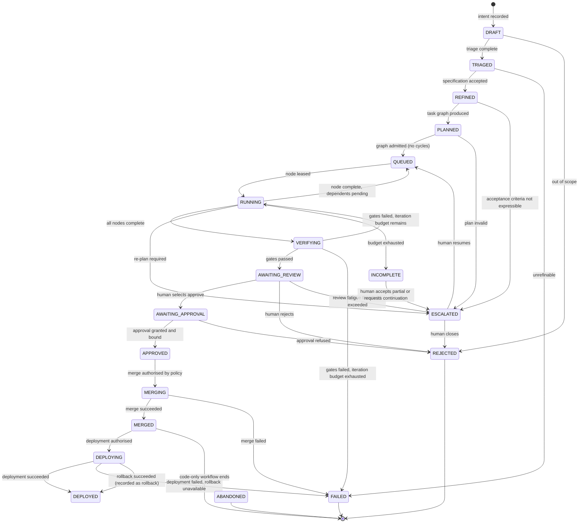
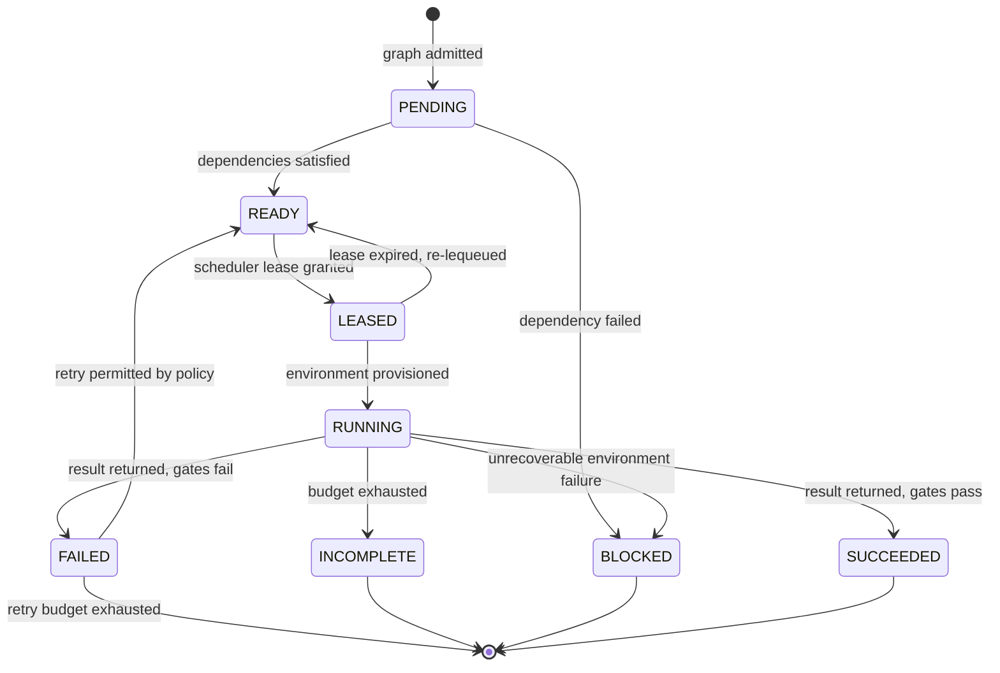
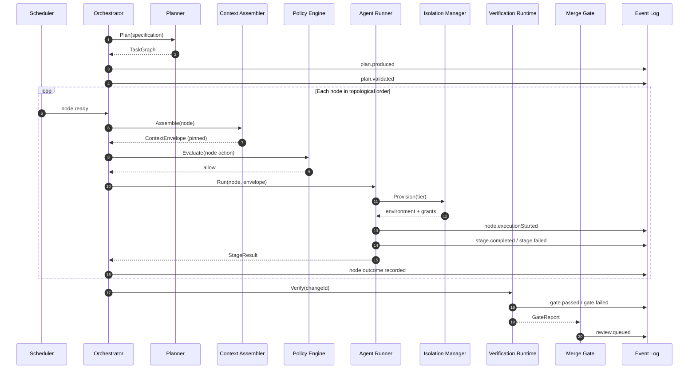
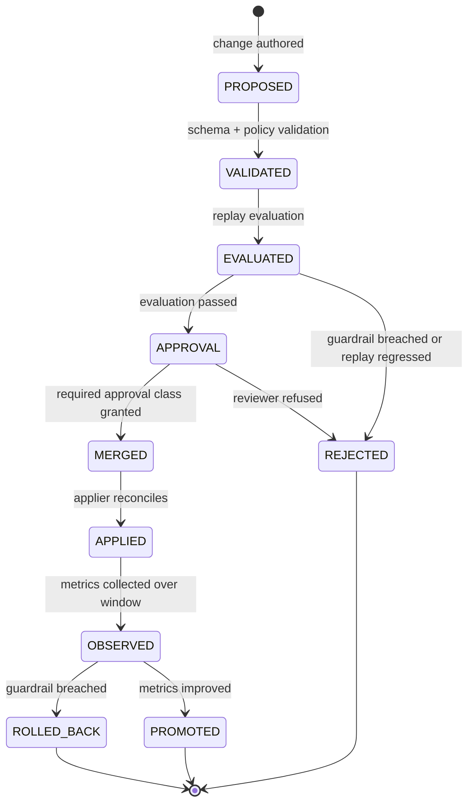

# 09 — Orchestration, State and Events

**Purpose:** the state model the factory maintains, the event schema it records, the transitions it permits, and the guarantees it provides.

**Source of truth for:** state machine definitions, event schemas, state ownership, and durability guarantees.
**Derived from:** ADR-0001, ADR-0002, ADR-0007, ADR-0008, ADR-0010, `06_REQUIREMENTS_AND_NFRS.md` (FR-20…FR-26).

---

## 1. State ownership

| State | System of record | Written by | Read by |
|---|---|---|---|
| Factory definition | Definition repository (git) | Merged changes only | Applier, all components (read-only, versioned) |
| Effective configuration | Control plane cache | Applier | All components |
| Task / workflow state | Relational store | Control plane only | Control plane, data plane (scoped), operational surface |
| Approvals | Relational store | Access-Point API | Merge gate, deployment controller, operational surface |
| Leases | Relational store | Scheduler | Workers, orchestrator |
| Event log | Relational store (append-only) | Every component | Evaluation, audit, operational surface, improvement loops |
| Run artefacts | Object storage + relational index | Runtime, verifier | Replay evaluator, operational surface, humans |
| Capability grants | Relational store | Credential broker | Tool broker, isolation manager |
| Policy decisions | Event log (with index) | Policy engine | Audit, metrics |
| Skill corpus | Definition repository + registry index | Merged changes | Context assembler, workflow runner |
| Knowledge records | Knowledge store | Knowledge workflow step | Context assembler, planner |
| Violation benchmarks | Benchmark store | Calibration harness | Verification runtime, replay evaluator |

**Rule.** The data plane never writes task state, approval state, lease state, or definition state. It reports outcomes; the control plane writes state. This is invariant I-1.

---

## 2. Task state machine

### 2.1 States

| State | Meaning | Terminal? |
|---|---|---|
| `DRAFT` | Intent recorded, not yet authorised or planned. | No |
| `TRIAGED` | Classified and routed to a workflow. | No |
| `REFINED` | Specification with acceptance criteria exists. | No |
| `PLANNED` | Task graph exists, with topology classifications and justifications. | No |
| `QUEUED` | Ready nodes are released for execution. | No |
| `RUNNING` | At least one node is executing. | No |
| `VERIFYING` | All nodes complete; gates are running. | No |
| `AWAITING_REVIEW` | In the review queue, ordered by blast radius. | No |
| `AWAITING_APPROVAL` | A specific approval is outstanding. | No |
| `APPROVED` | All required approvals are satisfied and bound to the artefact. | No |
| `MERGING` | Merge in progress. | No |
| `MERGED` | Change is on the protected branch. | Yes (for the code path) |
| `DEPLOYING` | Deployment in progress. | No |
| `DEPLOYED` | Live. | Yes (for the code path) |
| `REJECTED` | A human or policy refused the change. | Yes |
| `FAILED` | The task failed and will not be retried in this attempt. | Yes |
| `ABANDONED` | Cancelled or superseded. | Yes |
| `INCOMPLETE` | A budget was exhausted; partial artefacts preserved. | Yes |
| `ESCALATED` | Requires human intervention to continue; holds the last good state. | No (resumable) |

### 2.2 Transitions



### 2.3 Transition guards

Every transition is guarded. A guard is evaluated against current state plus the policy decision for the action.

| Transition | Guard |
|---|---|
| `TRIAGED → REFINED` | The specification contains at least one checkable acceptance criterion and an oracle reference. |
| `PLANNED → QUEUED` | The graph is acyclic; every fan-out edge carries a valid chunkability justification; every node's required capabilities are within the workflow's grant. |
| `RUNNING → VERIFYING` | Every node is in a terminal state (`succeeded`, `failed`, or `skipped`); skipped nodes carry a reason. |
| `VERIFYING → AWAITING_REVIEW` | Every applicable gate passed, including the acceptance oracle (FR-51). |
| `AWAITING_REVIEW → AWAITING_APPROVAL` | The required approval class for the blast-radius tier is identified. |
| `AWAITING_APPROVAL → APPROVED` | An approval exists, is unexpired, and is bound to this artefact's hash (FR-74). |
| `APPROVED → MERGING` | The policy engine authorises the merge at the workflow's autonomy level; the autonomy level permits merging (≥ L3), or the merge is a human-initiated action through an access point. |
| `MERGED → DEPLOYING` | The deployment target is in the enumerated runbook set for the workflow's level; production access is permitted. |
| any → `ESCALATED` | The escalation trigger fires (review fatigue, unresolvable conflict, policy escalation, repeated classification). |

**The `APPROVED → MERGING` guard is where the autonomy ladder is enforced mechanically.** A workflow at L2 cannot merge autonomously; the merge must arrive via a human access point. This is ADR-0003's requirement FR-04 implemented as a transition guard.

---

## 3. Node (work-item) state machine

A task graph contains nodes. Each node is independently leased and executed.



**Node idempotency.** A node's handler is idempotent, keyed by `(taskId, nodeId, attempt)`. A duplicate execution after lease expiry is detected by the scheduler and recorded as `node.duplicateExecution`, and the first committed result wins.

**Independent vs. dependent edges.** `READY` is reached when all incoming edges are satisfied. For a dependent edge, the upstream node's **output artefact** is passed as `stage.upstream`. For an independent edge, no upstream context is passed — the node receives only its own specification and scoped context.

---

## 4. Event schema

Every consequential action appends exactly one event. The schema is versioned; fields may be added, never repurposed.

### 4.1 Envelope

```json
{
  "eventId": "01JCZ8K2QF7V9N4M6P8R0S2T4U",
  "sequence": 104822,
  "occurredAt": "2026-11-05T09:14:22.417Z",
  "eventType": "stage.completed",
  "aggregate": {
    "kind": "Task",
    "id": "tsk_01JCZ8K1...",
    "version": 17
  },
  "correlationId": "tsk_01JCZ8K1...",
  "causationId": "evt_01JCZ8JZ...",
  "actor": {
    "type": "agent",
    "id": "role.worker",
    "instanceId": "run_01JCZ8JY...",
    "model": {"provider": "providerA", "model": "modelX", "version": "2026-04"},
    "harness": {"name": "harnessY", "version": "1.4.2"}
  },
  "authority": {
    "source": "workflow.grant",
    "grantId": "grt_01JCZ8JQ...",
    "autonomyLevel": "L2",
    "policyRule": "policy.merge.default/v3#allow-explicit-review"
  },
  "subject": {
    "kind": "Change",
    "id": "chg_01JCZ8JM...",
    "ref": "org/repo#4711"
  },
  "payload": {},
  "context": {
    "envelopeId": "ctx_01JCZ8JN...",
    "items": [
      {"id": "skill.backend-conventions", "version": "7", "sha256": "…"},
      {"id": "repo.local-context", "version": "41", "sha256": "…"}
    ],
    "resolvedContextSha256": "…"
  },
  "redaction": {"applied": ["arguments.body", "result.body"], "policyRef": "redaction.v2"},
  "cost": {"tokensIn": 18422, "tokensOut": 3910, "usd": 0.184},
  "durationMs": 47213
}
```

### 4.2 Required envelope fields

| Field | Required | Notes |
|---|---|---|
| `eventId` | Yes | Globally unique. |
| `sequence` | Yes | Monotonic per partition. Gap detection is a monitoring signal. |
| `occurredAt` | Yes | UTC, from the emitting component's clock. |
| `eventType` | Yes | From the controlled vocabulary below. |
| `aggregate` | Yes | The entity whose state changed. `version` supports optimistic concurrency. |
| `correlationId` | Yes | The task id, linking the whole causal chain. |
| `causationId` | No | The event that directly caused this one. Enables causal reconstruction. |
| `actor` | Yes | Who acted. `type` ∈ `human`, `agent`, `system`, `policy`. |
| `authority` | Yes | **Under what grant.** Required for every `type: agent` and `type: human` event. This is the audit backbone (SEC-07). |
| `subject` | No | The entity acted upon. |
| `payload` | Yes | Event-type-specific. See §4.4. |
| `context` | Required for agent events | The pinned context manifest. Enables exact replay (I-8). |
| `redaction` | Yes where applicable | What was redacted and under which policy. |
| `cost` | Required where money was spent | Token and currency amounts. |
| `durationMs` | No | Wall-clock duration of the action. |

### 4.3 Event type vocabulary

| Group | Event types |
|---|---|
| **Intake** | `intent.recorded`, `intent.rejected`, `request.triaged`, `request.classified` |
| **Specification** | `spec.refined`, `spec.accepted`, `spec.escalated`, `spec.criteriaAdded` |
| **Planning** | `plan.produced`, `plan.validated`, `plan.rejected`, `plan.replanned` |
| **Execution** | `node.ready`, `node.leased`, `node.executionStarted`, `stage.completed`, `stage.failed`, `stage.incomplete`, `tool.invoked`, `tool.denied`, `tool.failed`, `model.requested`, `model.failed`, `model.failedOver` |
| **Verification** | `gate.started`, `gate.passed`, `gate.failed`, `verification.blocked`, `calibration.completed` |
| **Review** | `review.queued`, `review.opened`, `review.commentAdded`, `review.approved`, `review.rejected`, `review.deferred`, `review.escalated` |
| **Integration** | `change.merged`, `change.mergeFailed`, `release.deployed`, `release.failed`, `release.rolledBack` |
| **Governance** | `policy.allowed`, `policy.denied`, `policy.escalated`, `approval.requested`, `approval.granted`, `approval.expired`, `approval.revoked`, `autonomy.promoted`, `autonomy.revoked` |
| **Improvement** | `proposal.created`, `proposal.evaluated`, `proposal.approved`, `proposal.rejected`, `harness.changeRolledBack` |
| **System** | `definition.applied`, `definition.driftDetected`, `environment.provisioned`, `environment.cleaned`, `budget.exhausted`, `run.replayed` |

**`tool.denied` is a security event.** It is counted, alerted on, and used as a signal that a workflow's capability grants or its context may need review.

### 4.4 Selected payload schemas

**`stage.completed`**
```json
{
  "nodeId": "n_04",
  "role": "worker",
  "status": "success",
  "artifacts": [
    {"kind": "patch", "uri": "s3://factory-artifacts/chg_.../diff.patch", "sha256": "…", "bytes": 48213}
  ],
  "verification": {
    "layers": [
      {"layer": "acceptance", "result": "pass", "authoredBy": "human", "trusted": true},
      {"layer": "unit", "result": "pass", "authoredBy": "agent", "trusted": false},
      {"layer": "static", "result": "pass", "authoredBy": "deterministic", "trusted": true}
    ]
  },
  "failureClassification": null,
  "usedOracleId": "oracle_01JCZ8JH...",
  "usedVerifierIds": ["verifier_aria-attrs/v2", "verifier.brittleness/v1"]
}
```

**`policy.denied`**
```json
{
  "action": "tool.invoke",
  "tool": "github.createRelease",
  "reason": "capability_not_granted",
  "requestedScope": "repo:org/repo",
  "grantedScopes": ["repo:org/repo:read", "repo:org/repo:pr:create"],
  "policyRule": "policy.toolScope/v4#exact-match",
  "escalatable": true,
  "workflow": "wf_release-notes"
}
```

**`proposal.created`**
```json
{
  "scope": "skill",
  "target": "skill.backend-conventions@7",
  "proposedVersion": "8",
  "evidence": {
    "runsAnalysed": 214,
    "windowDays": 30,
    "failureClassificationCounts": {
      "model.reasoning": 41,
      "workflow.composition": 12,
      "context.insufficient": 27
    },
    "pattern": "context.insufficient clustered on tasks touching the billing adapter; the applicable context item was not selected by the trigger evaluator"
  },
  "expectedEffect": "Reduce context.insufficient failures on billing-adapter tasks",
  "measurementPlan": {"metric": "context.insufficientRate", "baseline": 0.126, "target": 0.07, "windowDays": 30},
  "replayPlan": {"replaySet": "last_200_billing_adapter_runs", "gate": "no increase in acceptanceOraclePassRate"},
  "rollbackPlan": "Revert the skill version pin; no data migration involved",
  "approvalClass": "skill-scope"
}
```

---

## 5. Event log and projections

### 5.1 Append-only guarantee

- Events are append-only. No update, no delete. Corrections are compensating events.
- The log is partitioned by month and by aggregate kind.
- A `sequence` gap indicates a lost write and is a monitoring alert.

### 5.2 Projections

Read models are built from the event log and are **disposable** — they can be rebuilt from scratch. This keeps the log the single source of truth.

| Projection | Purpose | Consumers |
|---|---|---|
| `task_current` | Current state of every task | Operational surface, scheduler |
| `review_queue` | Ordered queue of changes awaiting review, with risk scores | Human Control Plane |
| `approval_queue` | Outstanding approvals with age and priority | Human Control Plane |
| `agent_performance` | Per-role success rate, cost, first-pass rate, failure taxonomy | Evaluation, routing policy |
| `skill_performance` | Per-skill invocation outcomes and quality | Improvement loops |
| `workflow_performance` | Per-workflow cycle time, failure classification, intervention rate | Improvement loops |
| `cost_attribution` | Cost per task, per change, per accepted change | Finance, routing policy |
| `audit_trail` | Action → authority reconstruction | Audit, compliance |
| `capacity_allocation` | Where agent capacity was spent | Capacity policy (FR-95) |

### 5.3 Rebuild guarantee

Any projection can be dropped and rebuilt from the log. A projection is not a source of truth and is never written to by a component other than the projection builder. This is what makes ADR-0011's replay requirement achievable.

---

## 6. Durability and recovery guarantees

| Guarantee | Mechanism | Verification |
|---|---|---|
| **No silent task loss** | State transitions and their events are written in one transaction | Fault injection at the transaction boundary; the task is found in a terminal or resumable state |
| **Exactly-once state transition** | Optimistic concurrency on `aggregate.version`; one writer wins | Concurrent-update test |
| **Exactly-once event per action** | The event is written in the same transaction as the state change | Reconciliation of state against event counts per aggregate |
| **Resumability** | State persisted after every step | Control-plane kill mid-run; the task resumes or fails explicitly |
| **Reconstructability** | The event log plus the artefact store reconstruct any past run | Replay suite |
| **Idempotent node execution** | Handlers keyed by `(taskId, nodeId, attempt)`; first committed result wins | Lease-expiry duplication test |
| **No orphan resources** | The reconciler reclaims environments, credentials, and leases | Leak detector plus fault injection |
| **Bounded recovery time** | Recovery replays projections and re-dispatches in-flight work | Recovery drill with measured time |

**Explicitly not guaranteed:** exactly-once *side effects* on external systems. A node that calls an external API may be retried after a lease expiry and the external call may be duplicated. Mitigation: idempotency keys are passed to external systems that support them; the invocation record makes duplicates visible; the affected external systems are enumerated in the workflow definition.

---

## 7. Task graph schema

```yaml
apiVersion: factory/v1
kind: TaskGraph
metadata:
  taskId: tsk_01JCZ8K1...
  specVersion: 4
  workflow: wf_bugfix
  planVersion: 2
nodes:
  - id: n_01
    role: worker
    objective: >
      Implement the stored-procedure migration that replaces the
      order_total denormalisation.
    scope:
      paths: [services/orders/**, migrations/**]
    acceptanceCriteria:
      - id: ac_1
        criterion: "Migration applies cleanly on a database seeded from the current production schema snapshot"
        oracleRef: oracle_migration_smoke@3
    dependsOn: []
    topology: independent
    contextScope:
      include: [repo.local-context, skill.data-migrations, standards.sql]
      exclude: [sibling.*, planner.fullGraph]
    toolScope:
      grant: [repo.write.scoped, db.migrate.local, ci.run]
      deny:  [prod.write, secrets.read]
    isolationTier: T2
    estimate: {difficulty: medium, filesAffected: 6}
  - id: n_02
    role: worker
    objective: Update the read path to use the new stored procedure.
    dependsOn: [n_01]
    topology: dependent
    upstreamArtefact: n_01.patch
    acceptanceCriteria:
      - id: ac_2
        criterion: "GET /orders/{id} returns the same total as the pre-migration implementation for the seeded dataset"
        oracleRef: oracle_order_total_parity@2
    isolationTier: T2
edges:
  - from: n_01
    to: n_02
    classification: dependent
    justification: "n_02 must consume the exact schema introduced by n_01; the file set overlaps"
  - from: n_03
    to: n_04
    classification: independent
    justification: >
      n_03 (docs) and n_04 (dashboard copy) touch disjoint files, each has an
      independent check, neither requires coordination, and both are cheaper
      to run concurrently than serially.
integration:
  order: [n_01, n_02, n_03, n_04]
  note: "n_03 and n_04 may merge in any order after n_01; n_02 requires n_01 merged"
```

**Field notes.**
- `topology` on a node and `classification` on an edge are both recorded; the edge is authoritative and the node field is a denormalised convenience.
- `justification` is mandatory for every edge. Its absence is a validation failure, not a warning.
- `isolationTier` is set from the workflow's declaration and the task's inputs; the tier may be escalated but not lowered.
- `oracleRef` ties each node to the acceptance oracle that decides it. A node without an oracle reference is rejected at admission.

---

## 8. Orchestration runtime

### 8.1 Stage kinds

| Stage kind | Agent? | Description |
|---|---|---|
| `specify` | Yes (Refinement) | Produce the specification with acceptance criteria. |
| `plan` | Yes (Planner) | Produce the task graph. |
| `implement` | Yes (Worker) | Produce the change. |
| `verify` | No (deterministic) | Run the applicable gates. |
| `review` | Yes (Reviewer, optionally Security Reviewer) | Judge the change. |
| `aggregate` | No (deterministic) | The panel's aggregation policy. |
| `approve` | Human | The approval interaction. |
| `merge` | No (deterministic) | The merge operation, policy-guarded. |
| `deploy` | No (deterministic) | The deployment operation, runbook-guarded. |
| `sweep` | Yes (Maintenance/Sweep) | Repo-wide conformance and maintenance work. |
| `investigate` | Yes (Incident) | Diagnose and propose a fix. |
| `record` | No (deterministic) | Knowledge and documentation capture. |
| `evaluate` | No (deterministic + model) | Replay evaluation and calibration. |
| `propose` | Model-assisted | Produce an improvement proposal. |

**The deterministic stages are the majority.** This is deliberate and is the architectural expression of the directive's requirement that verification be agent-independent.

### 8.2 Execution loop



### 8.3 Determinism and replay

The orchestrator's state transitions are deterministic functions of the event log. A replay of a task's events reproduces the same sequence of state transitions. **Model outputs are not replayed** — they are re-generated during a replay evaluation, which is precisely why a replay against a candidate configuration is a meaningful experiment rather than a tautology (ADR-0011, FR-93).

### 8.4 Idempotency keys

| Operation | Idempotency key |
|---|---|
| Model invocation (for caching and accounting) | `(taskId, nodeId, attempt, promptSha256, modelVersion)` |
| Tool invocation | `(taskId, nodeId, attempt, toolId, argsSha256)` |
| External API side effect | `(taskId, nodeId, attempt, externalOperation)` |
| Merge | `changeId` |
| Deployment | `releaseId` |

---

## 9. The definition change lifecycle

A change to the factory definition is a change like any other, but with a distinct lifecycle.



### 9.1 Approval class by scope

| Scope | Approval class | Additional evidence |
|---|---|---|
| Skill | Skill-scope | Batch evidence from ≥N runs; no regression on the skill's benchmark |
| Workflow | Workflow-scope | Batch pattern analysis; replay of affected workflows |
| Harness | Harness-scope | Systemic analysis; full replay evaluation; guardrail analysis |
| Policy / autonomy | Security-scope | Calibration evidence per ADR-0003; security review; red-team results |

### 9.2 Rollback

- Every applied definition change records the prior revision.
- Rollback is an applier action that restores the prior revision, followed by reconciliation.
- Automatic rollback is triggered by a guardrail breach within the observation window.
- A rollback is itself recorded as an event, and the underlying proposal is marked reverted rather than deleted.

---

## 10. Known limitations

1. **The state machines are the design, not an observation.** Nineteen task states and eight node states were derived from the corpus's workflow descriptions and this blueprint's analysis. The first hundred real runs will show whether the state set is complete — in particular whether `ESCALATED` is the right catch-all or whether several distinct escalation kinds need separating.
2. **The event vocabulary is prescriptive, not exhaustive.** The listed event types cover the actions this blueprint specifies. New event types will be needed as the factory grows, and the schema's versioning rule (add fields, never repurpose) means the vocabulary will accumulate history it no longer uses.
3. **Exactly-once side effects on external systems are explicitly not guaranteed.** A node calling an external API may be retried after a lease expiry, and the external call may be duplicated. Idempotency keys mitigate this where the external system supports them; the affected systems must be enumerated per workflow.
4. **The event log grows without bound.** Partitioning by month and aggregate kind controls the working set, but retention, compaction, and archival policy are not specified here. The retention classes are in `15_...` §2; the mechanics of expiring old partitions are not.
5. **`INCOMPLETE` conflates two different conditions.** A budget-exhausted run and a run that stopped because its input vanished both land in `INCOMPLETE`. A future refinement may split these, because they imply different human actions.
6. **The definition-change lifecycle assumes a functioning evaluation harness.** The `EVALUATED → APPROVAL` transition depends on replay being available. During the early phases, when the run-artefact store has little history, replay evaluation will have a thin run set — which is why ADR-0011 makes the store a Phase 1 prerequisite rather than a Phase 2 feature.

---

## 11. Related documents

- `07_REFERENCE_ARCHITECTURE.md` §4.1 — the components that own this state
- `08_AGENT_CATALOG_AND_CONTRACTS.md` §4 — the output contract each stage produces
- `14_QUALITY_TESTING_AND_EVALUATION.md` — the gates and calibration referenced here
- `15_OBSERVABILITY_COST_AND_FEEDBACK.md` — the projections and metrics
- `templates/WORKFLOW.md` — authoring workflow definitions
