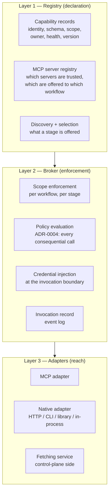
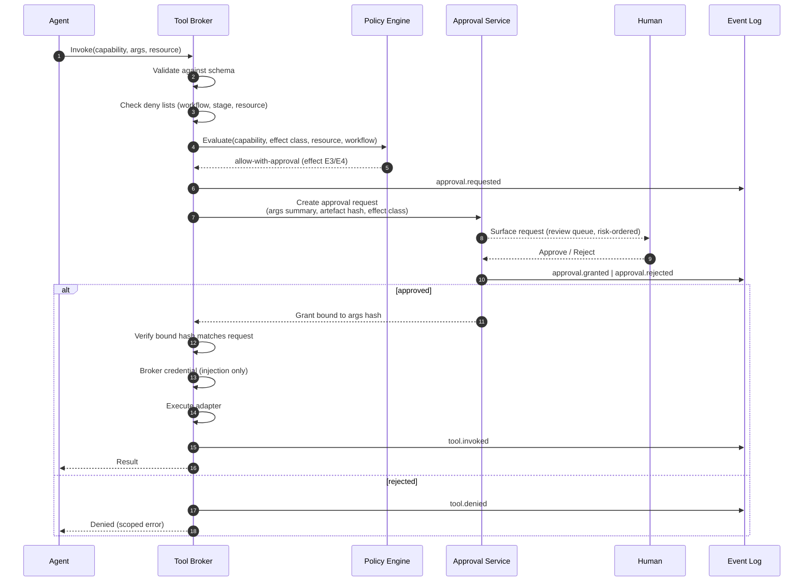
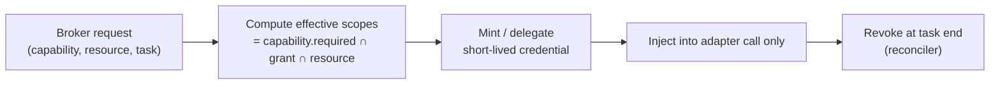

# 11 — Tools, MCP and Integrations

**Purpose:** how the factory reaches the outside world — the tool registry, the broker that is the single choke point for external effects, the MCP story, the credential broker, and the model gateway.

**Source of truth for:** the tool registry schema, the invocation contract, the capability-grant model, the MCP adapter contract, health-check semantics, and the model-routing policy.
**Derived from:** ADR-0002, ADR-0004, ADR-0006, ADR-0012, `06_REQUIREMENTS_AND_NFRS.md` (FR-60…FR-66, FR-33, FR-34, SEC-01…SEC-06), V07, V10, V12, V13, V15.

**Critical framing.** This blueprint does **not** assume MCP is the integration mechanism. MCP is **one transport** among several, and the registry's unit of record is the **capability**, not the protocol. The directive (§6.5) says explicitly: *"Do not assume MCP is always the best integration mechanism."*

---

## 1. Why a registry and a broker at all

### 1.1 The problem the registry solves

An agent with tools has *authority*. Authority without a registry is unbounded in three directions: **what** is callable, **what scope** it operates in, and **who** may call it. The registry is where those three are declared. The broker is where they are enforced.

Without a registry, three things happen, all observed in the corpus:

- Capabilities are invoked through whatever mechanism was nearest — a script, a raw API call, an ad-hoc command. Nothing is discoverable, so nothing can be governed (V10's progressive tool disclosure exists precisely because the tool set must be *controlled*).
- The same capability is implemented repeatedly, differently, in each workflow.
- An integration's failure is indistinguishable from a bug in the agent.

### 1.2 The three-layer model



**The unit of the registry is the capability.** A capability — "read a file in the repository" or "create a pull request" — may be reachable over MCP, over HTTP, over a CLI, or in-process. The registry does not care. The adapter does.

### 1.3 The single-choke-point rule

> Every external effect occurs through the tool broker. There is no path from an agent to an external system that does not pass through a policy decision.

This is the property that makes SEC-01 and SEC-02 enforceable rather than aspirational: if there were a second path, ADR-0004's separation of deterministic and probabilistic authority would be decorative.

**Direct access is physically prevented, not merely discouraged.** The execution environment holds no long-lived credential for any external system; the only way to obtain one is to have the broker inject it for a specific call.

---

## 2. The tool registry

### 2.1 The capability record

```yaml
apiVersion: factory/v1
kind: ToolCapability
metadata:
  id: git.createPullRequest
  version: "3"
  owner: platform-vcs
  kind: mutation            # read | mutation | compute | communicate
  transport:
    type: mcp               # mcp | http | cli | library | in-process
    server: mcp.vcs.internal     # for type: mcp
    tool: create_pull_request    # the transport-level name
  description: >
    Opens a pull request from the current branch to a target branch.
  inputSchema:
    type: object
    required: [title, body, head, base]
    properties:
      title: {type: string, maxLength: 120}
      body: {type: string, maxLength: 65536}
      head: {type: string}
      base: {type: string}
      draft: {type: boolean, default: false}
  outputSchema:
    type: object
    properties:
      url: {type: string}
      number: {type: integer}
  scope:
    required: ["repo:write:pr"]
    optional: ["repo:read:branch"]
    resourcePattern: "repo:org/repo"
    environment: control-plane | execution-environment
  effect:
    reversible: true
    undo: "close_pull_request"
    external: true
  credentials:
    credentialRef: cred.vcs.bot          # resolved by the credential broker
    scopes: ["repo:write:pr"]
    ttlSeconds: 3600
  cost:
    model: none
    perCallUsd: 0.0000
  trust:
    inputTrust: untrusted-content         # arguments may contain injected text
    resultTrust: untrusted-content        # results may contain injected text
  health:
    checkType: live
    timeoutSeconds: 5
    degradedBehaviour: fail-fast
  observability:
    redactArguments: ["body"]
    redactResult: []
```

### 2.2 Field rationale

| Field | Why it exists |
|---|---|
| `id` | Stable identity across transports and versions. Workflows grant capabilities by `id`, so a transport change does not require a workflow change. |
| `version` | A capability's schema can change. The grant names the version it was approved against. |
| `owner` | A capability without an owner is unmaintained. FR-60 requires owner metadata. |
| `kind` | `mutation` capabilities get additional treatment: they are the ones subject to approval gates and blast-radius scoring. |
| `transport` | The mapping from capability to mechanism. This is the seam at which MCP is one option among several. |
| `inputSchema` / `outputSchema` | Validation happens **before** invocation (the broker rejects invalid arguments), and the schema is what the agent is shown. |
| `scope.required` / `optional` | The grant vocabulary (§4). Required scopes must all be present in the effective grant. |
| `effect.reversible` / `undo` | Feeds blast-radius scoring (§5). A capability with no undo path cannot be automatically handled. |
| `credentials.credentialRef` | The capability names a **credential reference**, never a secret. The broker resolves it at call time. |
| `trust.inputTrust` / `resultTrust` | ADR-0004's untrusted-content rule applied at the tool boundary. A tool whose result is untrusted has its result tagged before it reaches the agent. |
| `health.degradedBehaviour` | What the factory does when this capability is unavailable: `fail-fast`, `degrade` (with a named reduced mode), or `queue` (retry with backoff). |

### 2.3 Effect classification

Every capability is classified by effect, and the classification determines the gate it must pass:

| Effect class | Definition | Examples | Automatic handling? |
|---|---|---|---|
| **E0 — Pure read** | No external state changes. | Read a file, list branches, fetch a public URL | Yes, at any autonomy level |
| **E1 — Reversible write** | Changes external state, but has an undo. | Create a branch, open a PR, add a comment, create a worktree | Yes, above L2 and with the merge gate |
| **E2 — External write** | Changes state outside the repository's control. | Create a release, publish a package, post to a chat channel, send a webhook | **No** — requires an approval or an enumerated runbook |
| **E3 — Destructive** | Removes or overwrites state with no undo. | Delete a branch, force-push, drop a table, remove a release | **No** — requires an explicit, artefact-bound human approval |
| **E4 — Production** | Affects a live production system. | Deploy, scale, restart, rotate a production secret | **No** — enumerated runbooks only, per SEC-08 |

**E3 and E4 capabilities are never granted to a workflow by default.** They appear only in a workflow's declared grant if the workflow's autonomy level and the approval class permit it, and they always require an artefact-bound approval at the moment of invocation (FR-75).

---

## 3. The MCP story

### 3.1 MCP's role

MCP is a **transport and discovery protocol**. It is genuinely good at what it does: letting a server publish a set of tools with schemas, and letting a client enumerate and call them without bespoke integration code. V15's and V10's interest in it reflects this.

What MCP is **not** in this blueprint:

- not the **registry** — the registry is authoritative and lives in the factory definition; MCP servers are *sources* that the registry reconciles with;
- not the **policy layer** — an MCP server's own permission model is advisory; the factory's policy engine is authoritative;
- not the **credential store** — credentials are brokered at the factory's invocation boundary, not handed to an MCP client;
- not the **audit record** — the factory's event log is authoritative;
- not the **scope boundary** — MCP servers advertise capabilities; the factory decides which are *offered* to which stage.

### 3.2 The MCP server registry

```yaml
apiVersion: factory/v1
kind: McpServerRegistration
metadata:
  id: mcp.vcs.internal
  owner: platform-vcs
  transport:
    type: stdio
    command: ["mcp-server-vcs"]
    version: "1.4"
  trust:
    level: internal            # internal | external | untrusted
    verified: true
    signature: "sig:..."
  scope:
    allowedCapabilities: ["git.*"]
    deniedCapabilities: ["git.forcePush"]
  credentials:
    credentialRef: cred.vcs.bot
  network:
    egress: none
  health:
    checkType: spawn-and-list
    intervalSeconds: 60
  discovery:
    mode: registered-static    # registered-static | probed-and-diffed
    reconciledAt: "2026-11-01T09:00:00Z"
```

**Trust levels.**

| Level | Meaning | Handling |
|---|---|---|
| `internal` | Built or vetted by the organisation. | Full registration; tools are eligible to be offered. |
| `external` | Third-party, provenance recorded, behaviour not fully known. | Registered explicitly; each tool must be individually approved before it may be offered. |
| `untrusted` | Unknown provenance or unvetted. | **Never offered to an agent.** May be reachable only through the control plane's fetching service, which tags the result. |

**The discovery reconciliation rule.** The registry's capability records are authoritative. When an MCP server advertises a tool that is not in the registry, that tool **does not exist** for the factory: it is not offered, not callable, and the discrepancy is recorded as a `registry.drift` finding. The opposite — a registered tool the server no longer advertises — marks the capability `unavailable` and triggers a health alert.

This is the concrete mechanism behind FR-62 ("a capability shall be reachable regardless of its transport") and FR-60 ("every invocable capability resolves to a registry entry"). It also prevents the failure mode where an integration silently expands its own surface: a server operator adding a tool does not thereby add it to the factory.

### 3.3 The adapter contract

All transports implement one interface:

```
Adapter:
  describe() -> CapabilityDescriptor[]        # for discovery/reconciliation
  invoke(capabilityId, arguments, ctx) -> Result
  health() -> HealthStatus
  close()
```

| Transport | Use when | Notes |
|---|---|---|
| **MCP** | A capability is published by an MCP server and the org uses MCP. | Discovery via `tools/list`; invocation via `tools/call`; the adapter maps the tool schema to the registry record. |
| **HTTP** | A capability is a REST/GraphQL endpoint. | Straightforward; often the least ceremony for internal services. |
| **CLI** | A capability is an existing command-line tool. | Requires argument templating and output parsing; the least reliable output contract, so it is confined to read-mostly capabilities. |
| **Library** | The capability is in-process code (e.g. a diff parser). | Fastest and most deterministic; used for pure functions. |
| **Fetching service** | The capability fetches external content. | **Control-plane side.** Returns tagged untrusted content; never runs in the agent's environment (ADR-0006 §3). |

**Adapter selection rule.** Prefer the transport with the **strongest output contract**. A deterministic, schema-validated contract beats an LLM-friendly prose contract, because the broker validates the output schema and a malformed result is then a cheap failure rather than a silent corruption. This is a generalisation of ADR-0005's authorship policy applied to transports.

### 3.4 Why not MCP everywhere

| Reason | Consequence |
|---|---|
| MCP servers are usually subprocesses with their own credentials and network posture. | Running them inside an agent's execution environment expands the trust boundary. The blueprint confines MCP servers to the control plane or a broker-side process. |
| An MCP tool's permission model is a convention, not a control. | The factory's policy engine is the enforcement point (ADR-0004). |
| Prose-native tool interfaces are poor validation targets. | Output schemas are preferred; an adapter without one is flagged in the registry. |
| Vendor MCP servers add a dependency on a third party's definition of a tool. | The registry's capability identity is factory-owned, so a vendor server can be replaced without touching workflow definitions. |
| MCP discovery is runtime state; the registry is declared state. | The reconciliation rule makes declared state win. |

---

## 4. Capability grants and scope

### 4.1 The grant model

A **grant** is the set of capabilities a workflow (or a stage within it) may invoke. Grants are **declared in the factory definition**, reviewed as changes, and enforced by the broker.

```yaml
apiVersion: factory/v1
kind: CapabilityGrant
metadata:
  name: grant.workflow-bugfix
  workflow: wf_bugfix
  stages:
    - role: worker
      grant: ["git.read", "git.write.branch", "git.write.commit", "ci.run", "shell.sandboxed"]
      deny:  ["git.push.protected", "git.forcePush", "secret.read", "prod.*"]
```

### 4.2 Scope vocabulary

Scopes are **hierarchical and prefix-matched**, so a grant can be expressed without enumerating every capability:

| Scope | Meaning |
|---|---|
| `repo:read` | Read any file in the granted repository |
| `repo:read:path:<glob>` | Read within a path pattern |
| `repo:write:path:<glob>` | Write within a path pattern |
| `git.write.branch` | Create and push branches (not to protected refs) |
| `git.write.commit` | Commit |
| `git.write.pr` | Open and update pull requests |
| `git.push.protected` | Push to a protected branch — **never granted below L3** |
| `shell.sandboxed` | Execute a command in the sandbox under the network policy |
| `net.fetch` | Fetch a URL through the control-plane fetching service |
| `net.egress:<host>` | Direct egress to a declared host — requires a definition change |
| `db.read:local` / `db.write:local` | Access to a local, seeded database only |
| `db.migrate:local` | Apply migrations to a local database |
| `prod.read` / `prod.write` | Production access — enumerated runbooks only (SEC-08) |
| `secret.read` | Read secrets — **never granted to an agent**; brokered only |
| `factory.write` | Modify the factory definition — **never granted to an agent** (SEC-11) |

### 4.3 The three-scope rule

Every capability invocation is checked against three scopes simultaneously:

| Scope | Question | Source |
|---|---|---|
| **Workflow scope** | Does this workflow's grant include this capability? | The grant in the factory definition |
| **Stage scope** | Does this *stage's* narrower grant include it? | The stage's tool scope in the task graph |
| **Resource scope** | Does the capability's `resourcePattern` match the *actual* resource being acted on? | The invocation's resource argument |

**The narrowest scope wins.** A stage's scope is the intersection of the three, not the union. This is the mechanism behind FR-61 ("an agent shall receive only the tools its stage requires") and SEC-06.

**Resource scope is the one that catches the interesting bug.** A worker with `repo:write` on `org/repo` that is handed an artefact referencing `org/other-repo` must be refused on the *resource*, not the capability. This is also the mechanism for SEC-12, repository isolation.

### 4.4 Deny overrides

A `deny` entry wins over any `grant`, at every level, and over the capability's own declaration. Deny lists are checked first, and a match is terminal.

Deny is checked **before** allow because a deny list is shorter, more specific, and more likely to be the safety-critical entry. An explicit `git.forcePush` deny should not require the evaluator to first prove the capability is allowed.

### 4.5 Scope is enforced at the broker, not in the prompt

The prompt tells the agent what it may do. The broker decides. If the prompt is wrong, the broker still refuses. This asymmetry is deliberate: prompts are advisory and unreliable; the broker is deterministic.

---

## 5. Approval attached to a sensitive invocation

FR-75 requires that approval can attach to an individual sensitive tool invocation, and ADR-0003's L-level discipline needs a mechanism to bind authority to a specific artefact.

### 5.1 The invocation approval flow



### 5.2 Binding rules

| Rule | Detail |
|---|---|
| **Artefact-bound** | The approval binds to the **hash of the arguments and the artefact**. A change to either invalidates the approval (FR-74). |
| **Expiry** | Approvals expire. Default 30 minutes for E3, 10 minutes for E4. |
| **Single-use** | An approval authorises one invocation, not a class of invocations. |
| **Non-transferable** | An approval for a task does not authorise another task, even the same workflow. |
| **Revocable** | A granted approval can be revoked before use; the event is recorded. |
| **Re-approval on change** | If the agent modifies the arguments after approval, the approval is void and a new request is raised. This is the mechanism that prevents "approve-then-modify". |

### 5.3 The plan-first approval

FR-74 requires plan-first approval: a human approves the *plan*, and execution is checked against it. This is a different, earlier approval than the invocation approval:

| | Plan approval | Invocation approval |
|---|---|---|
| **Artefact** | The task graph (`09_...` §7) | The concrete call arguments |
| **When** | After planning, before dispatch | At the moment of the sensitive call |
| **What it authorises** | "This decomposition is what I want executed." | "This specific irreversible action is authorised." |
| **Binding** | The graph's structure; deviations that change scope require re-approval | The argument hash |

Both may be required. A plan-approved task that later needs an E3 action still needs the invocation approval.

---

## 6. The broker

### 6.1 Invocation contract

```
Invoke(request) -> Result

request:
  capabilityId      string
  arguments         object          # validated against the capability's inputSchema
  resource          string          # the concrete target, for resource-scope checks
  workflow          string
  taskId            string
  nodeId            string
  attempt           int
  grantId           string          # the grant under which this call is made
  deadlineSeconds   int

result:
  status            success | denied | failed | unavailable | timeout
  value             any             # schema-validated
  error             {code, message, retryable}
  invocationRecord  {id, capabilityId, version, durationMs, cost, redactedArgs, redactedResult}
```

### 6.2 The broker's processing order

The order is fixed, and each step's failure is terminal for that step:

1. **Schema validation** of the arguments — before anything else. A malformed call never reaches policy, an adapter, or a credential.
2. **Deny-list check** across workflow, stage, and resource scopes.
3. **Grant check** — is the capability in the effective grant?
4. **Resource-scope check** — does the resource pattern match?
5. **Policy evaluation** — the deterministic decision (ADR-0004). The result is one of: `allow`, `allow-with-approval`, `deny`, `escalate`.
6. **Approval** (if required) — blocking, artefact-bound.
7. **Credential acquisition and injection** — the broker obtains a scoped, ephemeral credential and injects it into the adapter's call. **It never enters the agent's context, prompt, arguments, or result.**
8. **Execution** — via the adapter, with a timeout.
9. **Result validation** — the output is validated against the capability's `outputSchema`. An invalid result is a failure, not a success with a warning.
10. **Invocation record** — appended to the event log with argument and result summaries, redaction applied, duration and cost recorded.

### 6.3 Failure semantics

| Failure | Behaviour | Classification |
|---|---|---|
| Schema invalid | Rejected before invocation. The agent receives the schema error and may correct the call. | `tool.unavailable`? **No** — a validation error is a *usage* error; it is retried only within the agent's own turn budget, and counted separately. |
| Denied by scope or policy | Terminal. The agent is told it is not permitted; it must not attempt a workaround by another path. Recorded as a security event. | `policy.denied` |
| Approval refused or expired | Terminal for this call. The stage may continue if it does not depend on the result. | `policy.denied` |
| Capability unavailable (health) | Depends on `degradedBehaviour`: `fail-fast` (terminal), `degrade` (a named reduced result), `queue` (retry with backoff up to the deadline). | `tool.unavailable` |
| Timeout | Terminal. The invocation is recorded as attempted — a timeout may still have had an external effect, which is why external mutations carry idempotency keys (§6.5). | `tool.unavailable` |
| Adapter error | Retryable or not, per the capability's declared `retryable` flag. | `tool.unavailable` |
| Output schema invalid | Terminal failure. A malformed result is never passed through. | `tool.unavailable` |

**A denial never falls back to a broader capability.** The agent's only legitimate response to a denial is to escalate or to proceed without that capability. Attempting the same effect through a different tool is a policy violation and is detected by comparing effect classes.

### 6.4 Idempotency

Mutating capabilities declare an idempotency key:

| Operation | Key |
|---|---|
| Model invocation | `(taskId, nodeId, attempt, promptSha256, modelVersion)` |
| Tool invocation | `(taskId, nodeId, attempt, toolId, argsSha256)` |
| External side effect | `(taskId, nodeId, attempt, externalOperation)` |
| Merge | `changeId` |
| Deployment | `releaseId` |

The broker passes the idempotency key to the external system where the system supports one, and always records it. Where the system does not support one, the capability declares `effect.duplicateRisk: true` and the workflow definition enumerates it — the explicit non-guarantee in `09_ORCHESTRATION_STATE_AND_EVENTS.md` §6.

### 6.5 The invocation record

```json
{
  "invocationId": "inv_01JCZ8NQ...",
  "capabilityId": "git.createPullRequest",
  "capabilityVersion": "3",
  "transport": {"type": "mcp", "server": "mcp.vcs.internal", "tool": "create_pull_request"},
  "workflow": "wf_bugfix",
  "taskId": "tsk_01JCZ8K1...",
  "nodeId": "n_04",
  "attempt": 1,
  "grantId": "grt_01JCZ8JQ...",
  "arguments": {"title": "fix: order total parity", "body": "<redacted>"},
  "argumentsSha256": "…",
  "redaction": {"applied": ["arguments.body"], "policyRef": "redaction.v2"},
  "resource": "repo:org/repo",
  "policyDecision": {"decision": "allow", "rule": "policy.toolScope/v4#exact-match"},
  "credential": {"ref": "cred.vcs.bot", "scopes": ["repo:write:pr"], "expiresAt": "2026-11-05T10:14:22Z"},
  "result": {"status": "success", "value": {"url": "…", "number": 4711}},
  "durationMs": 1840,
  "cost": {"usd": 0.0},
  "occurredAt": "2026-11-05T09:14:22.417Z"
}
```

Note that the credential's **reference and scopes** are recorded but its **material** never is. The broker's own credentials are never written to the event log; only the reference, the scopes it was granted, and its expiry are.

### 6.6 Concurrency and rate limits

The broker is a shared hot path. Per-capability and per-provider concurrency caps are configured in the definition. Where a provider rate-limits, the broker queues within the request's deadline rather than failing immediately — but a queued call still respects the caller's `deadlineSeconds`, and exceeding it is a timeout.

---

## 7. Credentials

### 7.1 The rules

Per ADR-0006 §2 and SEC-04:

1. **Ephemeral** — short-lived, scoped to the task.
2. **Per-task** — minted for one task, revoked at task end.
3. **Least privilege** — the credential's scopes are the intersection of what the capability needs and what the workflow granted. A capability that needs `repo:read` never receives `repo:write`.
4. **Brokered** — injected at the invocation boundary. Never present in an agent's context, prompt, arguments, or returned result.
5. **Not broadenable** — a credential's scope cannot be widened by an agent. Widening is a policy decision (ADR-0004).
6. **Long-lived credentials live only in the control plane** and are never exposed to the data plane.

### 7.2 The credential broker



**Where the credential material lives.** In the platform's secret store, accessed by the broker in the control plane. The execution environment receives a *derived* token for the specific target — a database role scoped to one schema, a registry token scoped to one repository, a cloud token scoped to one resource and one hour. The agent's environment holds that token only for the duration of the call.

### 7.3 The test

SEC-04's acceptance criterion is a test demonstrating that a task cannot use a credential after termination. The corresponding test for FR-63 demonstrates the absence of secret material in the assembled context. Both are specified in `14_QUALITY_TESTING_AND_EVALUATION.md`.

### 7.4 Secrets are not context

**A secret is not context.** It is never selected by the context assembler, never written to a prompt, and never stored in a run artefact in material form. The run artefact records the credential **reference** and **scopes**. This is a hard separation and is the reason the context assembler has no path to the secret store.

---

## 8. Health and degraded operation

### 8.1 Health checks

| Check type | Mechanism | Used for |
|---|---|---|
| `live` | A cheap read call | HTTP-style capabilities |
| `spawn-and-list` | Start the process and enumerate tools | MCP servers, CLI tools |
| `credential-check` | Verify the credential is valid without performing the effect | Scoped capabilities |
| `dependency-check` | Verify the backing service is reachable | Capabilities that proxy another service |
| `synthetic` | Execute a harmless known-good call | Capabilities where no cheap read exists |
| `declared` | Trust a declared status without probing | Deterministic, in-process capabilities |

Health state is `healthy`, `degraded`, `unavailable`, or `unknown`. The state is a **projection** of recent invocation outcomes, not only of probes — a capability that passes its probe but fails every invocation is `degraded`, and that is the state that matters.

### 8.2 Degraded behaviour

Each capability declares what degradation means for it, and the workflow declares what degradation means for *it*. A workflow that cannot tolerate a degraded dependency declares that it cannot start. A workflow with a documented reduced mode declares the reduced mode.

**Degradation is a first-class state, not an error path.** It is visible on the operational surface, it is recorded in the event log, and it changes the blast-radius assessment — a degraded capability is more likely to produce a partial result, which means the merge gate applies more strictly, not less.

### 8.3 What is not degraded

The broker and the policy engine are **not degradable**. If the policy engine is unavailable, the broker fails closed: calls are denied, not permitted. This is the one place in the system where "degrade gracefully" would be actively dangerous (NFR-10 exempts the fail-closed components by design).

---

## 9. The model gateway

### 9.1 Purpose

The model gateway is the single point of model access. Its job is to make model and provider a **configuration matter** (FR-33), not a code matter (NFR-09, ADR-0012).

### 9.2 Interface

```
Complete(request) -> Response

request:
  role            string
  messages        []            # already assembled by the context assembler
  tools           []            # the offered tool set (schema-described)
  routingHints    {difficulty, contextScope, requiredProperties}
  budget          {tokens, usd, deadlineSeconds}
  responseFormat  json | text
  cachePolicy     {prefixStable: bool, ttlSeconds}

response:
  content         any
  toolCalls       []
  usage           {tokensIn, tokensOut, usd}
  model           {provider, model, version}
  routingDecision {selected, candidates, rule, reason}
  cached          bool
```

### 9.3 Routing policy

Routing is a **declarative policy** in the factory definition, evaluated per request:

```yaml
apiVersion: factory/v1
kind: RoutingPolicy
metadata:
  name: default
rules:
  - id: r-trivial
    when: {difficulty: trivial}
    select: {provider: providerA, tier: small}
    budget: {usd: 0.05}
  - id: r-standard
    when: {difficulty: standard, requiredProperties: [code-edit]}
    select: {provider: providerA, tier: medium}
    fallbacks:
      - {provider: providerB, tier: medium, on: [provider-error, quality-signal]}
    budget: {usd: 0.50}
  - id: r-planning
    when: {role: planner}
    select: {provider: providerA, tier: large}
    fallbacks:
      - {provider: providerB, tier: large, on: [provider-error]}
    budget: {usd: 3.00}
```

| Routing principle | Source | Enforcement |
|---|---|---|
| Prefer determinism — a stage that can be code is not a model call. | ADR-0010 §5 | The workflow definition determines which stages are agent stages. |
| Prefer the cheapest model that clears the task's quality threshold. | ADR-0010 §4 | `thresholdRef` per role; the evaluation suite supplies the threshold. |
| Prefer a stronger model for planning and review than for execution. | ADR-0010 §4 | Routing rules per role. |
| Fallback is a configuration decision with a named trigger. | ADR-0012 | `on: [...]` per fallback. |
| **A fallback to the same provider under the same failure mode is not a fallback.** | NFR-09 | The policy validation rejects a fallback whose provider and trigger match the primary's. |

### 9.4 Provider adapter

```
ProviderAdapter:
  complete(request) -> Response
  health() -> HealthStatus
  models() -> ModelDescriptor[]
  estimateCost(request) -> usd
```

A provider adapter is responsible for translating the factory's neutral request into the provider's format, and for normalising the response, token accounting, and error taxonomy. **All provider-specific behaviour is confined to the adapter** — NFR-09's acceptance criterion is exactly that.

### 9.5 Budgets and cost

| Rule | Detail |
|---|---|
| Per-request budget | Declared by the role specification. |
| Per-task budget | The sum of requests' budgets, plus the cost of tool calls. |
| Per-workflow budget | A ceiling across all tasks of that workflow. |
| Enforcement | A request whose projected cost exceeds the remaining budget is **refused before the call**, and the task halts with `budget.exhausted`. |
| Accounting | Tokens and currency are recorded on every request and attributed to `(taskId, nodeId, attempt)`. |
| Reconciliation | Attribution must reconcile with the provider's billing within an agreed tolerance (MEAS-04). |

**A budget breach is a first-class outcome, not a failure.** The task returns `incomplete` with partial artefacts preserved and labelled — FR-32's contract. It does not fail, and it does not silently continue.

### 9.6 Failover

| Trigger | Meaning | Action |
|---|---|---|
| `provider-error` | Transport or provider failure. | Try the next fallback. |
| `budget-exhausted` | The primary's budget is spent. | Try the next fallback **if** it has its own budget; otherwise fail. |
| `quality-signal` | The evaluation suite flagged a quality regression for this model on this task class. | Try the next fallback. |
| `rate-limited` | Provider throttling. | Back off and retry; then fall back. |

**Failover records the reason** in the event log (`model.failedOver`). A provider that fails over repeatedly is removed from the routing policy by the evaluation loop, not by an operator's guess.

### 9.7 Prompt-prefix caching

Where a provider supports it, a **stable prefix** — the role, authority, trust rules, acceptance criteria, and standards — is cached across requests within a task, because it does not vary between turns of the same stage.

| Rule | Detail |
|---|---|
| Only the stable prefix is cached. | The task-specific and untrusted sections vary and are never cached. |
| The cache key includes the prefix hash and the model version. | A provider-side cache must never serve a different prefix's result. |
| Caching is a cost optimisation only. | A cache miss is always correct. The factory never depends on a cache hit for correctness. |

### 9.8 Model lifecycle

| Event | Consequence |
|---|---|
| Provider deprecates a model | The routing policy's `models()` list changes; the definition is updated through the normal change path. |
| A model version is retired mid-run | In-flight runs are pinned to the version they started with; new runs use the current version. |
| A provider is lost entirely | The routing policy's fallbacks cover it; if not, affected workflows fail with a classified error and the operational surface alerts. |
| A model's quality changes silently | The evaluation suite (replay against the historical run set) detects the regression; a guardrail breach rolls the routing change back (ADR-0007, FR-94). |

**No correctness or governance property depends on one provider.** A reviewer and an implementer may be routed to different tiers, and the review's independence is preserved by routing policy, not by luck.

---

## 10. Environment declaration

FR-66 requires a mechanism by which a workflow declares its required integrations, schedule, and permissions. This is the mechanism by which a workflow is provisioned with exactly its declared capabilities, and nothing more.

```yaml
apiVersion: factory/v1
kind: WorkflowEnvironment
metadata:
  name: env.wf-bugfix
spec:
  capabilities:
    - {id: git.read, required: true}
    - {id: git.write.branch, required: true}
    - {id: ci.run, required: true}
    - {id: issue.read, required: false}
  isolation: T2
  network:
    egress:
      allow: ["github.com:443", "registry.npmjs.org:443"]
      denyAllElse: true
  credentials:
    - {capability: git.write.branch, credentialRef: cred.vcs.bot, scopes: ["repo:write:branch"]}
  schedule:
    kind: event                          # event | cron | manual | api
    trigger: {on: issue.labeled, label: "bug"}
  limits:
    maxConcurrent: 8
    maxTurnsPerRun: 100
    maxWallClockSeconds: 3600
    maxUsdPerTask: 5.00
```

**Declared ≠ granted.** The environment declares what the workflow *needs*; the grant says what it is *allowed*; the policy engine decides per invocation. The effective capability set of a stage is the intersection of all three.

---

## 11. Integrations catalogue

The initial integration set, with the transport each is best served by:

| Capability | Transport | Effect class | Isolation | Notes |
|---|---|---|---|---|
| `repo.read`, `repo.write` | Native (git over SSH/HTTPS) | E0 / E1 | execution-environment | The worktree is the unit |
| `git.write.branch`, `git.write.commit` | Native | E1 | execution-environment | Branch naming is policy-controlled |
| `git.write.pr` | MCP or HTTP | E1 | control-plane | The PR body is untrusted-content from the factory's perspective |
| `git.push.protected` | HTTP | E1 | control-plane | **Never granted below L3** |
| `ci.run`, `ci.read` | HTTP | E1 | execution-environment | Verification is deterministic |
| `issue.read`, `issue.write` | HTTP | E0 / E1 | control-plane | Issue text is **untrusted-content** |
| `registry.read` | HTTP | E0 | control-plane | Dependency metadata; untrusted-content |
| `net.fetch` | Fetching service | E0 | control-plane | Returns tagged untrusted content |
| `model.complete` | Model gateway | E0 | control-plane | Never available to an agent directly |
| `secret.resolve` | Credential broker | — | control-plane | **Never offered to an agent** |
| `deploy.*` | HTTP | E4 | control-plane | Enumerated runbooks only (SEC-08) |
| `observability.read` | HTTP | E0 | control-plane | Telemetry queries; read-only |

---

## 12. Invariants

| ID | Invariant | Enforcement |
|---|---|---|
| **TL-1** | Every external effect passes through the broker and a policy decision. | A direct capability call without a policy decision fails; no alternate path exists in the data plane. |
| **TL-2** | A capability not in the registry is not callable. | The broker resolves only registered capabilities; MCP advertisement alone grants nothing. |
| **TL-3** | The effective scope is the intersection of workflow, stage, and resource scopes; deny wins. | A test demonstrates that a read-only stage cannot invoke a write tool, and that a resource outside the pattern is refused. |
| **TL-4** | Secret material never appears in an agent's context, prompt, arguments, results, or the event log. | A test scans assembled contexts, prompts, arguments, results, and stored artefacts for secret material. |
| **TL-5** | Every invocation is recorded with identity, arguments summary, result summary, duration, and cost. | The event log contains a complete tool-call trail for every run (FR-65). |
| **TL-6** | Model and provider choice is configuration; no provider-specific behaviour exists outside an adapter. | A provider-substitution test changes the routing policy only. |
| **TL-7** | The policy engine and broker fail closed. | A policy-engine outage results in denials, not permits. |
| **TL-8** | A denial is terminal for the call and is never routed around. | The effect-class comparison detects an attempt to reach the same effect by another capability. |
| **TL-9** | Untrusted tool output is tagged before it reaches the agent. | The ingestion path tags; the red-team suite tests a poisoned tool result. |
| **TL-10** | The effective capability set of a stage is the intersection of declaration, grant, and policy. | A test asserts the offered tool set matches the declared set. |

---

## 13. Known limitations

1. **The registry is a maintenance burden.** Every new integration is a definition change with review. This is deliberate friction (ADR-0006's consequence section) but it means the registry grows more slowly than ad-hoc integration would — which is the intended direction.
2. **The MCP reconciliation is a periodic check, not a live one.** Between reconciliations, a server may advertise a tool the registry does not know. The registry still wins (the unknown tool is not offered), so the exposure is a stale registry entry, not an unauthorised capability.
3. **Output schema validation rejects legitimate loose outputs.** Capabilities whose result is genuinely unstructured are marked as such and their results are passed through with the trust classification applied. The strictness is applied where it is available.
4. **Provider failover changes the model, which changes behaviour.** A failover is recorded and counted, and quality across failovers is measured. It is not invisible, but it is not free either.
5. **The credential broker is a single high-value component.** Its compromise would be severe. Mitigations: it holds no agent-reachable interface, its operations are audited, and the grants it issues are constrained by policy. It is a named critical component in the roadmap.
6. **Effect classification is a human judgement recorded in the registry.** A misclassified capability weakens the gate. Mitigations: the classification is reviewed at registration, and the review queue orders by it.

---

## 14. Related documents

- `07_REFERENCE_ARCHITECTURE.md` §4.1.7, §4.1.8 — the Tool Broker and Model Gateway component specifications
- `08_AGENT_CATALOG_AND_CONTRACTS.md` §4 — the input contract's `stage.tools` and `stage.grant` fields
- `09_ORCHESTRATION_STATE_AND_EVENTS.md` §4.3 — the `tool.invoked` / `tool.denied` / `model.requested` event types
- `10_CONTEXT_SKILLS_PROMPTS_AND_MEMORY.md` §5.5 — deferred tool references and the context-budget interaction
- `13_SECURITY_GOVERNANCE_AND_HUMAN_CONTROL.md` — the policy engine, the approval model, and the threat model
- `templates/MCP_INTEGRATION.md` — the integration authoring template
