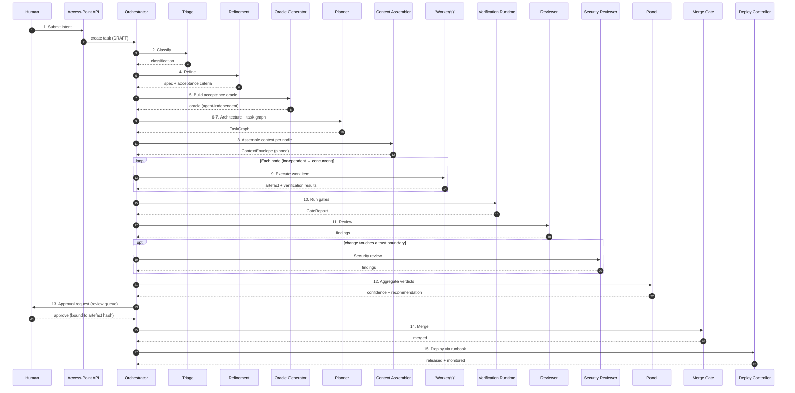
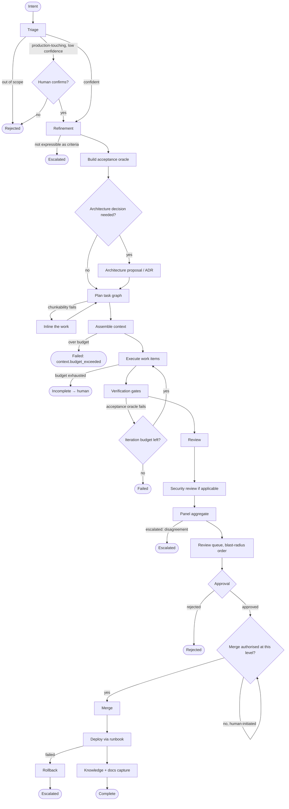

# 12 — End-to-End Workflows

**Purpose:** the seven canonical workflows the factory runs, specified completely enough to be implemented.

**Source of truth for:** workflow definitions, step sequences, approval gates, failure handling, and completion criteria.
**Derived from:** `08_AGENT_CATALOG_AND_CONTRACTS.md`, `09_ORCHESTRATION_STATE_AND_EVENTS.md`, `10_CONTEXT_SKILLS_PROMPTS_AND_MEMORY.md`, `11_TOOLS_MCP_AND_INTEGRATIONS.md`, ADR-0003, ADR-0005, ADR-0006, ADR-0007, ADR-0010, V02, V04, V13, V14, V15.

**How to read this document.** Every workflow is specified with the same thirteen fields, so they can be compared:

| Field | Meaning |
|---|---|
| **Trigger** | What starts the workflow, and who or what may start it. |
| **Inputs** | The declared inputs and their source. |
| **Execution steps** | The ordered steps, with the role or deterministic component that executes each. |
| **Participating agents** | The role specifications involved. |
| **Required skills** | The skills the steps depend on. |
| **Required tools** | The capabilities the workflow declares (per `11_...` §10). |
| **Context requirements** | What the assembler must select, and the constraints on it. |
| **Intermediate artefacts** | The artefacts produced and passed between steps. |
| **State transitions** | The task-state moves and their guards. |
| **Approval gates** | Where a human must act, and what they are approving. |
| **Failure handling** | The failure modes, their classification, and the response. |
| **Completion criteria** | What must be true for the workflow to be complete. |
| **Observability** | What is recorded and what is surfaced. |

---

## 1. Workflow catalogue

| ID | Name | Autonomy | Ends in | Primary source |
|---|---|---|---|---|
| **A** | Idea to production | L2 default (L3 per-component when earned) | Production release | V04, V05, V13 |
| **B** | Issue to pull request | L2 | An open PR | V03, V13 |
| **C** | Autonomous bug fixing | L2 | An open PR with a regression test | V12, V14 |
| **D** | Automated testing and self-healing CI | L1–L2 | A PR, or a repaired pipeline | V14, V15 |
| **E** | Production incident response | L2 (L3 for the merge) | A deployed fix, or an escalation | V14 |
| **F** | Multi-repository engineering | L1–L2 | Merged per-repo PRs plus an integration | V13, V15 |
| **G** | Factory self-improvement | L0–L1 | A reviewed change proposal | V11, V15 |

**Autonomy is a per-workflow declaration, and every one of these starts at or below L2.** See ADR-0003 §3: human reading of code is mandatory until a workflow's verifier set is discriminator-calibrated for its acceptance criteria.

### 1.1 Shared step vocabulary

All workflows are composed from the stage kinds in `09_ORCHESTRATION_STATE_AND_EVENTS.md` §8.1. Two facts about that vocabulary govern everything below:

1. **Deterministic stages outnumber agent stages.** Verification, aggregation, merge, deployment, recording, and evaluation are code.
2. **Every agent stage is bounded** — turn budget, wall-clock, tokens, cost — and every budget exhaustion returns a labelled incomplete result to a human (FR-32).

---

## 2. Workflow A — Idea to production

### 2.1 Overview

The complete delivery lifecycle: a human intent becomes a running production service, with agents performing the work and the human providing intent and judgement. This is the 1968 Beamer/GE factory (V05 2:22) realised: a controlled programming environment with standardised development tools and historical information for management and measurement.

**Fifteen steps.** The directive fixes this at fifteen; the mapping is below.

| # | Step | Executed by | Agent? |
|---|---|---|---|
| 1 | Intent capture | Access-Point API | No (human) |
| 2 | Triage and classification | Triage | Yes |
| 3 | Prioritisation | Prioritiser | Yes (with deterministic constraints) |
| 4 | Requirement refinement | Refinement | Yes |
| 5 | Acceptance oracle construction | Deterministic generator + human | Mostly no |
| 6 | Architecture decision | Planner (architecture tier) | Yes |
| 7 | Task decomposition and topology | Planner | Yes |
| 8 | Context and skill selection | Context Assembler | No (deterministic) |
| 9 | Implementation | Worker(s) | Yes |
| 10 | Verification | Verification Runtime | No (deterministic) |
| 11 | Review | Reviewer (+ Security Reviewer) | Yes |
| 12 | Panel aggregation | Panel / Decision Aggregator | No (deterministic policy) |
| 13 | Approval | Human | No (human) |
| 14 | Merge | Merge Gate | No (deterministic) |
| 15 | Deployment, monitoring, and knowledge capture | Deployment Controller + deterministic steps | No |

### 2.2 Trigger

A human submits an intent through the **Access-Point API** (FR-03). Intent is the only sanctioned human entry point. The intent carries a natural-language goal and whatever constraints the human states. It may reference an existing issue, a document, or a prior decision.

**No automated trigger exists for step 1.** A factory that can accept work from an automated source can be flooded, and the intent step is where the human decides what should exist.

### 2.3 Inputs

| Input | Source | Required |
|---|---|---|
| Intent text | Human, via access point | Yes |
| Constraints (deadline, budget, compliance scope) | Human or intent | No |
| Reference material | Links, documents, issue IDs | No |
| Repository / component scope | Human or triage | Derived at step 2 |

### 2.4 Execution steps

**Step 1 — Intent capture.** The access-point API records the intent as an event (`intent.recorded`) and creates the task in `DRAFT`. The intent is untrusted-content from the agent's perspective (ADR-0004): it is data the refinement agent must interpret, not instruction it must obey. Human authorship does not make content trusted in the technical sense — a human can paste untrusted text.

**Step 2 — Triage and classification.** The Triage agent classifies the request: type, affected subsystem, risk indicators, and the workflow it belongs to. It may reject as out of scope. Classification into a production-touching workflow requires a confidence threshold and human confirmation — a misroute into a production workflow is not a cheap error.

*Artefact:* a classification record `{type, subsystem, workflow, riskIndicators, confidence}`.

**Step 3 — Prioritisation.** The Prioritiser scores the work against the queue on value, effort, and risk, subject to hard deterministic constraints: safety, regulatory deadlines, dependency ordering, capacity limits. Deterministic scoring wins over judgement where a constraint applies.

*Artefact:* a queue position and a priority record.

**Step 4 — Requirement refinement.** The Refinement agent produces the specification: scope, non-goals, **checkable acceptance criteria**, verification approach, blast-radius estimate, and required capabilities. It flags anything it cannot specify and escalates it rather than passing vagueness downstream.

*Artefact:* `specification.md` + a structured acceptance-criteria list.

**Step 5 — Acceptance oracle construction.** This is the step most often skipped and most consequential. The oracle is the set of tests that decide "done". Per ADR-0005, the oracle must be **agent-independent**: written against the specification, not the implementation. Two routes:
- A **deterministic generator** derives tests from a structured specification (a contract file, a schema, a behaviour table). This is preferred because it is reproducible and reviewable.
- A **human writes the oracle** for properties a generator cannot express.

The oracle is written **before** implementation, so the implementer cannot shape it.

*Artefact:* `oracle/` — the acceptance test suite + its provenance record.

**Step 6 — Architecture decision.** For changes that cross a boundary — a new service, a schema change, an interface change — the Planner produces an architecture proposal: the decision, the alternatives considered, the consequences. This may become an ADR. Architecture decisions are not made silently by an implementer.

**Step 7 — Task decomposition and topology.** The Planner produces the task graph (`09_...` §7). Every fan-out edge carries a four-condition chunkability justification (ADR-0010). Dependent edges receive the upstream artefact at a context boundary, never the upstream context.

**Step 8 — Context and skill selection.** The Context Assembler resolves the envelope per `10_...` §5, deterministically, within budget, with the precedence rules applied. Over budget is a failure, not a truncation.

**Step 9 — Implementation.** Worker(s) execute their work items. Independent items run concurrently in isolated environments (T2 by default; T3 where inputs are untrusted). Each worker receives only its own specification, its inputs, and — for a dependent edge — the upstream artefact.

**Step 10 — Verification.** The Verification Runtime runs the applicable gate layers: the acceptance oracle (primary), integration/contract, static analysis, type check, lint, security scanning, standards verifiers. Layer applicability depends on the blast-radius tier. Agent-authored tests are marked untrusted and do not alone satisfy the acceptance criterion (ADR-0005).

**Step 11 — Review.** The Reviewer judges the change against the criteria, distinguishing **specification conformance** from **observed behaviour** (FR-56). It does not inherit the implementer's reasoning transcript, because inheriting the reasoning reproduces the implementer's blind spots. The Security Reviewer is added when the change touches a trust boundary.

**Step 12 — Panel aggregation.** The panel applies the aggregation policy — weighted vote, disagreement rule, veto rule — to produce a confidence value and a recommendation. **The policy is code**, so it is auditable and consistent. Disagreement escalates rather than being resolved unilaterally.

**Step 13 — Approval.** The change enters the review queue, ordered by blast radius (FR-72). A human approves or rejects. The approval is bound to the artefact hash.

**Step 14 — Merge.** The Merge Gate performs the merge, policy-guarded. The `APPROVED → MERGING` transition guard in `09_...` §2.3 is where the autonomy ladder is enforced: below L3, the merge must arrive through a human access point.

**Step 15 — Deployment, monitoring, knowledge capture.** The Deployment Controller executes the declared release through the enumerated runbook. On success, the deployment is recorded and monitored; the knowledge step captures the decision rationale (deterministic extraction, per `10_...` §9.1); the documentation step updates affected docs as a stage of the same workflow (FR-82).

### 2.5 Sequence diagram



### 2.6 Flowchart



### 2.7 Approval gates

| Gate | Artefact approved | Level at which it is skipped |
|---|---|---|
| Architecture decision | The architecture proposal / ADR | Never below L3; may be delegated at L3+ per the policy |
| Plan-first approval | The task graph | Only where the workflow is at L3+ and the policy permits |
| Merge approval | The change + its verification report + review findings | Never, until ADR-0003's calibration floor is met for this workflow |
| Deployment approval | The release and the runbook | Only under an L4 enumerated runbook |

### 2.8 Failure handling

| Failure | Classification | Response |
|---|---|---|
| Misclassification | `workflow.composition` | Re-route; raise a workflow-scope proposal if the pattern repeats |
| Vague specification | `context.insufficient` | Escalate to a human; do not proceed with unverifiable criteria |
| Oracle generation fails | `workflow.composition` | Escalate; a human writes the oracle |
| Plan invalid | `workflow.composition` | Re-plan; the graph is a reviewable artefact |
| Context over budget | `context.insufficient` | Skill-scope proposal; fix triggers or the corpus, not the budget |
| Implementation fails the oracle | `verification.failure` | Iterate within budget; skill-scope proposal if repeated |
| Budget exhausted | `budget.exhausted` | Return labelled partial artefacts; human decides to continue |
| Tool unavailable | `tool.unavailable` | Degraded mode if declared; else fail fast |
| Policy denial | `policy.denied` | Terminal; escalate to a human with the policy reason |
| Review disagreement | `verification.failure` | Escalate to a human reviewer; the panel does not decide unilaterally |
| Deployment failure | `tool.unavailable` | Rollback via the runbook; post-hoc review |

### 2.9 Completion criteria

1. Every node is in a terminal state, and every skipped node carries a reason.
2. The acceptance oracle passes.
3. Every mandatory gate for the blast-radius tier passes.
4. A review verdict exists from a reviewer whose identity differs from the implementer's (FR-35).
5. The panel's aggregation recorded a confidence value and did not escalate.
6. An approval bound to the artefact hash exists, or the merge was human-initiated at an autonomy level that permits it.
7. The merge is on the protected branch.
8. The release is deployed and monitored, or the workflow is explicitly code-only.
9. The run artefact is complete: context manifest, tool-call trail, verification results, cost, outcome.
10. The knowledge record and the affected documentation are updated.

### 2.10 Observability

- Lead time from intent to production, split by stage.
- Cycle time per stage, with p50 and p95.
- Human intervention count and reason, by stage.
- Escalation rate, and the reason distribution.
- Cost per accepted change, and cost per stage.
- Acceptance-oracle pass rate on first attempt.
- Defect escape rate — the rate at which merged changes produce a production defect. This is the metric that governs autonomy promotion.

---

## 3. Workflow B — Issue to pull request

### 3.1 Overview

The daily workhorse: an issue becomes a reviewed pull request. Eleven steps. No deployment — the change ends at a PR, and a human decides whether to merge.

**Eleven steps.**

| # | Step | Executed by |
|---|---|---|
| 1 | Issue intake | Access-Point API / issue tracker |
| 2 | Triage and classification | Triage |
| 3 | Requirement refinement | Refinement |
| 4 | Acceptance oracle construction | Deterministic generator / human |
| 5 | Task decomposition | Planner |
| 6 | Context and skill selection | Context Assembler |
| 7 | Implementation | Worker(s) |
| 8 | Verification | Verification Runtime |
| 9 | Review | Reviewer |
| 10 | Panel aggregation | Panel |
| 11 | PR creation and summary | Deterministic + Worker |

### 3.2 Trigger

An issue is labelled with a workflow trigger, or a human raises an intent through the access point referencing the issue. **Issue text is untrusted-content** (ADR-0004) — it is data to be interpreted, never instruction to be obeyed. This is the single most likely injection vector in the whole factory, because issue text is written by arbitrary requesters.

### 3.3 Execution steps

Steps 2–10 are identical to Workflow A steps 2–12. Step 1 differs in that the intent may arrive through an issue tracker rather than a human typed into the access point, and the triage step must consider the reporter's authority for the affected component.

**Step 11 — PR creation and summary.** A Worker (or a deterministic step, where the template suffices) writes the PR description from the artefacts already produced: what changed, why, how it was verified, what the acceptance criteria were, what was not done, and the known risks. The PR body is generated from the run's own records, not from the agent's memory of what it did.

*Artefact:* the PR, with a machine-readable summary block that a reviewer and an evaluation harness can both parse.

### 3.4 Approval gates

| Gate | Artefact |
|---|---|
| Plan-first approval (optional, policy) | The task graph |
| PR review | The PR, its verification report, and its summary |

**No merge gate.** The workflow terminates at the PR. The merge happens in Workflow A's path or by a human acting outside the factory — which is FR-05's second path: "a workflow producing a proposal for human application."

### 3.5 Failure handling

As Workflow A, with one addition: **if the issue is under-specified**, the refinement step escalates rather than inventing requirements. An agent that guesses requirements and produces a clean PR against the wrong specification is a *false success* — the worst outcome for this workflow. The gate that prevents it is the requirement that every acceptance criterion traces to something in the issue or a referenced decision record.

### 3.6 Completion criteria

1. A PR exists against the correct base branch.
2. The acceptance oracle passes.
3. The PR summary is generated from the run's artefacts.
4. The verification report is attached and all mandatory gates for the tier passed.
5. A reviewer verdict exists.
6. The run artefact is complete.

### 3.7 Observability

- Issue-to-PR cycle time, split by stage.
- PR acceptance rate (the ratio of PRs a human merges to PRs a human reviews).
- First-pass acceptance-oracle rate.
- Escalation rate for under-specified issues.
- Cost per PR, and cost per merged PR.

---

## 4. Workflow C — Autonomous bug fixing

### 4.1 Overview

A defect is found, diagnosed, fixed, and proven fixed — with the regression test as the acceptance oracle. This workflow exists because **a bug fix without a regression test is not a fix**; it is a change that happens to address the symptom today.

### 4.2 Trigger

| Trigger class | Source | Notes |
|---|---|---|
| **User-reported** | Issue tracker, support ticket | Untrusted content. |
| **Detected by CI** | A failing test in a build | Deterministic signal; the failing test is a candidate oracle. |
| **Detected in production** | Monitoring / alerting | Triggers Workflow E instead. |
| **Detected by a sweep** | A conformance or regression sweep | Periodic. |

### 4.3 Steps

| # | Step | Executed by | Notes |
|---|---|---|---|
| 1 | Detection and report | External source | The report is untrusted-content. |
| 2 | Triage | Triage | Classify: defect vs. environment vs. flaky test. |
| 3 | Reproduction | Worker, deterministic where possible | **The oracle is the reproduction.** |
| 4 | Diagnosis | Worker / Incident agent | Locate the cause. |
| 5 | Root-cause confirmation | Deterministic + Reviewer | The cause must be shown, not asserted. |
| 6 | Regression test construction | Deterministic generator / human | A test that fails before and passes after. |
| 7 | Fix implementation | Worker | |
| 8 | Verification | Verification Runtime | The regression test must be the primary gate. |
| 9 | Review | Reviewer | |
| 10 | Panel aggregation | Panel | |
| 11 | PR creation | Deterministic | |

### 4.4 The reproduction requirement

**Step 3 is mandatory and may not be skipped.** The fix workflow cannot proceed to implementation until the defect is reproduced on a known-good checkout with a deterministic procedure.

| Situation | Response |
|---|---|
| Reproducible deterministically | Proceed. The reproduction is the oracle. |
| Reproducible probabilistically (a race, a flake) | The reproduction runs N times; the defect is confirmed at a stated rate. The regression test uses the same rate as its pass threshold. |
| Not reproducible | The task escalates. **The factory does not implement speculative fixes.** A speculative fix produces a diff that looks like a fix and changes behaviour under a cause nobody identified. This is one of V14's core warnings. |
| The "defect" is a flake | Route to Workflow D (flaky-test repair) instead. |

### 4.5 The regression test as oracle

The regression test is the acceptance oracle, and it has the properties ADR-0005 requires:

1. It is written **before** the fix, or written from the specification of correct behaviour rather than from the fix's implementation.
2. It **fails on the unfixed code** — this is checked, not assumed.
3. It **passes on the fixed code**.
4. It is **deterministic** (or has a stated statistical threshold for an inherently non-deterministic defect).

**A regression test that does not fail before the fix is rejected.** This check is the cheapest and most powerful guard in the factory: it catches a fix that changes nothing, a test that asserts the implementation rather than the behaviour, and a misdiagnosis.

### 4.6 Approval gates

| Gate | Artefact |
|---|---|
| Diagnosis review | The root-cause analysis — a human may override it before implementation |
| PR review | The PR, including the regression test and the before/after evidence |

### 4.7 Failure handling

| Failure | Classification | Response |
|---|---|---|
| Not reproducible | `workflow.composition` | Escalate to a human. Do not proceed. |
| Test does not fail before the fix | `verification.failure` | Reject the test; regenerate or escalate. The fix may also be wrong. |
| Flaky | `tool.unavailable` (environment) | Route to Workflow D |
| Diagnosis wrong | `model.reasoning` | Iterate within budget; escalate if repeated |
| Fix breaks other tests | `verification.failure` | Iterate; a regression here is evidence the diagnosis was shallow |

### 4.8 Completion criteria

1. The defect was reproduced, or the task was escalated.
2. A regression test exists that fails on the unfixed code and passes on the fixed code.
3. The full applicable gate set passes.
4. A reviewer verdict exists, distinct from the implementer.
5. The PR states the cause, the fix, and the before/after evidence.

### 4.9 Observability

- Defect-to-PR cycle time, split by stage.
- Reproduction rate — the proportion of reported defects that reproduce. This measures the **quality of incoming reports**, not the factory.
- Fix acceptance rate.
- Regression rate — the rate at which a merged bug fix introduces a new defect. A high value here indicates the diagnosis was shallow.
- Reopen rate — the proportion of merged fixes that are reopened. This is the strongest single signal of a bad oracle.

---

## 5. Workflow D — Automated testing and self-healing CI

### 5.1 Overview

The factory maintains its own quality infrastructure: repairing flaky tests, backfilling coverage, upgrading dependencies, and conformance sweeps. This is V15's maintenance-loop pattern (35:03–35:14) and V14's self-healing CI, applied as a recurring workflow rather than a one-off.

### 5.2 Trigger

| Trigger class | Schedule | Workflow |
|---|---|---|
| **Flaky test repair** | On detection (a test fails intermittently in CI) | `wf.flaky-repair` |
| **Coverage backfill** | Nightly | `wf.coverage-backfill` |
| **Dependency upgrade** | Weekly | `wf.dep-upgrade` |
| **Conformance sweep** | Weekly | `wf.conformance-sweep` |
| **CI pipeline repair** | On CI failure that is not a product defect | `wf.ci-repair` |

**Scheduled workflows are declared with an explicit environment declaration** (`11_...` §10), so the set of capabilities they receive is fixed and reviewable — a scheduled job that acquires new capabilities is a privilege-escalation vector (FR-66).

### 5.3 Steps

| # | Step | Executed by |
|---|---|---|
| 1 | Detection and scoping | Deterministic (scheduler / CI) |
| 2 | Chunking into independent work items | Deterministic + chunkability rule |
| 3 | Context and skill selection | Context Assembler |
| 4 | Repair implementation | Worker(s) |
| 5 | Verification | Verification Runtime |
| 6 | Review | Reviewer |
| 7 | PR creation | Deterministic |

**Step 2 is the defining feature of this workflow.** A sweep over 500 files is the canonical chunkable case: each file is independently specifiable, independently verifiable, requires no cross-file coordination, and is cheaper to do concurrently than serially (ADR-0010's four conditions all hold). The planner records the chunkability justification for the fan-out.

### 5.4 The per-item acceptance criterion

Each chunk carries its own acceptance criterion, and this is what makes a sweep safe:

| Sweep type | Acceptance criterion |
|---|---|
| Flaky test repair | The test fails on the recorded failing seed **and** passes on the recorded passing seed, across the stated number of repetitions. The test's assertions are unchanged — only its determinism is fixed. |
| Coverage backfill | The new test **fails on the pre-fix code** and passes after, and it covers the declared uncovered branch. A coverage-increasing test that asserts nothing is rejected. |
| Dependency upgrade | The build passes, the dependency's own test suite passes, and the lockfile is regenerated deterministically. |
| Conformance sweep | The specific non-conformance is detected before and absent after. |
| CI repair | The pipeline that failed now passes, and the repair does not disable, skip, or weaken any gate. **A repair that weakens a gate is rejected.** |

**The last criterion is the one that matters most.** A self-healing CI that "fixes" a failing pipeline by disabling the failing test has made the system worse while reporting success. The acceptance criterion explicitly forbids it, and the reviewer is asked to look for it specifically.

### 5.5 Failure handling

| Failure | Classification | Response |
|---|---|---|
| A chunk cannot be made deterministic | `verification.failure` | Report the chunk as unfixable; do not weaken the test. Escalate the aggregate. |
| The sweep finds far more than expected | `workflow.composition` | Stop; the detection rule is over-broad. Do not produce a thousand PRs. |
| The repair weakens a gate | `verification.failure` | Reject the chunk. Escalate as a security-relevant finding. |
| The sweep would exceed the concurrency limit | — | Queue; do not raise the limit without a definition change. |

**The "far more than expected" stop condition is a safety valve.** A sweep's blast radius is its volume. A sweep that suddenly finds 10,000 issues has found a rule problem, not 10,000 problems, and continuing would flood the review queue — the approval-fatigue failure mode FR-73 measures.

### 5.6 Completion criteria

1. Every chunk either produced a PR or was reported as unfixable with a reason.
2. Each PR's acceptance criterion was independently verified.
3. No PR weakened a gate, skipped a test, or loosened a threshold.
4. The unfixable set is reported with reasons and is visible to a human.
5. Cost and time for the sweep are recorded.

### 5.7 Observability

- Findings per sweep, by type.
- Repair acceptance rate.
- Unfixable rate — a rising rate means the detection rule is wrong, not that the codebase is getting worse.
- Gate-weakening attempts — must be zero; a non-zero value is a security signal.
- Queue pressure contributed by sweeps, measured against the review-fatigue indicators.

---

## 6. Workflow E — Production incident response

### 6.1 Overview

A production alert triggers diagnosis and a candidate fix, and the human spends their effort on judgement rather than on diagnosis. This is V14's specific contribution (11:49): **the pager carries the PR the agent thinks will fix it**, so the responder is not reconstructing the diagnosis from scratch.

### 6.2 Trigger

An alert from the monitoring system, classified as production-affecting. Alerts are untrusted-content — an alert body can contain injected content from a user-facing field that ended up in a log line.

### 6.3 Steps

| # | Step | Executed by | Time budget |
|---|---|---|---|
| 1 | Alert normalisation | Deterministic | seconds |
| 2 | Triage and severity | Triage | seconds |
| 3 | Diagnosis | Incident agent | minutes |
| 4 | Candidate fix construction | Worker | minutes |
| 5 | Verification (including against production-like data) | Verification Runtime | minutes |
| 6 | Alert enrichment with the candidate fix | Deterministic | seconds |
| 7 | Human decision | Human | — |
| 8 | Merge and deploy | Merge Gate + Deployment Controller | minutes |
| 9 | Verification in production | Deterministic | minutes |
| 10 | Post-hoc review and knowledge capture | Deterministic + human | — |

### 6.4 The incident workflow's distinctive properties

**It runs at T3.** ADR-0006 makes T3 mandatory for production-adjacent work: hostile input is plausible, and the network policy is default-deny.

**It is time-bounded.** The Incident agent has the tightest wall-clock budget in the factory. An incident agent that runs for an hour has failed, even if it eventually succeeds.

**It is read-only against production.** The Incident agent may read production telemetry. It may not write. Production changes flow through the deployment gate (SEC-08).

**Step 6 is the key step.** The alert is enriched with the candidate fix, the diff, the reasoning, and the verification results, so that the responder's screen shows the hypothesis and the proposed remedy together.

### 6.5 The human decision (step 7)

Three options, presented with the evidence:

| Option | Meaning |
|---|---|
| **Accept** | Merge and deploy the candidate fix |
| **Modify** | The human edits or directs a modification before deploying |
| **Reject** | The candidate fix is wrong; the human continues manually |

The workflow does not guess which is right. It presents a well-formed hypothesis with its evidence and its uncertainty, and it says plainly what it does not know.

### 6.6 Rollback

Every deployment through this workflow has a **prepared rollback**, because the deployment is a production action performed under time pressure. Rollback is not a plan to be devised during the incident; it is a declared operation in the runbook, tested before the incident.

If the deployment fails verification in production, the rollback runs automatically and the incident escalates to a human with the rollback recorded.

### 6.7 Failure handling

| Failure | Classification | Response |
|---|---|---|
| No diagnosis within budget | `budget.exhausted` | Escalate with partial findings — **never** deploy an unverified change |
| Candidate fix fails verification | `verification.failure` | Return to diagnosis within the remaining budget; escalate if exhausted |
| Production has no rollback | — | Refuse to deploy. This is a hard gate, not a warning. |
| Human rejects | — | The incident continues manually; the factory records the outcome for the improvement loop |

### 6.8 Completion criteria

1. The alert carries a candidate fix, its reasoning, and its verification results — or the incident was escalated with partial findings.
2. The human's decision is recorded with the evidence they saw.
3. If deployed, the deployment was verified in production, or rolled back.
4. A post-hoc review exists within the incident's defined window.

### 6.9 Observability

- Time to candidate fix.
- Time to human decision — this measures the *value* of the workflow, because the goal is to shorten human diagnosis time, not human total time.
- Fix acceptance rate at incident time.
- Rollback rate — a rising rate indicates the diagnosis quality is poor.
- Post-hoc defect rate — incidents whose fix caused a second incident.

---

## 7. Workflow F — Multi-repository engineering

### 7.1 Overview

A change that spans repositories is decomposed into per-repository changes with an explicit integration plan. V13 names this as a distinct capability; the corpus treats it as a hard case rather than a routine one.

### 7.2 Trigger

A request that necessarily affects two or more repositories, or an architectural change that requires coordinated changes across services.

### 7.3 The problem this workflow solves

Cross-repository work fails in a specific way: each repository's change is individually correct, but the **combination** is wrong, because the interface between them changed and the changes were not coordinated.

### 7.4 Steps

| # | Step | Executed by |
|---|---|---|
| 1 | Triage and cross-repo detection | Triage |
| 2 | Refinement | Refinement |
| 3 | Interface-first design | Planner (architecture tier) |
| 4 | Per-repository decomposition | Planner |
| 5 | Integration order determination | Deterministic from the dependency graph |
| 6 | Per-repo context and skill selection | Context Assembler (per repo) |
| 7 | Per-repo implementation | Worker(s) |
| 8 | Per-repo verification | Verification Runtime (per repo) |
| 9 | Cross-repo integration verification | Deterministic (contract tests) |
| 10 | Per-repo review | Reviewer(s) |
| 11 | Per-repo merge | Merge Gate (per repo) |
| 12 | Integration verification and smoke test | Deterministic |
| 13 | Consolidated summary and knowledge capture | Deterministic |

### 7.5 The interface-first rule

**Step 3 is not optional.** The shared interface — the API contract, the schema, the event shape — is decided **first**, and the decision is recorded as a versioned contract artefact. Per-repository changes are then written against that contract.

Without this rule, each repository's implementer guesses what the other side will do, and the guesses disagree.

### 7.6 The integration order

The integration order is computed **deterministically** from the dependency graph, not negotiated by the agents:

| Situation | Order |
|---|---|
| Repo B consumes a new API from repo A | A merges and deploys first; B merges after |
| Both sides change a shared contract | The contract repository merges first, then both consumers |
| Independent repos with no shared interface | Any order; they may merge in parallel |
| A repo is blocked by another's *release* (not just merge) | Merge order and deployment order are separated; the deployment order respects the release dependency |

The order is a **merge-plan artefact** the planner produces and a human can review.

### 7.7 Repository isolation

Per SEC-12, an agent working in one repository cannot access another's artefacts or credentials. In a multi-repo workflow this means:

- each per-repo worker runs in its own isolated environment with only its repository's checkout;
- each worker's capability grant is scoped to its repository;
- cross-repo reads that are genuinely needed (a shared contract) go through an explicitly declared capability, not through a shared filesystem;
- the integration verification runs with access to all involved repositories — as a separate, deterministic stage, not as a widened worker.

### 7.8 Failure handling

| Failure | Classification | Response |
|---|---|---|
| One repo's change fails verification | `verification.failure` | That repo's branch is held; the others may proceed if their merge is independent; the integration is held |
| Contract mismatch between repos | `workflow.composition` | The interface decision was wrong; re-do step 3, not the implementations |
| Integration test fails after all merges | `workflow.composition` | The integration plan was wrong. Roll back the dependent deploys where possible. |
| One repo unavailable | `tool.unavailable` | Hold the integration; do not merge into an inconsistent state |

### 7.9 Completion criteria

1. An interface contract artefact exists and is versioned.
2. Every affected repository has a change with passing verification.
3. The cross-repo integration verification passes.
4. The merge plan was followed or was amended through a reviewed change.
5. The consolidated summary states what changed in each repository and what the combined effect is.

### 7.10 Observability

- Cross-repo cycle time.
- Interface-change frequency — a rising rate suggests an architecture under strain.
- Integration failure rate after all repos merged.
- The ratio of changes that touched one repository to those that touched several. A rising ratio indicates a coupling problem in the product, not in the factory.

---

## 8. Workflow G — Factory self-improvement

### 8.1 Overview

The factory improves itself from evidence. This is V11's meta loop and V15's log-driven skill improvement, constrained by ADR-0007 so that the improvement mechanism cannot itself become the failure.

**The governing constraint:** *the improvement loop proposes; it does not apply.* Every change to the factory definition, a skill, a workflow, a harness configuration, or a policy lands in the definition as a reviewed change (ADR-0001, ADR-0007 §1).

### 8.2 Trigger

| Trigger class | Frequency | Scope |
|---|---|---|
| **Scheduled analysis** | Weekly | Skill scope |
| **Pattern detection** | Continuous | Skill scope |
| **Guardrail breach** | On detection | Immediate rollback candidate |
| **Human request** | On demand | Any scope |
| **Metric trend** | On threshold crossing | Workflow or harness scope |

### 8.3 Steps

| # | Step | Executed by | Scope |
|---|---|---|---|
| 1 | Evidence collection | Deterministic (projections) | — |
| 2 | Pattern analysis | Model-assisted | — |
| 3 | Attribution to the narrowest layer | Deterministic + model | — |
| 4 | Proposal construction | Model-assisted | — |
| 5 | Batch-evidence check | Deterministic | — |
| 6 | Replay evaluation | Replay Evaluator | — |
| 7 | Experiment design (harness scope) | Model-assisted | — |
| 8 | Human review | Human | Approval class by scope |
| 9 | Merge | Merge Gate | — |
| 10 | Observation window | Deterministic | — |
| 11 | Promotion or automatic rollback | Deterministic | — |

### 8.4 Step 3 — Attribution to the narrowest layer

The attribution rule in `10_...` §4.6 is operational here, and it is what keeps the improvement loop from misfiring:

| Evidence pattern | Attributed to | Why not the layer above |
|---|---|---|
| `context.insufficient` clustered on one component | Skill scope | The trigger evaluator worked; the skill was not selected |
| No skill exists for the area | Context source scope | The selector cannot select what does not exist |
| The selector never fires for a category | Harness scope | The trigger rules are broken |
| `workflow.composition` on one step | Workflow scope | The model reasoning was fine; the composition was wrong |
| `model.reasoning` across many workflows and roles | Model / routing scope | The harness is fine; the model tier is wrong for the task |
| Systematic across everything | Harness scope | Only after narrower layers are excluded |

**Step 3 is a gate.** A proposal that does not attribute its evidence to a specific scope is rejected — because an unattributed proposal is usually a proposal to change everything, which is how a factory degrades.

### 8.5 Step 5 — Batch evidence

ADR-0007 §4: a proposal must be grounded in evidence across **≥N runs**. A single-run proposal is rejected as noise-fitting — and, deliberately, as a defence against a single poisoned run manipulating the factory.

N is configured per scope and is a reviewed setting.

### 8.6 Step 6 — Replay evaluation

The candidate configuration is replayed against the historical run set. **Model outputs are regenerated, not replayed** (`09_...` §8.3) — which is exactly what makes the replay a meaningful experiment rather than a tautology.

Every evaluation reports the four elements ADR-0011 §3 requires:

| Element | Meaning |
|---|---|
| **Baseline** | The same metric, before the change, over the same window, on the same workload |
| **Delta** | The change in the metric |
| **Cost** | The total cost of the change, including the evaluation itself |
| **Guardrail** | At least one metric that must not degrade |

**A proposal without all four elements is not mergeable.** This is enforced by the review interface, not by convention.

### 8.7 Step 8 — Approval class

| Scope | Approval | Evidence |
|---|---|---|
| Run | Automatic | — |
| Skill | Automatic if additive and below a risk threshold; otherwise reviewed | Batch evidence; no benchmark regression |
| Workflow | **Human review required** | Batch pattern analysis; replay of affected workflows |
| Harness | **Human review required, always** | Systemic analysis; full replay; explicit experiment design |
| Policy / autonomy | **Human review required, always** + ADR-0003's calibration bar | Calibration evidence; security review; red-team results |

### 8.8 Step 11 — Promotion or automatic rollback

After the merge, the change is **observed** over a window. The guardrail metric is tracked. If the guardrail breaches, the change is **rolled back automatically** and the proposal is marked reverted rather than deleted.

Automatic rollback is what makes the improvement loop safe to run at any cadence: the worst case of a bad proposal is a reverted change, not a degraded factory.

### 8.9 The loop that is not allowed to exist

**There is no path by which an agent, a loop, or an automation writes to the definition, the policy set, the skill corpus, or the verifier set.** SEC-11's acceptance test attempts a write through every available tool path.

The improvement loop's output is a **proposal** — a structured diff with evidence, expected effect, measurement plan, and rollback plan — submitted through the same mechanism as any other change. There is no privileged path (ADR-0007 §6).

### 8.10 Completion criteria

1. The proposal cites batch evidence across ≥N runs.
2. The evidence is attributed to a specific scope and layer.
3. The replay evaluation ran and reports baseline, delta, cost, and guardrail.
4. The required approval for the scope was granted.
5. After the observation window, the change is promoted or rolled back, and the outcome is recorded.

### 8.11 Observability

- Proposals generated per week, by scope.
- Proposal acceptance rate by scope.
- Replay-regression rejection rate.
- Automatic rollback count — a non-zero rate is healthy; it means the guardrail works.
- Time from proposal to promotion — the improvement loop's own latency.
- **The loop's own cost**, measured against the value of the changes it promotes. A meta-factory that consumes more capacity than it returns is a net negative and should be scaled back (FR-95's capacity-reallocation principle).

---

## 9. Cross-workflow patterns

### 9.1 The shared spine

Every workflow A–F follows the same spine. This is deliberate: a uniform spine means the gates, the artefact format, and the failure taxonomy are learned once.

```
intake → refine → oracle → plan → assemble → implement → verify → review → aggregate → approve → (merge → deploy)
```

Only G departs from it, and it departs by ending at *approve* — it produces a change to the factory rather than a change to the product.

### 9.2 The common gate set

| Gate | Applies to | Agent? |
|---|---|---|
| Acceptance oracle | A, B, C, E, F | No |
| Integration / contract | Where applicable | No |
| Static analysis / types / lint | Always | No |
| Security scanning | Always | No |
| Standards verifiers | Where a matching standard exists | No |
| Specification-conformance review | A, B, C, E, F | Yes |
| Behavioural review | Where the change is behavioural | Yes |
| Security review | Where a trust boundary is touched | Yes |
| Panel aggregation | A, B, C | No (policy) |
| Blast-radius-ordered human review | A, B, C, D, E, F | Human |

### 9.3 The common artefact set

| Artefact | Produced by | Consumed by |
|---|---|---|
| Specification | Refinement | Planner, reviewer, oracle generator |
| Acceptance criteria (structured) | Refinement | Oracle generator, workers, reviewers |
| Acceptance oracle | Generator / human | Verification runtime |
| Task graph | Planner | Orchestrator, reviewers, humans |
| Context envelope | Assembler | Workers, replay evaluator |
| Change artefact | Worker | Verification, review, merge gate |
| Verification report | Verification runtime | Reviewers, panel, merge gate |
| Gate report | Verification runtime | Merge gate |
| Review findings | Reviewer / Security reviewer | Panel, human approver |
| Panel decision | Panel | Merge gate |
| Run artefact | Framework | Everyone, later; audit; improvement loops |

### 9.4 The common failure taxonomy

All seven workflows use the taxonomy in `08_AGENT_CATALOG_AND_CONTRACTS.md` §4.3, including the `unknown → workflow.composition` default. A consistent taxonomy across workflows is what makes the improvement loop's attribution possible at all: if each workflow used its own labels, no cross-workflow pattern would ever be visible.

### 9.5 The context rule, applied to every workflow

> A stage receives its own specification, its own inputs, and — for a dependent edge — the upstream artefact. It never receives a sibling's context, a predecessor's transcript, or the full task graph.

This is the rule that V10's "fresh context" principle and ADR-0010's tiering both point to, and it is what makes cost predictable.

---

## 10. Invariants

| ID | Invariant | Enforcement |
|---|---|---|
| **WF-1** | Every workflow begins at an access point or a declared schedule; there is no other entry. | The control plane exposes no other intake path. |
| **WF-2** | No task reaches an implementer without checkable acceptance criteria and an oracle reference. | The planner's admission check rejects the graph. |
| **WF-3** | The acceptance oracle is agent-independent. | Provenance check on the oracle artefact; a same-run-authored oracle is flagged untrusted. |
| **WF-4** | A dependent stage never inherits its predecessor's context. | Context-envelope test: the downstream envelope contains the upstream artefact and nothing else from the upstream run. |
| **WF-5** | Every fan-out edge carries a chunkability justification. | Graph validation rejects the plan without it. |
| **WF-6** | Human code review is mandatory until a workflow's verifiers are discriminator-calibrated for its acceptance criteria. | The `APPROVED → MERGING` guard requires a human-origin approval below the calibrated bar. |
| **WF-7** | A denied action is never routed around. | Effect-class comparison detects the attempt. |
| **WF-8** | No workflow may modify the factory definition outside the reviewed-change path. | SEC-11's write-attempt test. |
| **WF-9** | Every workflow emits a complete run artefact. | MEAS-01's completeness assertion. |
| **WF-10** | Budget exhaustion returns labelled partial artefacts, never a silent stop or a silent success. | The incomplete state is distinct from failed and from success. |

---

## 11. Known limitations

1. **The oracle-first discipline is expensive at the start.** Every task pays an up-front cost that a later, cheaper implementation might have avoided. The cost is real and is the largest single contributor to slow early throughput.
2. **The workflow definitions in this document are specified, not measured.** The step counts, the budgets, and the boundary points are engineering judgements informed by the corpus, not results from a running factory. They are expected to change once the factory produces its own baselines.
3. **Blast-radius estimation is imperfect.** The tier a change receives is an estimate, and a badly estimated change could receive too few gates. Mitigated by the review gate and by the recorded blast-radius rationale, which is auditable after the fact.
4. **The incident workflow assumes a prepared rollback.** Workflows without a tested rollback cannot use it, and the factory refuses to deploy for them — which is a hard constraint on which services can be brought under the incident workflow.
5. **Multi-repository workflows assume the contract is the interface.** Repositories coupled by convention, shared state, or timing are not modelled, and the interface-first rule does not resolve them.
6. **Workflow G's batch-evidence threshold is a blunt instrument.** A rare failure with severe impact may not reach the threshold, and will be fixed reactively rather than through the loop. Accepted: the alternative (acting on single-run evidence) is worse.

---

## 12. Related documents

- `08_AGENT_CATALOG_AND_CONTRACTS.md` §7 — the role sequences per workflow
- `09_ORCHESTRATION_STATE_AND_EVENTS.md` — the state machine every workflow's transitions follow
- `10_CONTEXT_SKILLS_PROMPTS_AND_MEMORY.md` — the context rule applied to every workflow's steps
- `11_TOOLS_MCP_AND_INTEGRATIONS.md` — the capability declarations each workflow uses
- `13_SECURITY_GOVERNANCE_AND_HUMAN_CONTROL.md` — the approval model and blast-radius scoring
- `14_QUALITY_TESTING_AND_EVALUATION.md` — the gate definitions and the calibration procedure
- `15_OBSERVABILITY_COST_AND_FEEDBACK.md` — the metrics each workflow's observability section names
- `templates/WORKFLOW.md` — the authoring template for these definitions
