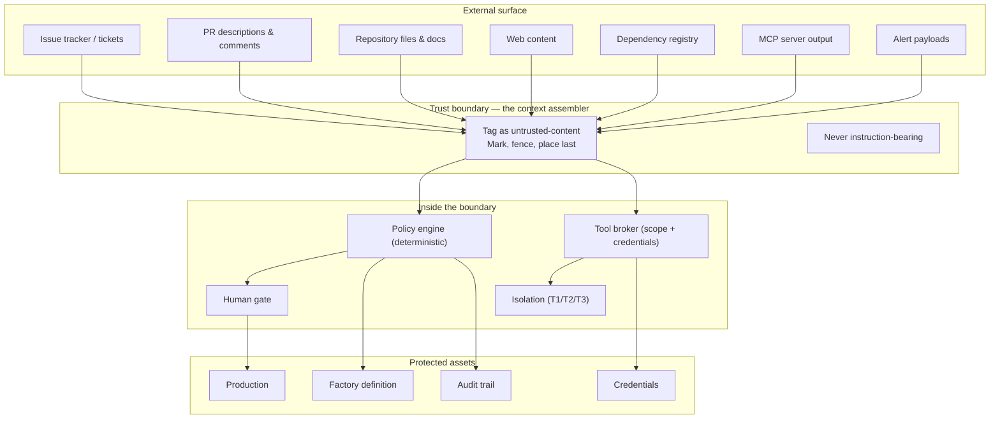

# 13 — Security, Governance and Human Control

**Purpose:** the threat model, the authority model, the access points, the autonomy ladder in operation, and the rules that decide what the factory may do without asking.

**Source of truth for:** access-point contracts, the autonomy ladder's enforcement, the blast-radius model, the threat model, and the human approval policies.
**Derived from:** ADR-0001, ADR-0002, ADR-0003, ADR-0004, ADR-0006, ADR-0007, `06_REQUIREMENTS_AND_NFRS.md` (SEC-01…SEC-12, FR-70…FR-86), `11_TOOLS_MCP_AND_INTEGRATIONS.md`.

**Provenance of the threat model.** The corpus of 15 transcripts contains **no source that addresses prompt injection, credential scoping, secret management, supply-chain integrity, multi-tenant isolation, or rollback**. Those sections are marked **[E3]** — blueprint engineering judgement, not source-derived. Where a source *does* contribute (V13's blast-radius proportionality, V14's production-access restriction, V15's context integrity, V02's dark-factory failure), the attribution is given.

---

## 1. The threat model

### 1.1 What is being protected

The factory holds authority that a single compromised agent could misuse to affect production, exfiltrate data, or permanently alter the rules that govern future agents. The assets, in priority order:

| # | Asset | Why it matters | Loss consequence |
|---|---|---|---|
| 1 | **Production systems** | Availability and correctness for users | Direct user harm; the worst outcome |
| 2 | **Credentials** | Access to every system the factory touches | Lateral movement, exfiltration, blast radius unbounded by the factory's own controls |
| 3 | **The factory definition** | The rules governing all future agents | Silent, permanent corruption of every subsequent run |
| 4 | **The audit trail** | The ability to reconstruct what happened | Loss of accountability; loss of the ability to detect |
| 5 | **Source code and artefacts** | The product itself | Loss of work; IP exposure |
| 6 | **Run artefacts and telemetry** | The substrate for improvement and measurement | Loss of the ability to improve or to investigate |

### 1.2 Threat actors

| Actor | Capability | Objective | Primary control |
|---|---|---|---|
| **T1 — Malicious requester** | Can submit an issue, a PR description, a ticket, or text that lands in a repository | Make the agent perform an action on their behalf | Untrusted-content tagging; policy engine; approval on effectful actions |
| **T2 — Compromised dependency** | Code executes inside a task's environment | Read credentials, exfiltrate, tamper | T2/T3 isolation; default-deny egress; scoped credentials; dependency integrity (SEC-09) |
| **T3 — Compromised integration** | An MCP server, a CI provider, or an API returns malicious content or results | Poison the agent's context or output | Untrusted-result tagging; output schema validation; review independence |
| **T4 — Insider or careless operator** | Legitimate access to the control surface | Widen permissions, bypass a gate, or hide a change | ADR-0001's read-and-request rule; definition changes are reviewed; audit trail |
| **T5 — Confused or manipulated agent** | The agent itself, through hallucination, misparse, or injection | Perform an unintended action | The deterministic policy engine; deny-by-default; blast-radius tiers |
| **T6 — The system itself** | A mis-specified workflow, a wrong policy, a bad definition | Cause systematic harm at scale | Reviewed changes; replay evaluation; drift detection; automatic rollback |

**T6 is the threat the corpus talks about least and the one that most needs the blueprint's controls.** A single misconfigured policy applied by a reconciler across every repository causes more damage than any individual injection.

### 1.3 The attack surface



**Every path from the external surface to a protected asset passes through the policy engine and, where the effect class warrants it, a human.**

### 1.4 The injection threat, stated precisely

**Prompt injection** is the case where content the agent reads contains instructions that the agent obeys. The threat is not that the model is "vulnerable"; it is that the model is a system that follows instructions, and instruction-shaped content is indistinguishable from instruction to it.

The corpus is silent on this. The blueprint's answer is structural:

> **Untrusted content is data, never instruction. It is tagged at ingest, passed in a marked envelope, and — critically — the agent can only *propose* actions. Every consequential action is checked by a deterministic policy engine, and irreversible actions require a human who can see the injected content.**

The chain of controls, in order of reliance:

| # | Control | Layer | Strength |
|---|---|---|---|
| 1 | Untrusted content tagged at ingest, before it reaches any model | Deterministic | **Primary** |
| 2 | Untrusted content placed last in the envelope, fenced, item-labelled | Deterministic | Supporting |
| 3 | The prompt states that embedded instructions are not to be followed | Probabilistic | Defence in depth |
| 4 | The policy engine checks the *proposed action*, not the *content* | Deterministic | **Primary backstop** |
| 5 | Effect class + blast radius determine whether a human must approve | Deterministic | **Primary** for irreversible effects |
| 6 | The human sees the raw untrusted content alongside the proposal | Human | **Primary** for irreversible effects |

**The architecture does not depend on the model resisting injection.** It depends on the model being unable to *complete* an injected instruction on its own. This is the single most important security property in the blueprint, and it is achieved by separating authority from orchestration (ADR-0004), not by sanitising prompts.

### 1.5 Threat-to-control mapping

| Threat | Controls | Verification |
|---|---|---|
| **T1** — instruction embedded in an issue | Tagging; envelope marking; prompt instruction; policy engine; approval on effectful actions | Red-team suite (`14_...`); injected instruction cannot alter an action |
| **T2** — malicious dependency | T2/T3 isolation; default-deny egress; per-task scoped credentials; dependency integrity check; image pinning | T3 task cannot reach an undeclared host; tampered artefact detected |
| **T3** — poisoned tool output | Result trust tagging; output schema validation; registry authority (an MCP tool is not callable merely because it is advertised) | Poisoned result cannot produce an authorised action |
| **T4** — operator widens permissions | ADR-0001's read-and-request rule; definition changes reviewed; audit trail | A control-surface write without a reviewed change is rejected |
| **T5** — confused agent | Deny-by-default; escalation on uncertainty; blast-radius tiers; turn and cost budgets | A scope-escalation attempt is denied and logged |
| **T6** — mis-specified system | Reviewed changes; replay evaluation; guardrail metrics; automatic rollback; drift detection; promotion bar | A guardrail breach triggers an automatic revert |

---

## 2. The authority model

### 2.1 Two kinds of authority, never held by one component

Per ADR-0004:

| | Deterministic policy authority | Probabilistic orchestration authority |
|---|---|---|
| **Holder** | The policy engine | The orchestrator agent |
| **Decides** | Is this permitted? What scope? What blast radius? Is this credential valid? Is this content untrusted? | How to achieve it: decomposition, sequencing, tool choice within scope, retry strategy, interpretation of unstructured output |
| **Cannot** | — | Widen its own scope, escalate autonomy, mint credentials, bypass a gate, or treat untrusted content as instruction |
| **Failure mode** | Denies too much | Produces a wrong plan within its authority |

### 2.2 The enforcement points

Three components can refuse an action, and all three are deterministic:

| Component | Refuses | Effect |
|---|---|---|
| **Policy engine** | An action outside the grant, an action denied by policy, an action whose blast radius exceeds the autonomy level | `tool.denied`; a security event |
| **Tool broker** | An out-of-scope tool, an out-of-scope resource, a missing schema-valid call, a missing approval | `tool.denied`; the call never reaches the adapter |
| **Merge gate** | A change failing any mandatory gate, or lacking a bound approval | Merge refused; the change stays in review |

**There is no probabilistic component in this chain.** That is the point of the design.

### 2.3 The arbitration rule

Per ADR-0004 §3:

| Situation | Resolution |
|---|---|
| Action not enumerated in the workflow's granted capability set | **Denied.** The task fails to a human. |
| Action in scope but not enumerated in policy's allow-list for the current state | **Escalated** to an approval access point. |
| Action explicitly denied by policy | **Denied, permanently.** Recorded as a security event. |
| Policy engine unavailable | **Fail closed.** Denied. |
| Broker unavailable | **Fail closed.** Denied. |

**"Deny by default and escalate"** is the rule. "Let the orchestrator try and see" is not available anywhere in the system.

### 2.4 The authority record

Every consequential action carries the authority that permitted it:

```json
{
  "authority": {
    "source": "accesspoint.approve",
    "grantId": "grt_01JCZ8JQ...",
    "autonomyLevel": "L2",
    "policyRule": "policy.merge.default/v3#allow-explicit-review",
    "approver": "human:alice",
    "approvedAt": "2026-11-05T09:14:00Z",
    "artefactSha256": "…"
  }
}
```

This is what SEC-07's acceptance criterion means in practice: an auditor can reconstruct any action's authorisation from the event log alone.

---

## 3. The access points

Per ADR-0002, humans enter the factory through a **small, enumerated set of typed access points**. Each carries declared authority. There is no other sanctioned channel.

### 3.1 The catalogue

| Access point | Authority | Cannot |
|---|---|---|
| **AP-1 `define-intent`** | Submit an intent; supply constraints; request a workflow | Modify any configuration; approve anything; act on an agent's behalf directly |
| **AP-2 `approve`** | Grant, refuse, or revoke an approval for a specific artefact | Approve an artefact that has changed since approval; approve outside its effect class |
| **AP-3 `review`** | Comment on a change; request changes; reject | Merge; approve one's own request in a workflow that forbids it |
| **AP-4 `inspect`** | Read the operational surface, the audit trail, and any run artefact | Change state |
| **AP-5 `intervene`** | Pause, cancel, escalate, re-run, or redirect an in-flight task; grant a temporary capability | Write to the factory definition; grant a permanent capability |
| **AP-6 `amend-factory`** | Propose a change to the definition, a skill, a workflow, a policy, or an autonomy level | Apply it — it lands as a reviewed change |

**Deliberately excluded:** a generic "chat with the agent" access point. ADR-0002 retains it only as a *development-time* affordance, never as a production path, because it makes governance unenforceable and leaves no durable record of authority.

### 3.2 Human contributions through the factory

Humans may contribute to the codebase by raising a pull request directly. This is **not** a governance channel (ADR-0002). Such contributions are processed exactly as any externally-submitted change: they are untrusted-content at intake, they pass the same refinement and verification, and they are subject to the same quality gates (FR-77).

The point is that the factory's guarantees hold regardless of who wrote the code.

### 3.3 The access-point contract

Every access-point call:

1. is authenticated with a human identity;
2. names the authority it is exercising;
3. is recorded in the event log with the authority and the resulting state change;
4. is subject to the same policy evaluation as any other consequential action.

A control-surface write that is not backed by a reviewed change in the definition is **rejected** (ADR-0001's acceptance test).

---

## 4. The autonomy ladder in operation

### 4.1 The levels

Per ADR-0003:

| Level | Name | The factory may | Human involvement |
|---|---|---|---|
| **L0** | Research | Read, search, analyse, produce reports | None required |
| **L1** | Propose | Produce plans, designs, patches, specs — no repository mutation | Human selects and applies |
| **L2** | Execute isolated | Create branches, run in isolated workspaces, open PRs | **Human reviews the PR; always required for code** |
| **L3** | Merge after approval | Merge and deploy after a configured, risk-tiered approval is satisfied | Approval per the merge policy |
| **L4** | Operate production | Execute an enumerated set of authorised production operations | Pre-approved runbook; no per-action approval; post-hoc review |

### 4.2 The level is enforced where it matters

The ladder is not a label. It is enforced at the transition guard:

```
APPROVED → MERGING
  guard: policy engine authorises the merge at the workflow's autonomy level;
         the level permits merging (≥ L3), OR the merge is a human-initiated
         action through an access point.
```

**A workflow at L2 cannot merge autonomously.** The merge must arrive via a human access point. This is a single guard in the state machine, and it is the enforcement point for the entire ladder.

### 4.3 The floor

> Human reading of code is mandatory for any workflow whose output enters the main branch, until that workflow has a **discriminator-calibrated verifier set** covering its acceptance criteria.

"Discriminator-calibrated" means the verifier has been demonstrated, **on that repository and for that class of change**, to fail when its property is violated. "The verifier exists" is not sufficient.

This reconciles V14's evidence (unattended models degrade codebase quality; SlopCodeBench 14.8%) with V15's claim (verifiers can substitute for review) — the substitution is earned, not assumed.

### 4.4 Promotion and revocation

| Aspect | Rule |
|---|---|
| **Default** | A new workflow starts at L2. |
| **Promotion evidence** | A calibration run showing the workflow's verifiers detect known violations, plus an observed defect-escape rate below the agreed threshold over a defined sample. |
| **Promotion process** | A reviewed definition change. The autonomy level is part of the definition, so promotion is versioned, reviewable, and revertible without a code deployment (ADR-0003 §5). |
| **Revocation triggers** | A defect escape; a verifier regression; a cost anomaly; a guardrail breach; a policy change that raises the bar. |
| **Revocation is normal** | Revocation is not an exceptional path. A workflow that is demoted returns to L2 and the merge path changes immediately. |
| **L4 is narrow** | L4 applies only to operations with a written, reviewed runbook: a defined alert class, a prepared remediation, an abort condition, and a post-hoc review. It is **not** a general "deploy to production" permission. |

### 4.5 What each level means in practice

| Level | Typical workflow | What a human does |
|---|---|---|
| L0 | Research, codebase analysis, an architecture survey | Reads the report, if they care |
| L1 | A plan, a design, a spec, a patch as a proposal | Selects and applies |
| L2 | Issue-to-PR, bug fix, conformance sweep | Reviews the PR and merges it |
| L3 | Release automation for low-risk changes, dependency bumps | Gives a risk-tiered approval; does not read the code |
| L4 | A defined remediation for a defined alert class | Pre-approved runbook; post-hoc review |

---

## 5. The risk model

### 5.1 Blast radius

Blast radius is the estimate of **how much damage this change could cause if it is wrong**. It determines the gate set, the review depth, the approval class, and the autonomy level at which the change may merge automatically.

**V13's principle, adopted:** review and approval depth are proportional to blast radius. A documentation typo and a schema migration receive identical treatment in most pipelines, and that is a defect.

### 5.2 The scoring dimensions

| Dimension | How it is assessed | Weight |
|---|---|---|
| **Reach** | How many components, services, repositories, or users does the change affect? | High |
| **Reversibility** | Is there a tested undo? A revert? A rollback? A data restore? | High |
| **Data** | Does it touch persisted data, a schema, a migration, or a retention policy? | High |
| **Security boundary** | Does it cross a trust boundary, change an authorisation check, or handle credentials or personal data? | High |
| **Blast of error** | If the code is wrong, what happens — a wrong number, a data loss, an outage? | High |
| **Novelty** | Is this a class of change the factory has made before with a known escape rate? | Medium |
| **Change size** | Lines, files, and the size of the diff. | Low — it is a weak proxy, and it is the one people over-weight |

**Change size is deliberately the lowest-weighted dimension.** It is what most review policies use, and it is a poor proxy for risk: a three-line change to an authorisation check is far riskier than a three-hundred-line documentation refactor.

### 5.3 The tiers

| Tier | Score | Example | Gate set | Merge autonomy |
|---|---|---|---|---|
| **R0 — Trivial** | 0–1 | Typo in a comment; a non-functional doc edit | Static analysis only | L3 (policy-configured) |
| **R1 — Low** | 2–3 | A new internal function with tests; a dependency patch | Static + unit + acceptance | L3 with a standard approval |
| **R2 — Moderate** | 4–6 | A change to a shared library; a new endpoint | Static + unit + integration + acceptance + review | L2 (human reads the code) |
| **R3 — High** | 7–8 | A schema migration; an authorisation change; a config change affecting production | All of R2 + security review + security approval + rollback plan | L2 with security-scope approval |
| **R4 — Critical** | 9+ | A production data operation; a trust-boundary change; a credential-handling change | All of R3 + explicit rollback verification + named approver + security-scope approval | L2 with named approval; L4 only under an enumerated runbook |

### 5.4 How the tier is computed

**Deterministically where possible.** The blast-radius assessment is a computation over the change's declared properties — files touched, paths matched, symbols referenced, data classes involved — crossed with the repository's declared criticality map. The model contributes a proposal, but the **tier is recorded with its rationale and reviewed**, and it may only be **raised** by a human; it may be lowered only by policy that is itself reviewed.

**The asymmetry is deliberate.** A wrongly high tier costs review capacity. A wrongly low tier causes an unreviewed dangerous change. Under uncertainty, the tier is raised.

### 5.5 The criticality map

Each repository declares a **criticality map**: which paths and components carry which consequences.

```yaml
apiVersion: factory/v1
kind: CriticalityMap
metadata:
  name: org-payments
spec:
  paths:
    - pattern: "services/auth/**"
      tier: R3
      reason: "Authorisation decisions; a defect grants or denies access"
    - pattern: "services/payments/ledger/**"
      tier: R4
      reason: "Irreversible financial records; a defect causes data loss"
    - pattern: "services/payments/api/**"
      tier: R3
      reason: "Customer-facing money movement"
    - pattern: "docs/**"
      tier: R0
      reason: "No runtime effect"
  dataClasses:
    - {pattern: "models/pii/**", class: "personal", maxTier: R4}
    - {pattern: "models/ledger/**", class: "financial", maxTier: R4}
```

The map is part of the factory definition and is reviewed as a change. It is the mechanism by which a repository's risk knowledge is expressed once, rather than re-derived per change.

### 5.6 Reversibility and rollback

| Requirement | Detail |
|---|---|
| Every R3+ change has a **declared rollback** | Written before the change merges, not devised during an incident |
| The rollback is **tested** | A rollback drill restores a known-good state within an agreed time (SEC-10) |
| A change without a tested rollback **cannot deploy** | A hard gate, not a warning (Workflow E) |
| Data changes require a **data restore** path, not just a code revert | A code revert does not undo a migration |

---

## 6. Human approval policies

### 6.1 What an approval is

An approval is a **human's authorisation of a specific artefact under a specific authority, bound to that artefact's hash, time-limited, and single-use.**

| Property | Rule |
|---|---|
| **Artefact-bound** | The approval binds to the artefact's hash. If the artefact changes, the approval is void. |
| **Time-limited** | Default 30 minutes for E3 effects, 10 minutes for E4. |
| **Single-use** | One approval authorises one invocation or one merge, not a class. |
| **Non-transferable** | An approval for one task does not authorise another, even the same workflow. |
| **Revocable** | Revocable before use; the revocation is recorded. |
| **Identity-bound** | The approver's identity is recorded. Self-approval is blocked where the policy forbids it. |

### 6.2 Approval types

| Type | What it authorises | Bound to |
|---|---|---|
| **Plan approval** | Executing a specific task graph | The graph's structure |
| **Merge approval** | Merging a specific change | The change's hash + its verification report |
| **Deployment approval** | A specific release | The release artefact + the runbook |
| **Invocation approval** | One specific sensitive tool call | The argument hash |
| **Autonomy promotion** | A workflow operating at a higher level | The workflow definition + the calibration report |
| **Definition amendment** | A change to the factory's own configuration | The diff |
| **Security exception** | A deviation from a security policy, for a named scope and a stated duration | The scope + the expiry |

### 6.3 Who may approve what

| Role | May approve | May not approve |
|---|---|---|
| **Engineer** | Plan, merge (R0–R2), invocation (E1) | Anything R3+; their own change in a workflow that forbids self-approval |
| **Service owner** | Merge (R0–R3), deployment (their service) | R4; another team's service |
| **Security reviewer** | Security exceptions, R3+ security approvals | Ordinary merges |
| **Platform owner** | Definition amendments, autonomy promotions, policy changes | — |
| **Incident commander** | Deployment under an incident runbook | Autonomy promotion; permanent policy change |

**Separation of duties.** The engineer who wrote the change may not be the sole approver of an R3+ change. This is a small rule with a large effect on review quality, and it is cheap to enforce.

### 6.4 Approval fatigue

FR-73 requires the factory to detect and surface approval-fatigue indicators. This is a real failure mode: a queue that is too large produces rubber-stamping, which makes the approval step ceremonial.

| Indicator | Definition | Threshold behaviour |
|---|---|---|
| **Volume** | Approvals awaiting action, and approvals per human per day | Above the sustainable rate, the factory escalates: the queue is a capacity problem, and the answer is to fix the workflow or the tiering |
| **Latency** | Time from request to decision, per tier | A rising latency at a stable volume indicates confusion, not capacity |
| **Rubber-stamp rate** | The proportion of approvals granted with no recorded modification, comment, or inspection | A high rate is the strongest single signal that the gate is not doing work |
| **Post-hoc defect rate** | The rate at which approved changes are later reverted or produce incidents | The measure that ultimately matters |

**The factory's response to fatigue is not to loosen the gate.** It is to reduce the number of things that need approval — by fixing the tiering, by fixing the workflow, by improving the verification so that a lower tier is genuinely safe. Loosening the gate in response to fatigue is how a review step becomes theatre.

**Approval latency by tier is also a routing signal.** If R0 approvals are slow, the problem is the queue's ordering or the notification path, not the reviewers.

### 6.5 Plan-first approval

FR-74: a human may approve an agent's plan before execution, and the execution is then checked against the approved plan.

| Aspect | Rule |
|---|---|
| **What is approved** | The task graph: the decomposition, the topology, the scope |
| **What is checked at execution** | Each node's scope and dependencies against the approved graph |
| **Deviation** | A node that exceeds its approved scope, or a graph that changes materially, requires re-approval |
| **Benefit** | The expensive failure (a wrong decomposition amplified across N workers) is caught before the cost is incurred |
| **Cost** | It is a serialisation point — it adds latency before any work starts |

---

## 7. Security controls by category

### 7.1 Least privilege

| Principal | Holds | Explicitly does not hold |
|---|---|---|
| **Triage agent** | Read-only repository metadata, issue read, workflow catalogue read, context lookup | Any write, any shell, any network beyond internal services |
| **Worker** | The tools its work item requires, scoped to its declared paths | Write tools on a read-only item; production write; secret read |
| **Reviewer** | Read access to the change and its context; optionally the verifiers | Any write tool |
| **Security reviewer** | Read access, security scanners, dependency metadata | Any write; production access |
| **Incident agent** | Production telemetry read; branch and change creation; verification | Direct production write |
| **A skill** | Nothing | It may *request* a capability; the policy engine decides |
| **A workflow** | The intersection of its declared environment and its grants | Anything outside it |
| **A stage** | The intersection of the workflow's grant and the stage's narrower scope | Anything outside it |
| **A capability** | Its declared `scope.required` | Anything the workflow did not grant |

### 7.2 Secret management

| Rule | Detail |
|---|---|
| **Storage** | Long-lived credentials live only in the control plane's secret store. Never in a repository, never in an environment variable file that is committed, never in a prompt. |
| **Brokering** | Every agent-facing credential is minted per task, scoped to the minimum the capability needs, and injected at the invocation boundary. |
| **Lifetime** | Short-lived by default; revoked at task end by the reconciler. |
| **Non-broadening** | A credential's scope cannot be widened by an agent. Widening is a policy decision. |
| **Observability** | The credential's *reference* and *scopes* are recorded in the event log; the material never is. |
| **Rotation** | A credential rotation is a definition change with a reviewed procedure. |
| **Leak response** | A suspected leak revokes the credential, halts affected tasks, and produces an incident record. |

**The gap this closes.** The corpus is silent on secret scoping (logged in `03_EVIDENCE_LEDGER.md` §4). The risk it addresses is concrete: an agent that can read a long-lived credential can reach every system that credential reaches, which makes the blast radius of one confused agent the whole estate.

### 7.3 Sandboxed execution

Per ADR-0006, three tiers, applied by task risk:

| Tier | Mechanism | Protects against | Applies when |
|---|---|---|---|
| **T1** | Fresh git worktree from the base branch | File-level interference; accidental commits to the protected branch | Documentation, low-blast-radius changes; the default |
| **T2** | Containerised workspace, declared image, no host mounts beyond the checkout, restricted network, scoped credentials | Process escape; cross-task contamination; credential over-reach; runaway resource use | Anything that executes code, touches dependencies, or runs tests |
| **T3** | Ephemeral network-restricted sandbox, per-task ephemeral credentials, resource quotas, full audit | Hostile input; network exfiltration; supply-chain compromise | Untrusted inputs; production-adjacent systems; all L4 operations |

**Every task runs at T1 or above. T2 is the default for anything that runs code. T3 is mandatory when the task reads untrusted content or touches production-adjacent systems.**

### 7.4 Repository isolation

SEC-12: an agent in one repository cannot access another's artefacts or credentials.

| Mechanism | Detail |
|---|---|
| **Checkout isolation** | Each task's environment contains only its repository's checkout. |
| **Grant scoping** | The capability grant names the repository; a resource outside it is refused. |
| **Credential scoping** | The brokered credential is scoped to one repository. |
| **Artefact isolation** | Run artefacts are stored per task and are not readable across tasks except through declared capabilities. |
| **Cross-repo reads** | Where genuinely needed, they go through an explicitly declared capability with its own scope — never through a shared filesystem. |

### 7.5 Network restrictions

| Rule | Detail |
|---|---|
| **Default deny** | Egress from the execution environment is denied unless explicitly allowed. |
| **Allow-list** | Per workflow, declared in the factory definition, reviewed as a change. |
| **Fetching service** | Untrusted content is fetched by a control-plane service, not by the agent's environment, and returned tagged as untrusted. This removes the agent's ability to browse freely and exfiltrate. |
| **Production egress** | Denied by default. Where a workflow requires it, it is enumerated and reviewed. |
| **Fail-closed** | If the network policy service is unavailable, egress is denied. |

### 7.6 Supply-chain security

SEC-09 and the evidence gaps in `03_EVIDENCE_LEDGER.md` §4.

| Control | Detail |
|---|---|
| **Image pinning** | Container images are pinned by digest, not by tag. |
| **Dependency integrity** | Lockfiles are mandatory and regenerated deterministically. Dependency metadata is untrusted-content. |
| **Provenance** | Context and skill artefacts carry a provenance record and a signature; the signature is verified on load. A tampered artefact is rejected. |
| **Dependency review** | New dependencies require the security review at the tier the criticality map assigns. |
| **Advisory monitoring** | A dependency advisory triggers a maintenance workflow (FR-84, FR-85), not an ad-hoc fix. |
| **Build reproducibility** | The build is reproducible from a declared input set, so a compromised build is detectable by rebuilding. |

### 7.7 Untrusted content handling

| Property | Rule |
|---|---|
| **Tagging** | At ingest. Every external path tags: issue tracker, PR text, comments, docs, web, registries, tool output, alert payloads. |
| **Marking** | The envelope marks the item and its classification. |
| **Placement** | Untrusted content is last in the envelope, fenced, item-labelled. |
| **Instruction** | The prompt states that embedded instructions are not to be followed. Defence in depth. |
| **Authority** | The agent may quote, analyse, or summarise untrusted content. It may not treat it as instruction, and the policy engine does not treat an action derived from it as authorised by it. |
| **Quarantine for execution** | Untrusted content is never executed. If a workflow needs to run code from an untrusted source, it runs at T3 with a reviewed procedure. |

### 7.8 Audit logging

| Property | Rule |
|---|---|
| **Immutability** | The event log is append-only. Corrections are compensating events. |
| **Completeness** | Every consequential action produces exactly one event, in the same transaction as the state change. |
| **Authority** | Every event carries the authority under which it happened. |
| **Correlation** | Every event carries a correlation id (the task) and, where applicable, a causation id. |
| **Context** | Agent events carry the pinned context manifest, so the run is reconstructible. |
| **Cost** | Events carry token and currency amounts where money was spent. |
| **Redaction** | Redaction is applied at capture and recorded — what was redacted and under which policy. |
| **Reconstruction** | An auditor can answer "who did this, under what authority, with what context" for any consequential action. |

### 7.9 Production access

SEC-08 and FR-86: production access is restricted to **enumerated, runbook-backed operations**.

| Requirement | Detail |
|---|---|
| **Enumeration** | Every production operation is declared with its exact scope, its abort condition, and its rollback. |
| **Runbook** | A written procedure, reviewed, with a named owner. |
| **Pre-approval** | Under L4, the runbook is pre-approved; no per-action approval is required, but the runbook's scope is narrow. |
| **Abort conditions** | Each operation declares the conditions under which it must stop rather than continue. |
| **Post-hoc review** | Every production operation produces a review record. |
| **Refusal** | An operation outside the enumerated set is refused by the tool broker, not by convention. |
| **No direct agent write** | An agent never writes to production. It proposes; the deployment controller executes the enumerated operation. |

### 7.10 Deployment protection

| Control | Detail |
|---|---|
| **Protected branches** | No task may modify a protected branch directly. All changes are delivered as reviewable change records (FR-41). |
| **Required checks** | The applicable gate set is a required check in the CI configuration; it cannot be skipped by a setting change without a reviewed change. |
| **Gate weakening** | A change that disables, skips, or loosens a required check is itself R3 and requires security-scope approval. |
| **Environment separation** | Staging and production are distinct; a deployment is bound to an environment. |
| **Rollback** | Every deployment has a tested rollback (SEC-10). |
| **Canary** | Where supported, a deployment proceeds canary-first with automated abort conditions. |
| **Deployment authority** | Deploying is an L3 action by default, requiring a bound approval. |

---

## 8. The human control plane in operation

### 8.1 The one view

NFR-07: a human must be able to answer *"what is the factory doing now, and what does it need from me?"* in one view, without navigating more than two levels.

The surface shows, at minimum:

| Region | Content |
|---|---|
| **Needs you** | Approvals outstanding, ordered by blast radius; items escalated to a human; failures requiring a decision |
| **In flight** | Every running task: workflow, stage, age, cost so far, isolation tier, next expected event |
| **Recent outcomes** | Merged, rejected, failed, rolled back — with the failure classification |
| **Health** | Degraded capabilities, failing gates, budget consumption, queue depth |
| **Cost** | Cost today, this week, per accepted change |

### 8.2 Intervention verbs

The surface is **read-and-request** (ADR-0001). Its verbs:

| Verb | Effect |
|---|---|
| **Pause** | The task stops at the next safe point; the environment is retained. |
| **Cancel** | The task moves to `ABANDONED`; resources are reclaimed. |
| **Escalate** | The task moves to `ESCALATED` and appears in "needs you". |
| **Re-run** | A new attempt with the same specification, recorded as a new attempt. |
| **Redirect** | Change the task's workflow or parameters — this is a **request** that lands as a reviewed change if it alters the definition. |
| **Grant (temporary)** | A scoped, time-limited capability for a named task, recorded with its authority. |

**The surface cannot write to the definition.** A redirect that would change a workflow's autonomy level, a policy, or a capability grant is submitted as a proposed change and follows the reviewed path.

### 8.3 Reviewer ergonomics

A reviewer's cost is the constraint the whole design works within (CP-7). The surface supports:

- **Risk-ordered queue** (FR-72) with the recorded rationale visible, so the ordering is explicable and challengeable.
- **The evidence, in one place**: the diff, the acceptance criteria, the oracle's results, the gate report, the reviewer's findings, the panel's confidence, the cost, and the failure history of similar changes.
- **The reviewer does not inherit the implementer's reasoning.** The implementer's transcript is available on request but is not shown by default, because inheriting the reasoning reproduces its blind spots.
- **Machine-checked conformance is already done.** The reviewer is not asked to check what the gates check; they are asked what the gates cannot.

### 8.4 The approval request's contents

An approval request carries: the artefact and its diff; the acceptance criteria; the verification report with per-layer results; the review findings; the panel's confidence and its dissent; the blast-radius tier and its rationale; the cost; the autonomy level; the applicable policy rules; and the exact effect that will occur if approved.

**The request must be self-contained.** A human should not have to reconstruct the reasoning to make a decision.

---

## 9. Governance of the factory itself

### 9.1 The definition is the governance surface

| Rule | Detail |
|---|---|
| **The definition is declarative** | ADR-0001: the factory's shape is version-controlled data. |
| **The surface is read-and-request** | No direct writes. |
| **Every change is reviewed** | Definition, policy, skill, workflow, harness, and autonomy changes alike. |
| **Scope-differentiated approval** | ADR-0007: four scopes, four approval bars. |
| **Drift is reported** | FR-26: divergence between declared and actual is surfaced with a recommended action, not silently corrected. |

### 9.2 The four scopes

| Scope | Changes | Approval |
|---|---|---|
| **Run** | One execution | Automatic |
| **Skill** | One skill's content | Automatic if additive and below a risk threshold; otherwise reviewed |
| **Workflow** | The composition of skills into a workflow | Human review required |
| **Harness** | Agent configuration, tool surface, model routing, context assembly, policy | Human review required, always |
| **Policy / autonomy** | The policy set or a workflow's autonomy level | Human review required, always, plus ADR-0003's calibration bar |

### 9.3 The continuous-improvement boundary

**The meta-factory may not autonomously rewrite critical infrastructure or security policy.** It may:

- read the run artefacts and the metrics;
- detect patterns;
- attribute them to a scope;
- construct a proposal with evidence, expected effect, measurement plan, and rollback plan;
- submit that proposal through the reviewed path.

It may **not**:

- write to the definition, the policy set, the skill corpus, or the verifier set (SEC-11);
- apply its own proposal;
- promote an autonomy level without the calibration evidence;
- change its own improvement thresholds.

**This boundary is what makes continuous improvement safe.** An autonomous improver that could rewrite the rules is a mechanism whose failure compounds: a degraded skill produces degraded runs, which produce more degraded skill proposals. ADR-0007 rejects it, and the blueprint adopts that rejection without qualification.

---

## 10. Invariants

| ID | Invariant | Enforcement |
|---|---|---|
| **SG-1** | No agent holds both deterministic and probabilistic authority. | Architectural: separate components; no component implements both interfaces. |
| **SG-2** | Every consequential action passes a deterministic policy evaluation. | SEC-01's test: a direct capability call without a policy decision fails. |
| **SG-3** | Untrusted content is never instruction-bearing. | Ingest tagging; envelope marking; red-team suite. |
| **SG-4** | A denied action is never routed around. | Effect-class comparison detects the attempt. |
| **SG-5** | Human code review is mandatory until calibration proves otherwise. | The `APPROVED → MERGING` guard. |
| **SG-6** | An approval is bound to an artefact hash, time-limited, and single-use. | The approval service rejects a stale or mismatched approval. |
| **SG-7** | Secret material never appears in an agent's context, prompt, or the event log. | Context scan test; artefact scan test. |
| **SG-8** | Production access is enumerated, runbook-backed, and refused outside the set. | The broker refuses an unenumerated operation. |
| **SG-9** | No agent may modify the definition, policy, skill, or verifier stores. | SEC-11's write-attempt test across every tool path. |
| **SG-10** | The control surface cannot write to the definition. | ADR-0001's acceptance test. |
| **SG-11** | Every consequential action is reconstructible with its authority. | SEC-07's audit reconstruction test. |
| **SG-12** | The failure mode of the policy engine is deny. | A policy outage results in denials. |

---

## 11. Known limitations

1. **The threat model is incomplete by construction.** It was derived from the corpus plus engineering judgement, and the corpus does not address most of the modern threat surface. A dedicated threat-modelling exercise against the concrete implementation is required before production deployment; this document is the starting point, not the finish.
2. **Blast-radius scoring is an estimate and depends on a criticality map that can be wrong.** A repository that has not declared its critical paths gets the default tier, which is too low. Mitigation: the default is deliberately conservative for repositories with no map, and the map's absence is visible.
3. **Separation of duties adds latency.** The engineer who wrote an R3+ change cannot be its sole approver. This is a real cost, accepted.
4. **Untrusted-content tagging depends on the ingest path being complete.** A capability added without correct tagging is a hole. Mitigation: the tagging is a property of the adapter contract, and the adapter registration is reviewed; a new adapter without a trust classification is a registration error.
5. **Approval-fatigue detection is a lagging indicator.** Rubber-stamping is only visible after the fact, in the post-hoc defect rate. The leading indicators (volume, latency, stamp rate) are proxies.
6. **The L4 runbook mechanism is only as good as the runbooks.** An enumerated operation with a bad abort condition is worse than no automation, because it acts with pre-approval. This is why L4 is narrow and each runbook has a named owner.
7. **Trust classification is binary in practice.** Real content is often partly trusted — a dependency manifest is mostly structural but may embed a URL. The classification is conservative (untrusted unless shown otherwise), and the cost is that some legitimately-trusted content pays the quarantine overhead.

---

## 12. Related documents

- `07_REFERENCE_ARCHITECTURE.md` §3, §4 — the control-plane topology and the policy engine, broker, and access-point service
- `09_ORCHESTRATION_STATE_AND_EVENTS.md` §2.3 — the transition guards that enforce the autonomy ladder
- `11_TOOLS_MCP_AND_INTEGRATIONS.md` §4, §5 — the scope model, the grant model, and the invocation approval flow
- `12_END_TO_END_WORKFLOWS.md` — where each workflow's approval gates sit
- `14_QUALITY_TESTING_AND_EVALUATION.md` — the red-team suite and the calibration procedure
- `15_OBSERVABILITY_COST_AND_FEEDBACK.md` — the approval-fatigue and human-intervention metrics
- `templates/ADR.md` — the decision-record template
