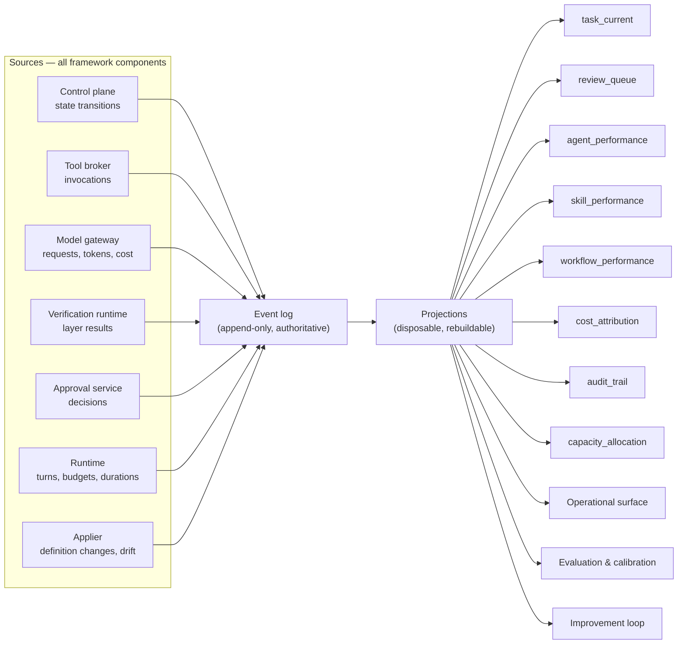
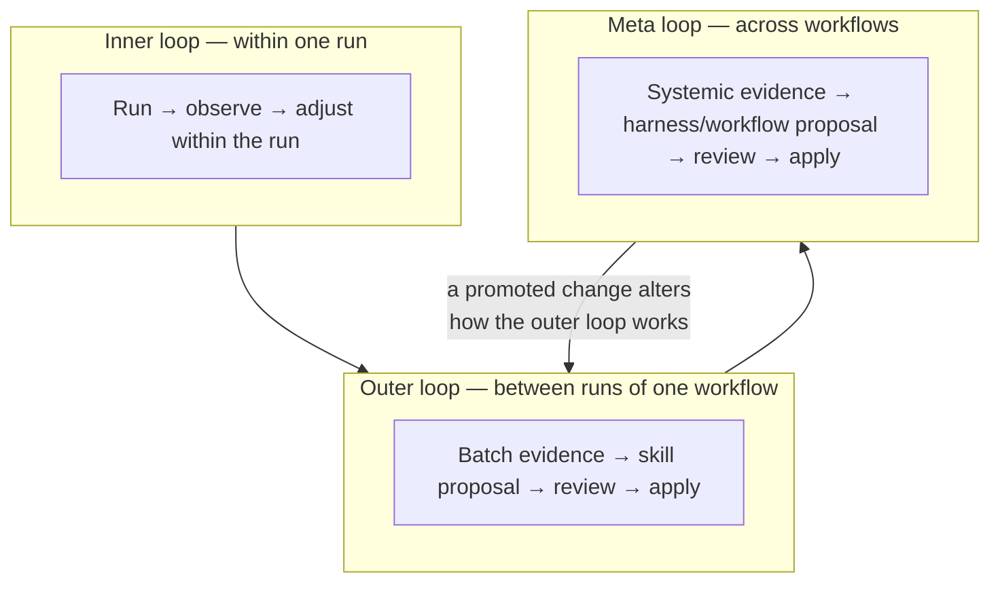
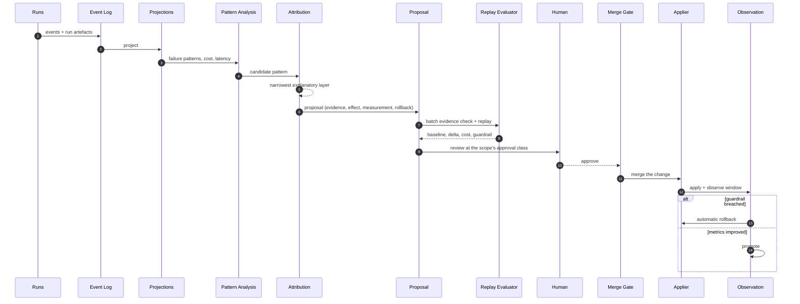
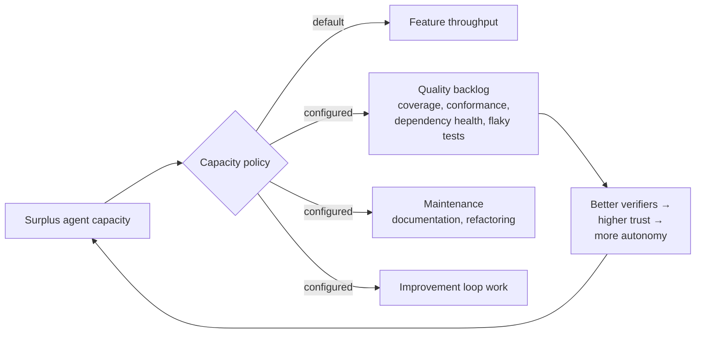
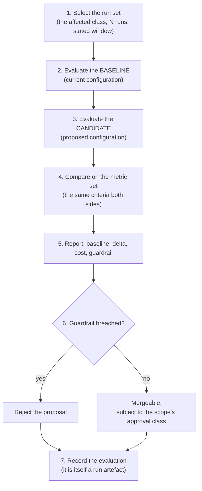

# 15 — Observability, Cost and Feedback

**Purpose:** how the factory sees itself, what it costs, and how what it learns changes what it does.

**Source of truth for:** the run-artefact record, the telemetry pipeline, the cost model, the feedback loops, and the operational surface's data contract.
**Derived from:** ADR-0001, ADR-0007, ADR-0011, `06_REQUIREMENTS_AND_NFRS.md` (MEAS-01…MEAS-08, NFR-03, NFR-08, NFR-11, FR-70, FR-84), `14_QUALITY_TESTING_AND_EVALUATION.md`, V02, V05, V09, V11, V12, V15.

**The claim this document makes good on.** ADR-0011: run artefacts, telemetry, and cost accounting are a **prerequisite**, not a deliverable. This document specifies them. Everything in `14_...` (calibration, replay, promotion) and everything in Workflow G (self-improvement) is unbuildable without this layer.

---

## 1. The measurement principle

### 1.1 Measurement is intrinsic to the concept

The 1968 Beamer/GE definition of a software factory — the earliest in the corpus (V05, 2:22) — lists three components:

1. a computer-controlled programming environment;
2. standardised development tools;
3. **historical information for management and measurement**.

Measurement was not a modern addition to the idea. It was a defining part of it from the beginning.

### 1.2 Why the corpus needs this constraint

The corpus reports many numbers and almost no baselines. The evidence ledger's metric register (`03_EVIDENCE_LEDGER.md` §2) holds ten headline figures — 10×/100× productivity, 50% token reduction, 90% slop tests, 850 PRs/week, 14.8% on a benchmark — and records for each that it is **vendor-reported, unreplicated, and baseline-free**.

Two of them are methodologically useful despite being unusable as targets:

- **V09 (24:13)** reports a baseline, a delta, a cost, and a **guardrail** (revert rate unchanged). This is the *method*, and ADR-0011 generalises it into a policy.
- **V02 (8:04)** found that workflow defects — not agent reasoning — caused 21 failures across hundreds of runs. That finding was only possible because runs were auditable. It is the clearest evidence in the corpus that the measurement layer is not optional.

### 1.3 The rules

| # | Rule | Source |
|---|---|---|
| **O-1** | Every run produces a complete artefact record. | MEAS-01 |
| **O-2** | Telemetry is emitted by the framework, never reported by agents. | MEAS-02 |
| **O-3** | Every factory change is reported with baseline, delta, cost, and guardrail. | MEAS-03, ADR-0011 §3 |
| **O-4** | Cost is attributed to the accepted change. | MEAS-04 |
| **O-5** | Every metric has a definition, a collection point, an owner, and a threshold. | MEAS-05 |
| **O-6** | **No target derives from any figure in the research corpus.** | MEAS-06, ADR-0011 §6 |
| **O-7** | A historical run can be replayed against a candidate configuration. | MEAS-07 |
| **O-8** | Agent failures are classified, separating reasoning from workflow composition. | MEAS-08 |

---

## 2. The run artefact

### 2.1 What it is

The **run artefact** is the complete record of one execution. It is written by the framework as a by-product of running the task, not assembled afterwards from logs.

### 2.2 The contents

| # | Element | Why it is recorded |
|---|---|---|
| 1 | **Task identity, workflow, and specification version** | The unit of work |
| 2 | **Effective context manifest** — item identifiers, versions, `resolvedContextSha256` | Reproducibility; ADR-0009's validation |
| 3 | **Model, harness, and configuration versions** | Replay; the configuration is the independent variable in every experiment |
| 4 | **Every tool call** — tool identity and version, arguments summary, result summary, duration, cost | FR-65; the capability trail |
| 5 | **All prompts and generated text** (subject to a retention policy) | Diagnosis of a bad run; the prompt is the primary input |
| 6 | **Verification results**, per layer, with authorship flags | The evidence for the merge decision |
| 7 | **Artefacts produced**, with hashes | The change; the hash is what the approval binds to |
| 8 | **Outcome**, including the failure classification | The signal for the improvement loop |
| 9 | **The approval and the authority under which the action occurred** | SEC-07; the audit backbone |
| 10 | **Token counts and compute cost** | MEAS-04; the routing input |
| 11 | **Budget consumption over time** | NFR-11's cost predictability |
| 12 | **Policy decisions** — allow, deny, escalate, with the rule | The security trail |

### 2.3 The record structure

```json
{
  "runId": "run_01JCZ8JY...",
  "taskId": "tsk_01JCZ8K1...",
  "workflow": {"id": "wf_bugfix", "version": "4"},
  "startedAt": "2026-11-05T09:02:11.004Z",
  "completedAt": "2026-11-05T09:31:47.221Z",
  "outcome": {"status": "success", "failureClassification": null},
  "context": {
    "envelopeId": "ctx_01JCZ8JN...",
    "resolvedContextSha256": "…",
    "items": [
      {"id": "skill.backend-conventions", "version": "7", "sha256": "…", "trust": "trusted"},
      {"id": "repo.local-context", "version": "41", "sha256": "…", "trust": "trusted"}
    ],
    "truncations": [],
    "gaps": []
  },
  "configuration": {
    "definitionRevision": "def_01JCZ8A...",
    "harnessVersion": "2.1.0",
    "routingPolicy": "default@3",
    "toolRegistryRevision": "tr_01JCZ8B..."
  },
  "nodes": [
    {
      "nodeId": "n_04",
      "role": "worker",
      "model": {"provider": "providerA", "model": "modelX", "version": "2026-04"},
      "attempts": 1,
      "turns": 47,
      "durationMs": 812430,
      "toolCalls": [
        {"invocationId": "inv_01JCZ8NQ...", "capabilityId": "repo.read", "durationMs": 42, "cost": {"usd": 0}}
      ],
      "artefacts": [
        {"kind": "patch", "uri": "s3://factory-artifacts/chg_.../diff.patch", "sha256": "…", "bytes": 48213}
      ],
      "verification": {
        "layers": [
          {"layer": "acceptance", "result": "pass", "authoredBy": "generator", "trusted": true},
          {"layer": "unit", "result": "pass", "authoredBy": "agent", "trusted": false},
          {"layer": "static", "result": "pass", "authoredBy": "deterministic", "trusted": true}
        ]
      }
    }
  ],
  "cost": {
    "tokensIn": 184220, "tokensOut": 39100,
    "modelUsd": 1.842, "toolUsd": 0.014, "infraUsd": 0.221,
    "totalUsd": 2.077
  },
  "budget": {
    "declaredUsd": 5.00, "consumedUsd": 2.077, "turnsDeclared": 100, "turnsUsed": 47
  },
  "authority": [
    {"action": "merge", "source": "accesspoint.approve", "approver": "human:alice", "artefactSha256": "…"}
  ],
  "retention": {"class": "engineering", "expiresAt": "2027-02-05T00:00:00Z"}
}
```

### 2.4 Writing rules

| Rule | Detail |
|---|---|
| **Framework-emitted** | The runtime and control plane write the artefact. An agent never writes it, and never writes a field of it (MEAS-02). |
| **Atomic with the outcome** | The artefact's final state and the terminal event are written in one transaction, so a completed run always has a complete artefact. |
| **Incremental** | Partial artefacts are written during the run, so a killed run still leaves a record. |
| **Redacted at capture** | Secrets are redacted **at capture time**, not at query time. A stored artefact never held secret material. |
| **Hashed** | The artefact has a content hash; the merge approval binds to the change artefact's hash, and the run artefact links to it. |

### 2.5 Retention

Run artefacts may contain sensitive material — prompts, code, internal identifiers, occasionally customer data quoted in an issue. Retention is policy-driven (NFR-08).

| Class | Content | Retention | Examples |
|---|---|---|---|
| **engineering** | Ordinary runs | 12 months | Issue-to-PR, bug fix |
| **security-relevant** | Runs with denied actions, security findings, or credential events | 24 months | Scope escalation attempts, red-team runs |
| **incident** | Incident-response runs | 24 months | Workflow E |
| **evaluation** | Runs in a replay set | Until the set is retired | Replay corpora |
| **sensitive** | Runs touching personal or regulated data | Per the data classification policy | — |
| **debug** | Sampling of ordinary runs for diagnosis | 30 days | — |

**Redaction.** A redaction policy declares what is removed at capture: secret material (always), personal data (per classification), and any field the policy names. The redaction is itself recorded — `redaction.applied` and `redaction.policyRef` — so a reader knows that something was removed rather than assuming it was never there.

---

## 3. The telemetry pipeline

### 3.1 The shape



**The event log is the source of truth. The projections are disposable.** Any projection can be dropped and rebuilt from the log. This is what makes the replay requirement (MEAS-07) achievable and what keeps the storage layer simple.

### 3.2 Collection points and fidelity

| Signal | Fidelity | Rationale |
|---|---|---|
| **Decision-gating metrics** — defect escape, cost per accepted change, verifier calibration, intervention rate | **Full** | These determine promotion and rollback; sampling would make the decision unsound |
| **Per-run artefacts** | **Full** | The replay corpus |
| **Tool invocations** | **Full** | FR-65 requires a complete trail |
| **Model requests** | **Full** | Cost reconciliation (MEAS-04) requires exact counts |
| **High-volume operational signals** — heartbeat, queue depth, lease renewals | **Sampled** | Volume without decision value |
| **Debug-level tracing** | **Sampled or off** | Cost |

**ADR-0011's rule:** sampling is acceptable for high-volume telemetry but **not** for the metrics that determine promotion or rollback.

### 3.3 The metric projections

| Projection | Key measures | Refresh | Consumers |
|---|---|---|---|
| `task_current` | State, stage, age, last activity, cost so far | Real-time | Operational surface, scheduler |
| `review_queue` | Blast-radius tier, age, risk score, explanation | Real-time | Human Control Plane |
| `approval_queue` | Outstanding approvals, age, type, approver group | Real-time | Human Control Plane |
| `agent_performance` | Per-role oracle pass rate, failure taxonomy, cost, first-pass rate | Hourly | Evaluation, routing |
| `skill_performance` | Per-skill invocation outcomes, context-selection accuracy, staleness | Hourly | Improvement loop |
| `workflow_performance` | Cycle time, stage conversion, intervention rate, escape rate | Hourly | Improvement loop |
| `cost_attribution` | Cost per task, per change, per accepted change | Hourly | Finance, routing policy |
| `audit_trail` | Action → authority reconstruction | Real-time | Audit, compliance |
| `capacity_allocation` | Where agent capacity was spent | Hourly | Capacity policy (FR-95) |
| `calibration_state` | Per-verifier calibration currency, detection rate, corpus size | Daily | Verification runtime |
| `drift_state` | Declared-vs-actual divergences | Real-time | Platform, operational surface |

### 3.4 Freshness and staleness

NFR-03: no task invisible for longer than the declared staleness threshold.

| Signal | Maximum staleness | On breach |
|---|---|---|
| `task_current` | 60 seconds | Alert; the task's last activity is shown as unknown |
| `review_queue` | 60 seconds | Alert |
| `cost_attribution` | 15 minutes | Warning; billing reconciliation is deferred |
| `agent_performance` | 1 hour | Warning |
| `calibration_state` | 24 hours | Warning; an expired calibration removes the verifier from the gate set |

**Staleness is itself a signal.** A task that has not produced an event within its expected stage duration is not merely stale — it is likely wedged, and the reconciler must act.

---

## 4. Cost

### 4.1 The model

The factory's cost has four components:

| Component | What it is | Measured how | Attributed to |
|---|---|---|---|
| **Inference** | Model tokens | The gateway's own accounting, reconciled with the provider's billing | The task, node, attempt |
| **Tool execution** | External API calls, CI minutes, compute | The tool's declared cost, or a measured rate | The task, node, capability |
| **Infrastructure** | Control plane, database, object storage, sandbox time | The platform's billing, apportioned by a stated rule | The task or the period |
| **Human** | Review and approval time | Measured by the operational surface, or sampled | The task, the workflow |

**Human time is included.** Excluding it is how an agentic system's economics get misstated: if the review cost is not counted, a factory that moves work from engineering to a review queue appears to save money while increasing total cost.

### 4.2 Attribution

**MEAS-04: cost is attributable to the accepted change.** The meaningful unit is the change that lands, not the token spent.

```
cost_per_accepted_change = total_cost_of_all_runs_in_window
                            ÷ number_of_changes_merged_in_window
```

This is the metric that governs model routing, because it captures the cost of everything — including the runs that failed and the reviews they caused.

### 4.3 The three cost views

| View | Question it answers | Consumer |
|---|---|---|
| **Per task** | What did this task cost? | Operational surface, budget enforcement |
| **Per accepted change** | What did landing this change cost, including failures? | Finance, routing policy |
| **Per workflow** | What does this workflow cost overall, and where? | Workflow owners, improvement loop |

**Per-stage cost** is the fourth, most actionable view: it shows where in a workflow the money goes. A workflow that spends 70% of its budget in the planning stage and 10% in implementation has a planning problem.

### 4.4 Budgets

| Budget | Declared by | Enforcement |
|---|---|---|
| **Per request** | The role specification | The gateway refuses a request whose projected cost exceeds the remaining per-request budget |
| **Per task** | The workflow's task specification | The runtime halts at the budget; the task returns `incomplete` with labelled partial artefacts |
| **Per workflow** | The workflow definition | The scheduler stops dispatching new tasks of that workflow |
| **Per period** | The platform's operating policy | The scheduler throttles |

**A budget breach is an outcome, not a failure.** The task returns `incomplete`, the partial work is preserved and labelled, and a human decides. It does not silently continue and it does not fail with everything discarded.

### 4.5 Cost predictability

NFR-11: a task's cost is bounded before it starts and observable while it runs.

| Mechanism | Detail |
|---|---|
| **Pre-declaration** | Every task declares a maximum cost before dispatch. The scheduler reserves it. |
| **In-flight visibility** | The operational surface shows cost accrued so far against the budget. |
| **Projected cost** | Before a request, the gateway projects its cost from the token estimate; a request that would breach the budget is refused *before* it is made. |
| **Anomaly detection** | A run whose cost diverges from its workflow's historical distribution is flagged. |
| **Hard stop** | At the budget, the run halts. It does not ask for more. |

### 4.6 Cost optimisation, in order

Cost is optimised in this order, because the earlier steps preserve quality:

| # | Lever | Risk to quality |
|---|---|---|
| 1 | **Use deterministic code instead of a model** where the output is specifiable | None — it improves it |
| 2 | **Narrow the context** to what the stage needs | Low — V10's deferred context |
| 3 | **Route to the cheapest model that clears the threshold** | Low, if the threshold is real |
| 4 | **Cache stable prefixes** | None — a cache miss is always correct |
| 5 | **Reduce redundant retries** | Low |
| 6 | **Reduce the number of stages** | Medium — a stage removed is a check removed |

**Reducing the number of gates is not on this list.** It is the most tempting lever and the most dangerous, because the gates are what the trust rests on. If cost pressure leads to gate removal, the correct response is to reduce scope or to stop accepting work — not to weaken verification.

---

## 5. Feedback loops

### 5.1 The three loops

Per V11's structure and ADR-0007's scopes:



| Loop | Scope | Evidence requirement | Approval | Cadence |
|---|---|---|---|---|
| **Inner** | One run | — | None | Continuous |
| **Outer** | One skill | Batch evidence across ≥N runs; no benchmark regression | Automatic if additive and below a risk threshold; otherwise reviewed | Weekly or on pattern detection |
| **Meta** | Harness, workflow, policy | Systemic analysis over a long window; full replay; explicit experiment design | **Human review required, always** | On metric trend or request |

### 5.2 The feedback path, end to end



### 5.3 The attribution rule, operationalised

The single most important discipline in the feedback loop. From `12_...` §8.4:

| Evidence | Attributed to | Rationale |
|---|---|---|
| `context.insufficient` on one component, with an applicable skill that was not selected | Skill scope | The trigger evaluator worked; the skill was not picked |
| `context.insufficient` where no skill exists | Context source | The selector cannot select what does not exist |
| The selector never fires for a category | Harness | The trigger rules are broken |
| `workflow.composition` on one step | Workflow | The model reasoned fine; the composition was wrong |
| `model.reasoning` across many roles | Model / routing | The harness is fine; the tier is wrong |
| Systematic across everything | Harness | Only after narrower layers are excluded |

**A proposal that does not attribute its evidence to a specific scope is rejected.** An unattributed proposal is usually a proposal to change everything, and that is how a factory degrades.

### 5.4 The capacity reallocation feedback

FR-95 and D-60 (V15 11:49–12:08): the surplus capacity from agents was spent on **codebase-quality backlog work**, not on new features.

The mechanism:



**The loop.** Quality backlog work produces better verifiers, better verifiers produce higher trust, higher trust permits higher autonomy, higher autonomy produces more surplus capacity. This is the only self-reinforcing loop in the blueprint that improves the factory rather than merely its output — and it depends entirely on the measurement layer existing.

### 5.5 The loop's own cost

**The improvement loop consumes capacity and must be measured against its return.** Metrics:

| Metric | Definition | Concern it raises |
|---|---|---|
| **Cost of the loop** | Total cost of proposals, replays, and reviews | A loop that costs more than it returns is a net negative |
| **Promotion rate** | Proposals promoted / proposals generated | A low rate means the analysis is noise-fitting |
| **Time to promotion** | Proposal → promoted | A long latency means the loop is too slow to matter |
| **Regression-catch rate** | Proposals whose replay caught a regression | Evidence the loop is doing work |
| **Rolled-back rate** | Promoted changes rolled back | Non-zero is healthy; it means the guardrail works |
| **Post-promotion effect** | The measured delta of the promoted change | The only measure that matters |

---

## 6. The operational surface

### 6.1 The one-view requirement

NFR-07: a human must be able to answer *"what is the factory doing now, and what does it need from me?"* in one view, without navigating more than two levels.

### 6.2 The regions

| Region | Content | Verb |
|---|---|---|
| **Needs you** | Approvals outstanding (risk-ordered), escalations, failures needing a decision | Approve / Reject / Intervene |
| **In flight** | Every running task: workflow, stage, age, cost so far, isolation tier, expected next event | Pause / Cancel / Escalate / Re-run |
| **Recent outcomes** | Merged, rejected, failed, rolled back, with the failure classification | Inspect |
| **Health** | Degraded capabilities, failing gates, budget consumption, queue depth, drift | Inspect |
| **Cost** | Today, this week, per accepted change, by workflow and stage | Inspect |

### 6.3 The intervention verbs

Per ADR-0001, the surface is **read-and-request**. It cannot write to the definition.

| Verb | Effect | Records |
|---|---|---|
| **Approve / Reject** | Grants or refuses an approval, bound to the artefact hash | The authority for the subsequent action |
| **Pause** | The task stops at the next safe point; the environment is retained | An intervention event |
| **Cancel** | The task moves to `ABANDONONED`; resources are reclaimed | An intervention event |
| **Escalate** | The task moves to `ESCALATED` and appears in "Needs you" | An intervention event |
| **Re-run** | A new attempt with the same specification | A new attempt in the run artefact |
| **Redirect** | Change the workflow or parameters | A request; a definition-affecting redirect lands as a reviewed change |
| **Grant (temporary)** | A scoped, time-limited capability for a named task | The authority, with its expiry |
| **Propose change** | Submit a change to the definition | A proposal in the reviewed path |

### 6.4 The reviewer's view

The reviewer's cost is the binding constraint on the whole system (CP-7, D-35, D-48). The surface is designed around it:

| Element | Why |
|---|---|
| **Risk-ordered queue** with the recorded rationale visible | The ordering must be explicable, or it cannot be challenged or improved |
| **The evidence in one place** — diff, acceptance criteria, oracle results, gate report, findings, panel confidence, cost | A reviewer should not assemble context |
| **No implementer reasoning by default** | Inheriting the reasoning reproduces the implementer's blind spots |
| **The machine-checked work already done** | The reviewer is asked what the gates cannot check |
| **The blast-radius rationale** | The reviewer can disagree with the tier, and knows what the tier assumed |
| **The applicable policy rules** | The reviewer sees the rules the change was judged against |

### 6.5 The approval request's completeness

An approval request must be **self-contained**: the artefact and its diff; the acceptance criteria; the verification report with per-layer results; the review findings; the panel's confidence and any dissent; the blast-radius tier and its rationale; the cost; the autonomy level; the applicable policy rules; and the exact effect that will occur if approved.

**A human should never have to reconstruct the reasoning to make a decision.** If they do, the request is incomplete — and an incomplete approval request is where rubber-stamping begins.

---

## 7. Replay

### 7.1 What replay is

**MEAS-07: the factory can replay a historical run against a candidate harness or configuration change.** This is the experimental instrument that makes every improvement measurable instead of anecdotal.

### 7.2 What is and is not replayed

| Replayed | Not replayed |
|---|---|
| The task specification | Model outputs |
| The context manifest (pinned versions) | Tool results that were non-deterministic |
| The configuration and the candidate configuration | The wall-clock environment |
| The gates and the verifiers | — |
| The evaluation criteria | — |

**Model outputs are regenerated, not replayed.** This is precisely what makes a replay a meaningful experiment rather than a tautology: if the outputs were replayed, every candidate configuration would produce identical results and the evaluation would measure nothing.

### 7.3 The procedure



### 7.4 The run set

| Property | Requirement |
|---|---|
| **Class-matched** | The same change class as the proposal targets. A skill proposal replays the runs that used the skill. |
| **Sized** | A minimum sample size, stated per scope, so the confidence interval is meaningful. |
| **Time-windowed** | The same window for baseline and candidate. |
| **Reproducible** | The same set is used for both sides. |
| **Held out** | Where the sample permits, a portion is held out to detect overfitting to the replay set. |

### 7.5 The replay's limits

Replay is a **controlled comparison**, not a field trial. Its limits must be stated in every report:

| Limit | Consequence |
|---|---|
| **The run set is historical** | It reflects the workloads that happened, not the workloads that will |
| **Model behaviour is non-deterministic** | The same configuration re-run produces a different result; the comparison needs repetitions and a confidence interval |
| **Interactions are not represented** | A change that helps in isolation may interact badly with another change; the guardrail set must cover the interactions |
| **The set may already be overfitted** | Repeatedly replaying one set drives the configuration to fit that set; the held-out portion and periodic set refreshes exist for this |

---

## 8. Drift detection

### 8.1 The requirement

FR-26: the factory reconciles actual state to the declared definition and **reports rather than silently corrects** divergence.

### 8.2 The kinds of drift

| Drift | Declared | Actual | Detection |
|---|---|---|---|
| **Definition drift** | A workflow exists at version N | The applier applied version N−1 | The applier's reconciliation loop |
| **Capability drift** | The grant includes `x` | The effective scope includes `y` | A periodic scan of the effective scope against the grants |
| **Context drift** | A skill is version 7 | The corpus holds version 8 in one repository | The context inventory (`10_...` §6) |
| **Skill drift** | A skill's subject is unchanged | The code it describes has changed | The inventory's "outdated" finding |
| **Environment drift** | A declared image digest | The running image differs | The isolation manager's reconciliation |
| **Policy drift** | The policy set at revision R | The engine is running revision R−1 | The policy engine's version check |
| **Calibration drift** | A verifier is calibrated | Its corpus or subject changed | The calibration store's currency check |

### 8.3 Report, then correct

**Drift is reported with a recommended action, not silently corrected.** The reasoning: a silent correction of a policy drift would restore the *declared* state — but if the declaration is wrong, the correction entrenches the error at speed (ADR-0001's negative consequence). Reporting makes the discrepancy visible to a human, who decides whether the declaration or the reality is wrong.

Exceptions where automatic correction is right:

| Case | Why |
|---|---|
| A crashed worker, a deleted sandbox, an expired lease | These are failures, not divergences. Self-healing is correct. |
| A version bump that was applied to some replicas and not others | Convergence is the intent. |
| An expired credential | It must be re-minted; there is no human decision here. |

### 8.4 The drift budget

Drift should be near zero and **any unresolved drift beyond its declared window is an alert**. A factory that drifts continuously has lost the property that makes its configuration reviewable: if the declared state is not the actual state, then a review of the declaration is reviewing nothing.

---

## 9. Invariants

| ID | Invariant | Enforcement |
|---|---|---|
| **OB-1** | Every run produces a complete artefact record. | MEAS-01's completeness assertion; the artefact is written atomically with the outcome. |
| **OB-2** | Telemetry is framework-emitted; no metric originates from an agent's self-report. | The collection points are framework components; the agent output contract has no metrics field. |
| **OB-3** | The event log is the source of truth; projections are disposable and rebuildable. | Any projection can be dropped and rebuilt. |
| **OB-4** | Secret material is redacted at capture, never at query. | The capture path applies the redaction policy; the artefact never held the material. |
| **OB-5** | Cost is attributable to the accepted change and reconciles with billing. | MEAS-04's reconciliation test. |
| **OB-6** | A task's cost is bounded before it starts and observable while it runs. | Pre-declared budget; projected-cost refusal; hard stop at the budget. |
| **OB-7** | No target derives from any figure in the research corpus. | MEAS-06's audit; the metric register. |
| **OB-8** | A historical run can be replayed against a candidate configuration. | MEAS-07's replay suite. |
| **OB-9** | Every factory change is reported with baseline, delta, cost, and guardrail. | The review interface rejects an incomplete report. |
| **OB-10** | Drift is reported with a recommended action before correction. | The applier reports; the operational surface surfaces it. |
| **OB-11** | Decision-gating metrics are collected at full fidelity. | The sampling policy excludes them. |
| **OB-12** | The improvement loop proposes; it never applies. | ADR-0007's write-attempt test. |

---

## 10. Known limitations

1. **The metric set is larger than a small team can act on.** Twenty-three metrics is a lot of dashboards. Mitigation: the catalogue is the full set available; the *operational* set is deliberately small (needs-you, in-flight, health, cost), and the rest are for weekly review. The set should be pruned once a baseline exists and the team knows which metrics it actually reads.
2. **Human-time measurement is approximate.** It is usually sampled or self-reported, and it is the component most likely to be excluded. The bias is against the factory: excluding human time makes agentic work look cheaper than it is.
3. **Replay is a controlled comparison, not a trial.** Its limits are in §7.5, and they must be stated in every report — a replay result presented without its caveats will be over-trusted.
4. **The cost model does not capture opportunity cost.** Capacity spent on quality backlog work is not feature throughput, and the metric set measures the work done, not the work forgone. The capacity-allocation projection makes the allocation visible but does not price the alternative.
5. **Detection of a slow quality regression is slow.** Escape rate and revert rate lag by weeks. The faster signals (rubber-stamp rate, gate failure rate, calibration currency) are proxies that can themselves degrade slowly.
6. **Drift detection for context and skills is best-effort.** The "outdated" finding requires knowing what an item references; an item referencing a moving target implicitly is not detected.
7. **The improvement loop can be gamed by a single poisoned run.** ADR-0007 §4's batch-evidence requirement is the defence, and it is a real defence — but it makes the loop slower to react to a genuine, rare, high-impact failure.

---

## 11. Related documents

- `07_REFERENCE_ARCHITECTURE.md` §4.1.12, §4.1.13 — the Run-Artifact Store and Replay Evaluator component specifications
- `09_ORCHESTRATION_STATE_AND_EVENTS.md` §5 — the projections and the rebuild guarantee
- `10_CONTEXT_SKILLS_PROMPTS_AND_MEMORY.md` §6 — the context inventory and §7.1 — the run-artefact memory class
- `12_END_TO_END_WORKFLOWS.md` §8 — Workflow G, the self-improvement workflow
- `13_SECURITY_GOVERNANCE_AND_HUMAN_CONTROL.md` §8 — the human control plane and the approval-fatigue indicators
- `14_QUALITY_TESTING_AND_EVALUATION.md` §8 — the metric catalogue and the baseline procedure
- `03_EVIDENCE_LEDGER.md` §2 — the metric register that MEAS-06 excludes from use as targets
