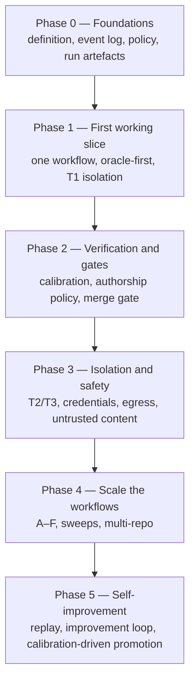

# 16 — Implementation Roadmap

**Purpose:** the phased plan for building this factory, with objectives, deliverables, dependencies, acceptance criteria, risks, and exit conditions per phase.

**Source of truth for:** the phase structure, the sequencing rationale, and the exit criteria.
**Derived from:** `06_REQUIREMENTS_AND_NFRS.md` (all), `07_REFERENCE_ARCHITECTURE.md`, ADR-0001 through ADR-0012, `12_END_TO_END_WORKFLOWS.md`, `14_QUALITY_TESTING_AND_EVALUATION.md`, `15_OBSERVABILITY_COST_AND_FEEDBACK.md`.

**Governing constraint (directive §11):** *"Prioritize a useful working factory over an impressive but unnecessarily complicated architecture."*

**Governing constraint (ADR-0012):** *"The initial implementation should be achievable by a small engineering team."*

---

## 1. The sequencing logic

The roadmap is not ordered by "what is most important to build". It is ordered by **what makes the next phase possible**.

Four dependencies dominate the ordering:

| Dependency | Why it blocks |
|---|---|
| **The run-artefact store** | Calibration, replay, promotion, cost attribution, and the improvement loop are all unbuildable without it (ADR-0011). It is first, not later. |
| **The acceptance oracle** | The merge gate cannot distinguish "correct" from "green" without it (ADR-0005). |
| **The policy engine** | Every subsequent phase adds capabilities; adding them before the enforcement point exists means retrofitting enforcement. |
| **The verifier calibration corpus** | Autonomy above L2 is impossible without it, and it takes wall-clock time to build (ADR-0003). Starting it late delays every promotion. |

**The most expensive thing in the blueprint — the calibration corpus — is started in Phase 1**, deliberately in parallel with the first working slice, because its cost is wall-clock rather than engineering.

---

## 2. Phase summary

| Phase | Objective | Exit condition | Approx. team |
|---|---|---|---|
| **0 — Foundations** | A control plane that can hold state, record events, and refuse an unauthorised action | An unauthorised tool call is denied and logged; a run produces a complete artefact | 2–3 |
| **1 — First working slice** | One workflow, end to end, on one repository, at L2 | An issue becomes a reviewed PR with a passing independent oracle | 2–3 |
| **2 — Verification and gates** | The gate set, the authorship policy, and the calibration machinery | A verifier that misses a violation cannot gate a merge | 2–3 |
| **3 — Isolation and safety** | T2/T3, credential brokering, default-deny egress, untrusted-content handling | The red-team suite passes; a credential cannot outlive its task | 2–3 |
| **4 — Scale the workflows** | Workflows A–F in production, sweeps, multi-repo | Six workflows run continuously with measured baselines | 3–4 |
| **5 — Self-improvement** | The outer and meta loops, and evidence-driven autonomy promotion | A change is proposed from batch evidence, reviewed, applied, and automatically rolled back on a guardrail breach | 2–3 |

**Phases overlap in practice.** The team is small; a phase boundary is a checkpoint, not a stop. But the *exit criteria* are not negotiable — a phase that has not met them does not enable the next one's risk.

---

## 3. Phase 0 — Foundations

### 3.1 Objective

Build the control plane's spine: the declarative definition, the event log, the policy engine, the tool broker, the model gateway, and the run-artefact store. At the end of this phase, the factory can run a trivial task, refuse an unauthorised one, and record everything.

### 3.2 Deliverables

| # | Deliverable | Notes |
|---|---|---|
| 0.1 | **Declarative factory definition** — schema, repository, applier, drift detection | ADR-0001. The applier is idempotent and reports divergence rather than silently correcting it. |
| 0.2 | **Relational store + append-only event log** | ADR-0008. Partitioned by time and aggregate kind. |
| 0.3 | **Task state machine** — the 20 states and the guarded transitions | `09_ORCHESTRATION_STATE_AND_EVENTS.md` §2 |
| 0.4 | **Event envelope** — the versioned schema and the type vocabulary | `09_...` §4 |
| 0.5 | **Policy engine** — policy as code, evaluated at every consequential action, fail-closed | ADR-0004 |
| 0.6 | **Tool registry + broker** — the single choke point, scope enforcement, invocation records | ADR-0012, `11_...` |
| 0.7 | **Model gateway** — provider adapter, routing policy, budget enforcement, cost accounting | ADR-0012 |
| 0.8 | **Run-artefact store** — the complete per-run record, with redaction at capture | ADR-0011 |
| 0.9 | **Scheduler + leases** — the relational-backed job queue | ADR-0012 |
| 0.10 | **Access-point API** — the enumerated human entry points, read-and-request for the surface | ADR-0002 |
| 0.11 | **Operational surface, minimal** — in-flight, needs-you, health, cost | NFR-07 |
| 0.12 | **T1 isolation** — git worktrees from the base branch, with reclamation | ADR-0006 |
| 0.13 | **Orchestrator** — the stage runner over the stage kinds | `09_...` §8 |

### 3.3 Dependencies

None. This phase has no prerequisites and everything else depends on it.

### 3.4 Implementation tasks

| # | Task | Notes |
|---|---|---|
| T0.1 | Define the factory definition schema (`apiVersion: factory/v1`); validate it in CI | The schema is the contract; write it first |
| T0.2 | Implement the applier: reconcile, report drift, idempotent | A crash mid-apply must not leave a half-applied definition |
| T0.3 | Implement the event log with the envelope schema; write the append path | The envelope is versioned from day one — changing it later means migrating history |
| T0.4 | Implement the task state machine with the guards as code, not as prose | The `APPROVED → MERGING` guard is the autonomy enforcement point |
| T0.5 | Implement the policy engine with the deny/allow/escalate decision function; fail closed | Test the adversarial cases first |
| T0.6 | Implement the tool registry, the scope model, and the broker's processing order | The broker is the choke point; get the order right (§6.2 of `11_...`) |
| T0.7 | Implement one MCP adapter and one native adapter, to prove the transport abstraction | FR-62's acceptance test |
| T0.8 | Implement the model gateway with two provider adapters and a routing policy | Two providers, so failover is real from the start |
| T0.9 | Implement the run-artefact writer, wired into every component | Every component must write its own artefact slice |
| T0.10 | Implement the scheduler with leases and idempotency keys | The lease-expiry duplication test |
| T0.11 | Implement the access-point API with per-access-point authority | ADR-0001's "no write to the definition" test |
| T0.12 | Implement the worktree isolation provider with reclamation | The leak detector |
| T0.13 | Implement a minimal operational surface over the projections | Rebuild any projection from the log |

### 3.5 Acceptance criteria

| # | Criterion | Verified by |
|---|---|---|
| A0.1 | A tool call outside the grant is **denied and logged** as a security event | Policy test |
| A0.2 | A direct capability call bypassing the policy engine **fails** | SEC-01's test |
| A0.3 | A run produces a complete artefact with every one of the 12 required elements | MEAS-01's completeness assertion |
| A0.4 | Two runs of the same trivial task resolve an identical context | CX-1's golden-file test |
| A0.5 | Killing the control plane mid-run yields a resumed or explicitly failed task — never a silent loss | Fault injection |
| A0.6 | Every projection can be dropped and rebuilt from the log | Rebuild test |
| A0.7 | A control-surface write to the definition without a reviewed change is **rejected** | ADR-0001's test |
| A0.8 | A task's cost is bounded before it starts and observable while it runs | NFR-11's test |
| A0.9 | A worktree is reclaimed when its task reaches a terminal state, including failure | Leak detector |
| A0.10 | The red-team subset AT-4, AT-5, AT-7, AT-8 passes | Red-team suite |

### 3.6 Risks

| Risk | Likelihood | Impact | Mitigation |
|---|---|---|---|
| **The event envelope schema is designed too narrowly and must change** | Medium | High — history becomes inconsistent | Write it once, carefully, with a version field and an explicit "fields may be added, never repurposed" rule. Accept that adding fields later is cheap and repurposing is not. |
| **The broker's processing order is subtly wrong** (e.g. credential injected before policy) | Medium | **Critical** — a bypass of the whole authority model | Write the order as a numbered, tested sequence; add an assertion that the credential is only obtainable inside step 7. |
| **The applier silently corrects a wrong declaration** | Low | High — entrenches the error at speed | Implement ADR-0001's report-then-correct rule in the first version, not later. |
| **The team over-builds the operational surface** | Medium | Medium — diverts effort from the gates | Restrict Phase 0's surface to four regions; defer polish. |
| **The relational queue's contention becomes a bottleneck** | Low at this scale | Medium | Measure first. ADR-0012's deferral trigger is measured queue latency, not anticipation. |

### 3.7 Exit conditions

- All ten acceptance criteria pass.
- The factory can run a trivial task end to end, from intent to a recorded outcome.
- The unauthorised-path tests pass.
- The run artefact is complete enough that a human can reconstruct what happened.

---

## 4. Phase 1 — First working slice

### 4.1 Objective

Deliver **one** workflow end to end, on **one** repository, at **L2** (human reviews the PR). This is the smallest thing that is genuinely a factory rather than a framework.

The workflow chosen is **Workflow B (Issue to PR)**, because it is the shortest complete path and because it exercises every component without needing deployment.

### 4.2 Deliverables

| # | Deliverable |
|---|---|
| 1.1 | **Context assembler** — the two-tier model, the precedence rules, the budget, deferred context, the resolution trace |
| 1.2 | **Skill registry + runtime** — the versioned corpus, the procedure/standard distinction, the property schema |
| 1.3 | **Prompt construction** — the ten-part structure, the versioned hash |
| 1.4 | **Refinement stage** — specification with checkable acceptance criteria |
| 1.5 | **Planner stage** — the task graph, the topology classification, the chunkability justifications |
| 1.6 | **Worker stage** — implementation in a worktree, scoped tools, bounded budgets |
| 1.7 | **Acceptance oracle construction** — the deterministic generator for structured specifications, plus the human route |
| 1.8 | **Verification runtime** — the gate layers, the authorship flags, the before-fix check |
| 1.9 | **Reviewer stage** — specification-conformance review, distinct from the implementer |
| 1.10 | **Panel** — the aggregation policy as code |
| 1.11 | **Merge gate** — the applicable gates, the approval binding, the autonomy guard |
| 1.12 | **PR creation** — the summary generated from the run's artefacts |
| 1.13 | **Knowledge capture + documentation** — the deterministic extraction step |
| 1.14 | **The first calibration corpus** — begun here, in parallel |

### 4.3 Dependencies

Phase 0, complete.

### 4.4 Implementation tasks

| # | Task | Notes |
|---|---|---|
| T1.1 | Implement the context assembler as a **pure function** with a precedence matrix | Unit-test the matrix exhaustively before adding selection logic |
| T1.2 | Implement the budget rule: over budget → fail, never truncate | This is the single most important rule in the context layer |
| T1.3 | Implement the skill registry, the skill schema, and the property schema | Start with three skills for one repository |
| T1.4 | Implement the prompt builder as a pure function of pinned inputs | The prompt must be reproducible from its inputs |
| T1.5 | Implement the refinement stage and the acceptance-criteria structure | Start with one structured spec format |
| T1.6 | Implement the planner and the graph validation (acyclicity, chunkability justifications, oracle references) | The graph validation is the enforcement point |
| T1.7 | Implement the worker stage with the four budgets | A budget breach returns a labelled incomplete result |
| T1.8 | Implement the oracle generator for the chosen spec format | Deterministic, not model-generated, wherever possible |
| T1.9 | Implement the verification runtime with the layer table and the authorship flags | The authorship flag comes from the run that produced the file |
| T1.10 | Implement the before-fix check | The regression test must fail on the unfixed code |
| T1.11 | Implement the reviewer with the two validation modes (conformance vs. behaviour) | The reviewer must not see the implementer's transcript by default |
| T1.12 | Implement the panel's aggregation policy as code | Deterministic, auditable, no model |
| T1.13 | Implement the merge gate with the applicable gate set and the approval binding | The approval binds to the artefact hash |
| T1.14 | Implement the PR summary generator | From the artefacts, not from the agent's memory |
| T1.15 | **Build the first calibration corpus** — mine historical fixes for real violations, add conforming samples | Start now; it is wall-clock bound |
| T1.16 | Establish the **pre-factory baseline** — the human team's cycle time, defect rate, review load | Measured once, before the factory's output is mixed in |

### 4.5 Acceptance criteria

| # | Criterion | Verified by |
|---|---|---|
| A1.1 | An issue becomes a reviewed PR with a passing, **independently-authored** acceptance oracle | The acceptance suite |
| A1.2 | The oracle is authored before the implementation runs | The provenance check |
| A1.3 | Every acceptance criterion has at least one oracle check | The graph admission check |
| A1.4 | The context envelope is within budget on every run; no silent truncation | The budget assertion |
| A1.5 | A dependent stage's context contains the upstream artefact and **nothing else** from the upstream run | ADR-0010's context-boundary test |
| A1.6 | An agent-authored test is flagged untrusted and does not alone satisfy an acceptance criterion | ADR-0005's authorship test |
| A1.7 | A merge is blocked when the acceptance oracle fails, regardless of the rest of the suite passing | The merge-gate negative test |
| A1.8 | The reviewer's identity differs from the implementer's | FR-35's test |
| A1.9 | A budget exhaustion returns a labelled incomplete result with partial artefacts preserved | FR-32's test |
| A1.10 | The context resolution is reproducible: two runs resolve identically | The golden-file test |
| A1.11 | The baseline and the cost per accepted change are computed | The measurement report |
| A1.12 | The first calibration corpus has both violation and conforming samples, and a measured detection rate | The calibration report |

### 4.6 Risks

| Risk | Likelihood | Impact | Mitigation |
|---|---|---|---|
| **The oracle-first discipline is too slow and the team abandons it** | **High** | **Critical** — every later guarantee depends on it | Make the oracle generator deterministic and fast. Measure the oracle's cost explicitly and report it as a first-class metric, so the trade-off is visible rather than resented. |
| **The team writes the tests after the implementation, "just this once"** | High | High — the factory's central guarantee is lost | Enforce the ordering mechanically: the oracle artefact's provenance must record a null implementation run at construction. The merge gate rejects an oracle whose provenance shows same-run authorship. |
| **The calibration corpus is never built** | Medium | High — autonomy can never exceed L2 | Assign an owner in Phase 1. It is wall-clock work and must start early. Mine historical fixes — the corpus already exists in the repository's history. |
| **Scope creep into other workflows** | Medium | Medium | One repository, one workflow. Anything else goes to Phase 4. |
| **The context assembler accumulates special cases** | Medium | Medium | The precedence matrix is data, not code. If a new case needs code, the model is wrong. |

### 4.7 Exit conditions

- A1.1 through A1.12 pass.
- The workflow has run on real issues for at least two weeks.
- The baseline and the first cost-per-accepted-change figure exist.
- The first calibration report exists, with a measured detection rate and false-positive rate.
- A human reviewer has used the surface and found the evidence sufficient to decide without reconstructing context.

---

## 5. Phase 2 — Verification and gates

### 5.1 Objective

Complete the gate set and build the **calibration machinery** that makes verifier-based trust possible. This phase is what makes ADR-0003's floor achievable — and therefore what makes autonomy promotion reachable at all.

### 5.2 Deliverables

| # | Deliverable |
|---|---|
| 2.1 | The full gate set — static, type, lint, integration, contract, security scan, formal verification where in scope |
| 2.2 | The authorship policy enforcement, with the trusted/untrusted lifecycle |
| 2.3 | **The calibration harness** — corpus format, the procedure, the report, the currency window |
| 2.4 | The **violation-injection harness** — historical mining, seed injection, mutation |
| 2.5 | Standards verifiers — the generator from a standard's properties, and the LLM-judge variant with its constraints |
| 2.6 | The blast-radius scorer and the criticality map |
| 2.7 | The review queue, risk-ordered, with the recorded rationale |
| 2.8 | The approval service — artefact-bound, time-limited, single-use, revocable |
| 2.9 | The panel's confidence calibration measurement |

### 5.3 Dependencies

Phase 1.

### 5.4 Implementation tasks

| # | Task |
|---|---|
| T2.1 | Implement the gate runner with the tier-to-gate-set mapping |
| T2.2 | Implement the authorship flags and the trusted/untrusted lifecycle for test files |
| T2.3 | Implement the calibration corpus format and the calibration procedure |
| T2.4 | Implement the historical violation miner (mine the repository's own fix history) |
| T2.5 | Implement the seed-injection harness (introduce a violation, verify the gate catches it, revert) |
| T2.6 | Implement the calibration currency check and the automatic removal of an expired verifier from the gate set |
| T2.7 | Implement the standards-verifier generator for one property kind |
| T2.8 | Implement the LLM-judge verifier with the narrow scope, the rubric, the structured output, and the calibration requirement |
| T2.9 | Implement the blast-radius scorer and the criticality map schema |
| T2.10 | Implement the risk-ordered review queue with the recorded rationale |
| T2.11 | Implement the approval service with all five binding properties |
| T2.12 | Implement the panel's confidence measurement against observed outcomes |
| T2.13 | Implement the gate-weakening detection (a change that disables or loosens a required check) |

### 5.5 Acceptance criteria

| # | Criterion | Verified by |
|---|---|---|
| A2.1 | A verifier with no calibration report **cannot gate a merge** | The gate's consultation of the calibration store |
| A2.2 | A verifier whose calibration has expired is removed from the gating set automatically | The currency check |
| A2.3 | A calibration corpus with only violation samples is **rejected** | The harness's validation |
| A2.4 | A seeded violation is detected by the full pipeline (verifier → gate → merge block), not just the verifier's logic | The seed-injection harness |
| A2.5 | A negative control that is realistic but not a violation is **not** flagged | The mutation corpus |
| A2.6 | Agent-authored tests do not alone satisfy an acceptance criterion | The authorship test |
| A2.7 | A change that disables a required check is classified R3 and requires security-scope approval | The gate-weakening detection |
| A2.8 | The review queue's ordering is explained by the recorded risk score for every item | The queue's explanation field |
| A2.9 | An approval for a modified artefact is void | The hash comparison |
| A2.10 | An expired approval cannot authorise an action | The expiry check |
| A2.11 | The panel's stated confidence correlates with observed correctness | The calibration report |

### 5.6 Risks

| Risk | Likelihood | Impact | Mitigation |
|---|---|---|---|
| **The calibration corpus becomes a permanent, unfunded chore** | **High** | **High** — it silently degrades and the safety property erodes | Assign a named owner. Automate the re-calibration on a schedule. Report calibration currency as a first-class metric with a threshold. Make the corpus as small as it can be while retaining a meaningful confidence interval. |
| **Detection-rate thresholds are set too low** | Medium | High — false confidence | Set them per property kind, conservatively, and review them. Security and correctness properties get the strictest. |
| **LLM-judge verifiers are trusted too readily** | Medium | High | The judge is never the only gate for an irreversible effect. Its calibration is measured, not assumed. |
| **The blast-radius scorer is systematically under-estimating** | Low–Medium | High | The tier may only be raised by a human; the scorer may only lower a tier under reviewed policy. Track the observed-versus-predicted tier and review. |
| **The gate set becomes so slow that developers bypass it** | Medium | **Critical** — a bypassed gate is worse than no gate | Measure gate latency per tier. Set a latency budget. If a gate is chronically slow, fix the gate, not the threshold. Track bypass attempts as security events. |

### 5.7 Exit conditions

- A2.1 through A2.11 pass.
- Every gating verifier has a current calibration report.
- The gate set is measured, and its latency is within budget.
- The merge-gate negative tests pass: a failing oracle blocks a merge; a missing approval blocks a merge.

---

## 6. Phase 3 — Isolation and safety

### 6.1 Objective

Complete the security architecture: tiered isolation, credential brokering, default-deny egress, untrusted-content handling, and the full red-team suite.

**Why this is Phase 3 and not Phase 1.** Phase 1 runs at T1 on trusted, single-team content. The corpus's own evidence justifies this ordering: V08's worktree isolation is the cheapest correct primitive for a trusted single-developer context, and V03's "laptop problem" only bites when the fleet is large or the input is hostile. Both arrive with scale and with external input — Phase 3.

**But the credential broker is a Phase 0/1 dependency for anything touching a shared system**, and is built early. The full T2/T3 substrate can wait; the brokering pattern cannot be retrofitted safely, because retrofitting it means touching every call site.

### 6.2 Deliverables

| # | Deliverable |
|---|---|
| 3.1 | **T2 isolation** — the container provider, declared images, resource limits, host-mount restriction |
| 3.2 | **T3 isolation** — the hardened sandbox provider, network allow-lists, quotas, hibernation |
| 3.3 | **The credential broker** — per-task minting, scoping, injection, revocation, the leak check |
| 3.4 | **Default-deny egress** — the policy service and the per-workflow allow-lists |
| 3.5 | **The fetching service** — control-plane-side external fetches, returning tagged untrusted content |
| 3.6 | **Untrusted-content tagging** — at every ingest path |
| 3.7 | **The full red-team suite** — the 15 attacks in `14_...` §10 |
| 3.8 | **Supply-chain controls** — image pinning by digest, dependency integrity, provenance signatures |
| 3.9 | **The audit reconstruction tool** — answer "who did this, under what authority, with what context" |

### 6.3 Dependencies

Phase 2 (the gate set must exist before the red-team suite can be meaningful).

### 6.4 Implementation tasks

| # | Task |
|---|---|
| T3.1 | Implement the T2 isolation provider against the `IsolationProvider` interface |
| T3.2 | Implement the T3 provider; select the substrate with the ADR-0012 properties as the criteria, not a vendor |
| T3.3 | Implement the credential broker: scope computation, minting, injection, revocation |
| T3.4 | Implement the credential leak check — scan contexts, prompts, arguments, results, and stored artefacts for secret material |
| T3.5 | Implement the default-deny egress policy and the per-workflow allow-lists |
| T3.6 | Implement the fetching service with its size limits and its tagging |
| T3.7 | Tag untrusted content at every ingest path: issue tracker, PR text, comments, docs, web, registries, tool output, alert payloads |
| T3.8 | Implement the red-team suite with all 15 attacks |
| T3.9 | Implement image pinning, the lockfile requirement, and the provenance signature check |
| T3.10 | Implement the audit reconstruction tool |
| T3.11 | Implement the leak detector for environments, credentials, and worktrees |

### 6.5 Acceptance criteria

| # | Criterion | Verified by |
|---|---|---|
| A3.1 | A T2 task cannot reach a host path outside its checkout | The sandbox test |
| A3.2 | A T3 task cannot reach the network beyond its allow-list | The network test |
| A3.3 | Credentials are **absent** from the agent's prompt and context | The context scan |
| A3.4 | A credential cannot be used after its task terminates | The revocation test |
| A3.5 | An injected instruction in fetched content cannot alter an action | Red-team AT-1, AT-2, AT-3 |
| A3.6 | A scope-escalation attempt is denied and logged | Red-team AT-4, AT-5 |
| A3.7 | An attempt to write to the definition is rejected through every tool path | Red-team AT-6 |
| A3.8 | A cross-repository access attempt is refused and recorded | SEC-12's test |
| A3.9 | A tampered context or skill artefact is rejected on load | SEC-09's test |
| A3.10 | A rejected approval is void and the attempt is recorded | Red-team AT-13 |
| A3.11 | The red-team suite runs as a required check in the factory's own CI | The CI configuration |
| A3.12 | Any consequential action can be reconstructed with its authority | The audit reconstruction test |

### 3.6 Risks

| Risk | Likelihood | Impact | Mitigation |
|---|---|---|---|
| **The default-deny network policy blocks a legitimate workflow and the team adds a broad allow-list to unblock it** | **High** | **High** — the allow-list becomes the new default | Make allow-lists narrow and per-capability, not per-host. Review every allow-list addition as a security-relevant change. Report the size of the allow-lists as a metric. |
| **T3 provisioning latency makes incident response too slow** | Medium | Medium | Warm pools for T2; hibernation for T3; measure provisioning time as a first-class metric against the incident budget. |
| **The credential broker becomes a critical single point** | Low | **Critical** | It holds no agent-reachable interface; its operations are audited; the grants it issues are policy-constrained. Name it as a critical component in the runbooks. |
| **Untrusted-content tagging is missed at one ingest path** | Medium | High | Make the trust classification a **required field of the adapter contract**, so an adapter without one is a registration error, not a silent omission. |
| **The red-team suite passes while the real attack differs** | Medium | Medium | The suite is a regression guard, not a proof. Extend it as the threat model is extended; run it against new adapters as they are registered. |

### 6.7 Exit conditions

- A3.1 through A3.12 pass.
- The red-team suite is a required check in the factory's own CI.
- The credential leak check finds no secret material in any stored artefact.
- An incident drill has been run end to end at T3.

---

## 7. Phase 4 — Scale the workflows

### 7.1 Objective

Bring the remaining workflows into production, add the maintenance loops, and establish the operational baselines. This is the phase where the factory's *scope* expands.

### 7.2 Deliverables

| # | Deliverable |
|---|---|
| 4.1 | **Workflow A** — idea to production, with deployment |
| 4.2 | **Workflow C** — autonomous bug fixing, with the reproduction requirement |
| 4.3 | **Workflow D** — automated testing and self-healing CI, with the sweep chunking |
| 4.4 | **Workflow E** — production incident response, with the alert carrying the candidate fix |
| 4.5 | **Workflow F** — multi-repository engineering, with the interface-first rule |
| 4.6 | **Workflow B at scale** — across multiple repositories |
| 4.7 | **The context inventory** — the outdated/duplicate/stale detection, the promotion/demotion cycle |
| 4.8 | **The knowledge store** — the decision records, retrieval, the linking to changes |
| 4.9 | **The scheduled maintenance loops** — dependency upgrades, flaky-test repair, coverage backfill, conformance sweeps |
| 4.10 | **Production access** — the enumerated runbooks, the abort conditions, the rollback drills |
| 4.11 | **Capacity reallocation policy** — the deliberate allocation of surplus capacity (FR-95) |
| 4.12 | **The operational surface, complete** — the reviewer's view, the cost views, the drift view |

### 7.3 Dependencies

Phases 0–3. Production access additionally requires tested rollbacks.

### 7.4 Implementation tasks

| # | Task |
|---|---|
| T4.1 | Implement the deployment controller and the release path with the runbook mechanism |
| T4.2 | Implement the enumerated production operations and the abort conditions |
| T4.3 | Run the rollback drills; a service without a tested rollback is excluded from Workflow E |
| T4.4 | Implement the incident workflow's alert enrichment — the alert carries the candidate fix, the diff, the reasoning, and the verification results |
| T4.5 | Implement the sweep chunking and the per-item acceptance criteria |
| T4.6 | Implement the sweep's stop conditions (a finding count far above expectation stops the sweep) |
| T4.7 | Implement the interface-first rule and the deterministic integration-order computation |
| T4.8 | Implement the context inventory and the promotion/demotion cycle |
| T4.9 | Implement the knowledge store and the deterministic capture step |
| T4.10 | Implement the scheduled maintenance loops with their environment declarations |
| T4.11 | Implement the capacity-allocation policy and its reporting |
| T4.12 | Complete the operational surface's reviewer view |
| T4.13 | Establish the full baseline set across all the metrics in `14_...` §8 |

### 7.5 Acceptance criteria

| # | Criterion | Verified by |
|---|---|---|
| A4.1 | Workflow A completes end to end in a staging environment with a recorded artefact chain | FR-01's test |
| A4.2 | A bug fix is rejected if its regression test does not fail on the unfixed code | The before-fix check |
| A4.3 | A not-reproducible defect is escalated, and **no speculative fix is produced** | The reproduction gate |
| A4.4 | A sweep's fix that weakens a gate is rejected | The acceptance criterion + the review |
| A4.5 | A sweep that finds far more than expected stops and escalates | The stop condition |
| A4.6 | The incident alert carries the candidate fix, the reasoning, and the verification results | FR-76's drill |
| A4.7 | An operation outside the enumerated production set is refused | SEC-08's test |
| A4.8 | A rollback drill restores a known-good state within the agreed time | SEC-10's drill |
| A4.9 | A cross-repository task produces the expected per-repo changes and an integration sequence | FR-83's test |
| A4.10 | The context inventory reports stale, duplicate, and orphaned findings, and the duplicate-and-stale count is tracked | The inventory report |
| A4.11 | A promotion moves a local artefact centrally and leaves a pointer behind | FR-15's test |
| A4.12 | The full metric baseline exists for every metric in the catalogue | The measurement report |

### 7.6 Risks

| Risk | Likelihood | Impact | Mitigation |
|---|---|---|---|
| **The review queue becomes the bottleneck** | **High** | **High** — the system stalls | This is the corpus's own finding (CP-7). Measure review capacity explicitly. Ration by blast-radius tiering. If the queue saturates, the answer is to fix the workflows or reduce scope — **never** to loosen the gate. |
| **Approval fatigue sets in** | Medium | High | Monitor the rubber-stamp rate. If it rises, the gate is not working; fix the tiering or the workflow. |
| **Too many workflows are added at once** | Medium | Medium | Bring them up one at a time, each with its own baseline and its own calibration. |
| **Production access is granted too broadly** | Medium | **Critical** | Enumerate narrowly. Each runbook has a named owner and an abort condition. L4 only where a runbook exists. |
| **The context corpus grows faster than it is curated** | Medium | Medium | Track the duplicate-and-stale count as a non-increasing metric. Run the inventory on a schedule from the first week. |

### 7.7 Exit conditions

- A4.1 through A4.12 pass.
- Six workflows have run continuously for at least a month with recorded baselines.
- No workflow has been promoted above L2 without a calibration report.
- The review queue is not saturated.

---

## 8. Phase 5 — Self-improvement and evidence-driven autonomy

### 8.1 Objective

Close the loop: the factory improves itself from evidence, and autonomy levels are earned by measured performance rather than by optimism.

### 8.2 Deliverables

| # | Deliverable |
|---|---|
| 5.1 | **The replay evaluator** — the experimental instrument for evaluating a candidate configuration |
| 5.2 | **The improvement loop** — the outer loop (skill scope) and the meta loop (harness scope) |
| 5.3 | **The proposal schema** — evidence, expected effect, measurement plan, rollback plan |
| 5.4 | **The review interface** — batch-evidence enforcement, the four-element report requirement |
| 5.5 | **The observation window** and the automatic rollback on a guardrail breach |
| 5.6 | **Autonomy promotion** — the calibration bar, the defect-escape threshold, the revocation path |
| 5.7 | **The evaluation suite** — agent, skill, model, and workflow evaluations |
| 5.8 | **The improvement-loop cost accounting** — the loop's own cost, against its return |

### 8.3 Dependencies

Phase 4, and specifically the baseline set. Promotion requires a baseline to compare against.

### 8.4 Implementation tasks

| # | Task |
|---|---|
| T5.1 | Implement the replay evaluator: baseline run, candidate run, comparison, the four-element report |
| T5.2 | Implement the run-set selection (class-matched, sized, windowed, held-out where possible) |
| T5.3 | Implement the pattern analysis and the narrowest-layer attribution |
| T5.4 | Implement the proposal schema and the proposal generator |
| T5.5 | Implement the review interface's batch-evidence enforcement (a single-run proposal is rejected) |
| T5.6 | Implement the observation window and the automatic rollback on a guardrail breach |
| T5.7 | Implement the autonomy promotion path: the calibration bar, the escape-rate threshold, the recorded promotion |
| T5.8 | Implement the autonomy revocation path — no code deployment required |
| T5.9 | Implement the four evaluation suites (agent, skill, model, workflow) |
| T5.10 | Implement the improvement-loop cost accounting and its report |
| T5.11 | Implement the capacity-reallocation feedback: quality backlog work feeds better verifiers |

### 8.5 Acceptance criteria

| # | Criterion | Verified by |
|---|---|---|
| A5.1 | A historical run is replayable against a candidate configuration, with a comparable result set | MEAS-07's replay suite |
| A5.2 | A proposal derived from a single run is **rejected** by the review interface | FR-93's test |
| A5.3 | A proposal without batch evidence cannot be merged | The review interface |
| A5.4 | A harness-scope proposal cannot merge without a passing replay | FR-91's test |
| A5.5 | A guardrail breach triggers an automatic revert | FR-94's test |
| A5.6 | Every factory change in the definition history is joinable to a report with all four elements | MEAS-03's audit |
| A5.7 | Autonomy is promoted only with a current calibration report and an escape rate below the threshold | The promotion gate |
| A5.8 | Autonomy can be revoked without a code deployment | The revocation path |
| A5.9 | An agent cannot write to the definition, policy, skill, or verifier stores through any tool path | SEC-11's test |
| A5.10 | The improvement loop's cost is computed and reported against the value of what it promoted | The loop cost report |

### 8.6 Risks

| Risk | Likelihood | Impact | Mitigation |
|---|---|---|---|
| **The loop over-fits the replay set** | **High** | Medium | Hold out a portion of the run set. Periodically refresh the set with new runs. Never evaluate against a set the proposal was derived from. |
| **The loop produces more proposals than it can review** | Medium | Medium | Measure the promotion rate; if it is low, the analysis is noise-fitting and needs improving, not the loop needing more proposals. |
| **The loop's own cost exceeds its return** | Medium | Medium | Measure it explicitly (FR-95's principle). Scale the loop back if it is net negative. |
| **A promotion is made on insufficient evidence** | Medium | **High** | The calibration bar and the escape-rate threshold are gates, not guidance. A promotion without both is not mergeable. |
| **The loop optimises the metrics instead of the outcome** | Medium | High | Guardrails, not just objectives. Every evaluation reports a guardrail that must not degrade. |

### 8.7 Exit conditions

- A5.1 through A5.10 pass.
- At least one skill-scope change has been proposed from batch evidence, reviewed, applied, observed, and promoted (or rolled back) through the full lifecycle.
- At least one workflow has been promoted above L2 on evidence, and at least one has been revoked on evidence.
- The loop's cost is reported.

---

## 9. Cross-phase requirements

### 9.1 Requirements that must be met in every phase

| Requirement | Phase |
|---|---|
| Every run produces a complete artefact | Phase 0 onward |
| Every metric has a definition, a collection point, an owner, and a threshold | Phase 0 onward |
| No target derives from any corpus figure | Phase 0 onward |
| Every consequential action passes a policy decision | Phase 0 onward |
| The factory is held to the same standard as the product | Phase 3 onward (the red-team suite as a required check) |
| Every factory change is reviewed, evaluated, and reversible | Phase 0 onward |

### 9.2 The standing test suite

Every phase adds to one suite:

| Suite | Phase it starts | Purpose |
|---|---|---|
| **Contract tests** | 0 | The interfaces in `07_...` §9 hold |
| **Policy tests** | 0 | Denials, escalations, scope, fail-closed |
| **Authorisation tests** | 0 | The un-bypassable evaluation point |
| **Durability tests** | 0 | Fault injection, no silent loss |
| **Concurrency tests** | 1 | No cross-task contamination |
| **Replay tests** | 1 | Reproducibility |
| **Gate tests** | 2 | The merge gate's negative cases |
| **Calibration tests** | 2 | The discrimination requirement |
| **Red-team tests** | 3 | The 15 attacks |
| **Isolation tests** | 3 | The tier properties |
| **Drift tests** | 3 | Report, then correct |
| **Audit tests** | 3 | Reconstruction |
| **Evaluation tests** | 5 | The four evaluation suites |

### 9.3 The standing reviews

| Review | Cadence | Attendees |
|---|---|---|
| **Definition review** | On every change | Platform + the affected owner |
| **Autonomy review** | Monthly | Engineering leadership + platform + security |
| **Calibration review** | Quarterly | Quality + the verifier owners |
| **Threat model review** | Quarterly, and on every new adapter or capability | Security + platform |
| **Baseline review** | Quarterly | Engineering leadership |
| **Post-incident review** | On every incident | The incident team + platform |

### 9.4 What is explicitly deferred, and when it is reconsidered

From ADR-0012, restated as roadmap items:

| Deferred | Phase it is reconsidered | Trigger |
|---|---|---|
| **Message broker** | Phase 4 | Measured queue latency at p95 exceeding the workflow's deadline, or write contention on the queue tables |
| **Kubernetes** | Phase 5+ | T2 workload count or resource diversity exceeding managed container compute's capability |
| **Vector database** | Phase 5 | Retrieval precision demonstrably limiting agent task success in a measured way |
| **Durable-execution platform** | Phase 4 | The own runner failing a stated resumability or determinism requirement under load |
| **Event streaming platform** | Phase 5 | Event log volume exceeding what partition-and-archive can serve for the required query patterns |

**None of these is scheduled on a calendar.** Each has a measured trigger, and the trigger is evaluated against the factory's own instrumentation.

---

## 10. Risks across the whole programme

| # | Risk | Likelihood | Impact | Mitigation |
|---|---|---|---|---|
| R1 | **The team concludes the factory needs to be more autonomous to be worth building** | Medium | **Critical** | The corpus's own evidence says otherwise (V02's abandoned dark factory; V14's degradation finding). The blueprint's value proposition is *reliable* automation, not maximum automation. The review queue is the constraint, not the defect. |
| R2 | **The oracle-first discipline is abandoned under schedule pressure** | High | **Critical** | Make the oracle's cost visible and explicit. Enforce the ordering mechanically. A cheap oracle generator is the answer, not a skipped oracle. |
| R3 | **The calibration corpus is never funded** | High | High — autonomy is capped at L2 forever | Assign an owner in Phase 1. Mine historical fixes — the corpus largely exists already. |
| R4 | **The measurement layer is under-built because "we can add it later"** | Medium | **Critical** — everything downstream becomes unbuildable | ADR-0011 makes it Phase 0. The run-artefact store is the first thing built after the control plane. |
| R5 | **Review capacity is the true bottleneck and is underestimated** | **High** | High | Measure it from day one. Treat it as a capacity planning input, not an afterthought. |
| R6 | **The team builds infrastructure the directive warns against** | Medium | Medium | ADR-0012's deferral triggers are measured, not scheduled. The minimal technology profile is a constraint, not a starting suggestion. |
| R7 | **The blueprint's assumptions about the corpus's evidence are wrong** | Medium | Medium | Every source-attributed claim is traceable in `03_EVIDENCE_LEDGER.md`. Where the blueprint is [E3] judgement, it says so. Re-verify against the transcripts if the blueprint is used without them. |
| R8 | **The factory is built but never used** | Low–Medium | **Critical** | The operational surface is built in Phase 0, not last. The workflows must be the default path for the team, or the factory becomes a side project. |

---

## 11. The first ninety days

A concrete starting plan for the team, so the roadmap is actionable immediately.

| Weeks | Focus | Deliverable |
|---|---|---|
| 1–2 | The definition schema, the event envelope, the repository | The two contracts everything else depends on |
| 3–5 | The relational store, the event log, the state machine | The factory can hold and record state |
| 6–8 | The policy engine, the tool registry, the broker | The unauthorised path is closed |
| 9–10 | The model gateway with two providers, the run-artefact store | Cost is attributable; the measurement layer exists |
| 11–12 | The scheduler, the worktree isolation, a trivial end-to-end task | **The first working slice of the control plane** |
| 13–16 | The context assembler, the skill registry, the prompt builder | Context is deterministic and within budget |
| 17–20 | The refinement, planning, and worker stages | A task graph is produced and executed |
| 21–24 | The oracle generator, the verification runtime, the merge gate | **A change can be gated** |
| 25–28 | The reviewer, the panel, the approval service | A human can make a decision from the evidence |
| 29–30 | The PR creation, the knowledge capture, the first real issue end to end | **Workflow B completes on a real issue** |
| Ongoing, from week 20 | **The calibration corpus** | Mine historical fixes; add conforming samples; measure detection |

**Two things start on day one and never stop:** the baseline measurement of the pre-factory workflow, and the calibration corpus. Both are wall-clock bound, and both gate later phases.

---

## 12. Related documents

- `06_REQUIREMENTS_AND_NFRS.md` — every requirement, its derivation, and its acceptance criterion
- `07_REFERENCE_ARCHITECTURE.md` — the component specifications the phase deliverables implement
- `12_END_TO_END_WORKFLOWS.md` — the workflows each phase brings into production
- `14_QUALITY_TESTING_AND_EVALUATION.md` §5 — the calibration procedure the corpus phase depends on
- `15_OBSERVABILITY_COST_AND_FEEDBACK.md` — the measurement layer the roadmap's early phases build
- `architecture-decisions/ADR-0012-mvp-technology-profile.md` — the deferral triggers restated in §9.4
- `templates/EXPERIMENT.md` — the experiment template for Phase 5's evaluations
